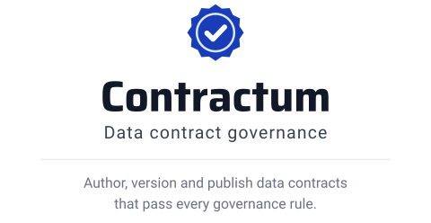
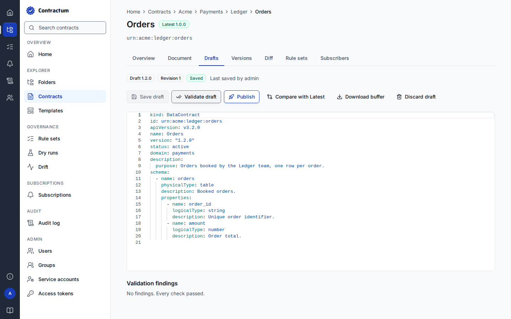
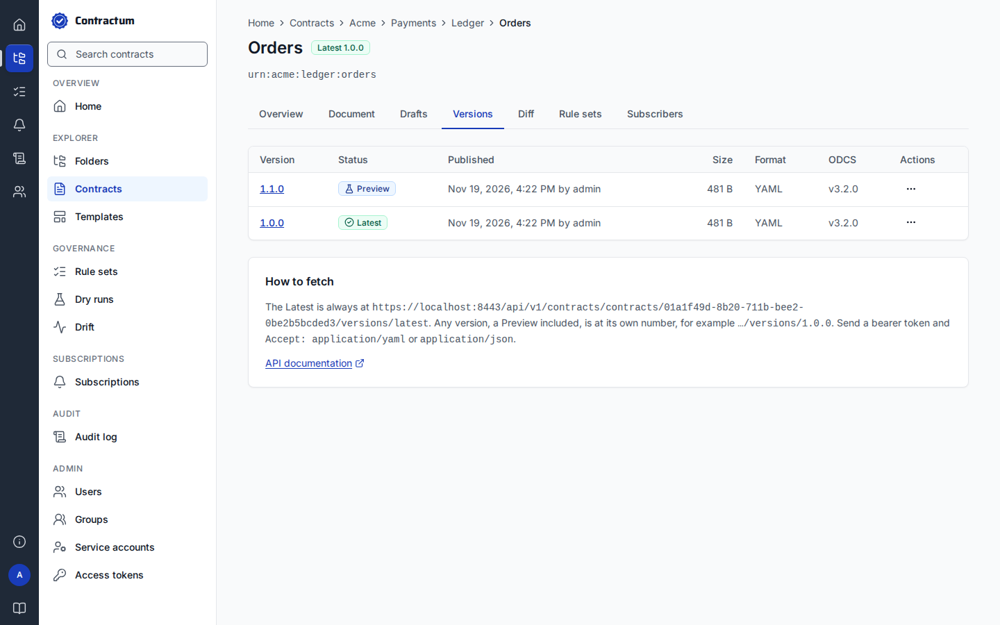
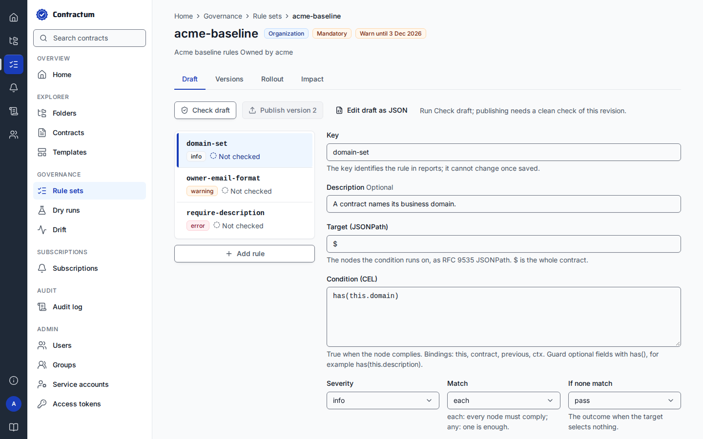
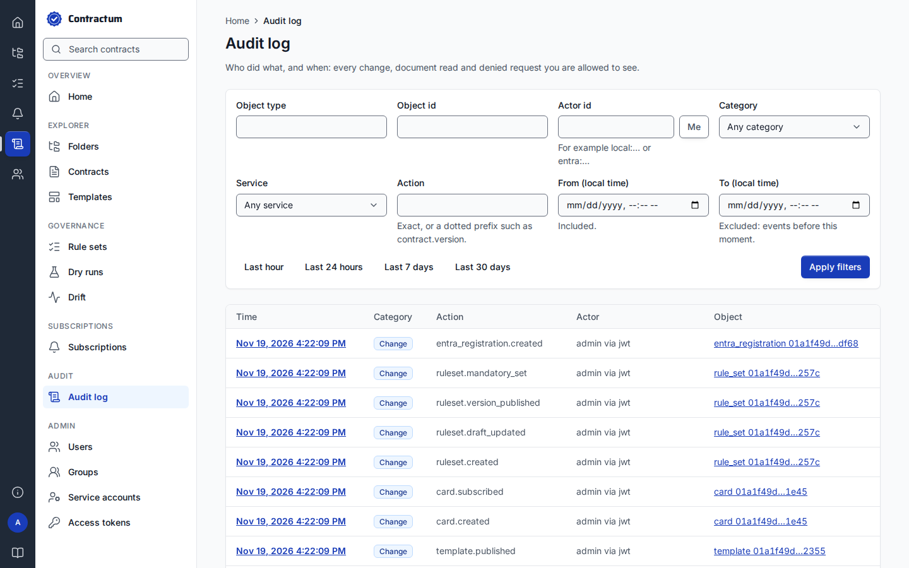

<p align="center"><picture><source media="(prefers-color-scheme: dark)" srcset="docs/images/readme-header-dark.svg"></picture></p>

<!-- markdownlint-disable-file MD041 -->

<p align="center">
  <a href="LICENSE"></a>
  <a href="https://bitol-io.github.io/open-data-contract-standard/"></a>
</p>

<p align="center">
  <a href="https://github.com/rkisliak/contractum/actions/workflows/ci.yml?query=branch%3Amain"></a>
  <a href="https://github.com/rkisliak/contractum/actions/workflows/security.yml?query=branch%3Amain"></a>
  <a href="https://github.com/rkisliak/contractum/actions/workflows/sdk.yml?query=branch%3Amain"></a>
  <a href="https://github.com/rkisliak/contractum/actions/workflows/docs.yml?query=branch%3Amain"></a>
  <a href="https://github.com/rkisliak/contractum/actions/workflows/e2e-nightly.yml?query=branch%3Amain"></a>
  <a href="https://github.com/rkisliak/contractum/actions/workflows/dast-nightly.yml?query=branch%3Amain"></a>
  <a href="https://github.com/rkisliak/contractum/actions/workflows/docs-links-weekly.yml?query=branch%3Amain"></a>
</p>

Contractum is one central place where data-engineering teams write, version and publish
**ODCS data contracts**. Contracts live in a folder tree: Root, then Organization, Project and Team.

- **Policy Managers** write reusable, versioned rules. A contract that breaks a mandatory rule for its
  folder cannot be published.
- **Data engineers and pipelines** fetch the exact version they need: the Latest, an older one, or the
  upcoming Preview. They use the web UI, the HTTPS API, or the `contractum` Python SDK and CLI, which
  also tests your own data against a contract.
- **Every change, read and refusal** is audited.

Sign-in works with Microsoft Entra ID or local accounts. Each person sees only the folders, contracts
and actions their roles allow.

<table>
<tr>
<td width="50%"><a href="docs/images/ui/draft-editor.png"></a></td>
<td width="50%"><a href="docs/images/ui/contract-versions.png"></a></td>
</tr>
<tr>
<td valign="top"><b>Draft editor.</b> Write the contract in YAML or JSON, validate it against every rule set for its folder, compare it with the Latest, and publish.</td>
<td valign="top"><b>Versions.</b> Every version with its lifecycle state and how to fetch it.</td>
</tr>
<tr>
<td width="50%"><a href="docs/images/ui/rule-set-editor.png"></a></td>
<td width="50%"><a href="docs/images/ui/audit.png"></a></td>
</tr>
<tr>
<td valign="top"><b>Rule sets.</b> Declarative rules: a JSONPath target and a CEL condition, with a dry run before you publish.</td>
<td valign="top"><b>Audit log.</b> Every write, read and refusal, filtered by time, person, category and object.</td>
</tr>
</table>

## Pick your path

### Users and Policy Managers

- [Getting started](docs/user/getting-started.md): sign in, find a contract, fetch a version.
- [SDK and CLI](docs/user/sdk-cli.md): fetch contracts and test your data from the command line, Python,
  pytest or CI.
- [Subscriptions](docs/user/subscriptions.md): subscriber cards that tell your team before a contract
  it uses changes.
- [API guide](docs/user/api-guide.md): sign-in, URLs, errors, paging and versions for direct API calls.
- [Writing rules](docs/user/writing-rules.md): rule sets for Policy Managers.
- [UI guide](docs/user/ui-guide.md): a tour of the web UI screens by role.

### Administrators

- [Deploy on Kubernetes](docs/admin/deploy-kubernetes.md): the Helm chart, the supported way to run
  Contractum.
- [First run](docs/admin/first-run.md): the first admin sign-in and the first access grants.
- [Entra setup](docs/admin/entra-setup.md): connect a Microsoft Entra ID tenant.
- [Upgrade and backup](docs/admin/upgrade-backup.md)
- [Troubleshooting](docs/admin/troubleshooting.md)
- [Settings](docs/admin/settings.md)
- [Security](docs/security.md): how Contractum is protected and the checks every change goes
  through (CodeQL, SonarQube, Dependabot, Trivy, gitleaks, OWASP ZAP).

### Developers

- [Local stack](docs/dev/local-stack.md): run, test and reset the platform on Docker Compose.
- [Architecture guide](docs/dev/architecture/README.md): how the system works, with diagrams.
- [CI and GitHub](docs/dev/ci-and-github.md): the workflows and the repository settings.
- [API design decisions](docs/dev/api-design-decisions.md)
- [Contributing](CONTRIBUTING.md): how changes are made and checked. Everyone follows the
  [Code of Conduct](CODE_OF_CONDUCT.md).
- [Accessibility](ACCESSIBILITY.md): what the UI is tested for and how to report a barrier.

## Try it locally

You need Docker with Compose v2 (2.21 or newer) and port 8443 free. Docker should have 6 GiB of memory
or more. No environment variables are needed.

```bash
./run.sh          # Windows PowerShell: .\run.ps1
```

`run.sh` checks these prerequisites, then builds and starts the whole platform with Docker Compose and
waits until every container is healthy. On the first start a one-shot container generates every secret,
the signing keys and a development TLS certificate into `.dev/`. When the stack is up:

- Web UI: `https://localhost:8443/`
- API docs (Swagger UI): `https://localhost:8443/api/v1/docs/`
- TLS: `.dev/ca.crt` is the local development CA that `run.sh` creates for this Compose stack only.
  Trust it with `curl --cacert .dev/ca.crt`, import it into the macOS keychain or the Windows
  certificate store, or accept the browser warning. A Kubernetes deployment does not use it: it has
  its own certificate, see [Deploy on Kubernetes](docs/admin/deploy-kubernetes.md).
- Admin sign-in: user `admin`, with the first-time password in `.dev/bootstrap_admin_secret`. You must
  change it at the first sign-in. `./run.sh smoke` does that for you and saves the new password to
  `.dev/admin_password`.

Other commands: `./run.sh check`, `status`, `logs [service]`, `e2e`, `down` (keeps the data) and
`reset` (deletes all data and generated secrets, after asking). The Compose stack is for a local trial,
development and tests. It also runs local stand-ins for Entra ID, Microsoft Graph, a mail relay and a
webhook receiver. See [Local stack](docs/dev/local-stack.md).

> [!NOTE]
> Production runs on Kubernetes with the Helm chart in `deploy/helm/contractum`. Follow
> [Deploy on Kubernetes](docs/admin/deploy-kubernetes.md).

## How it fits together

- A **gateway** (Traefik) is the only entry point. It terminates TLS and routes `/api/v1/<module>/` to
  a service and `/` to the web UI. It does no authentication, so another gateway can replace it.
- Four **services** hold the business logic, each with its own PostgreSQL database: `identity` (sign-in,
  folders, users, groups, role grants, tokens, and every access decision), `contracts` (contracts,
  drafts, versions, templates, subscribers), `validation` (rule sets and the publish verdict) and
  `audit` (the event store and the audit query). A small internal `mail` service sends notice emails.
- Services send audit events through **NATS JetStream**. Each write saves its event in the same database
  transaction, so no change goes unrecorded.
- The **web UI** (a static React app) and the **API docs** (one merged OpenAPI document with Swagger UI)
  also sit behind the gateway. The UI calls the same public API as everyone else.

The [architecture guide](docs/dev/architecture/README.md) explains each part with diagrams.

## Repo layout

```text
identity/          identity service: local sign-in, folders, grants, access decisions
contracts/         contracts service: contracts, versions, subscriber cards, notices
validation/        validation service: rule sets, rule sandbox, publish gate
audit/             audit service: event store and audit query
mail/              internal mail sender for notices
ui/                web UI: React app, unit tests, Playwright journeys
shared/            libraries: dc-core, dc-auth, dc-odcs, dc-rules
clients/python/    the contractum SDK and CLI (Apache-2.0)
gateway/           Traefik config, problem-responder, api-docs
infra/             Dockerfiles, dev secrets, Postgres and NATS config, local stand-ins
deploy/helm/       Helm chart for Kubernetes
tests/             cross-service repo, integration and end-to-end tests
scripts/           CI, end-to-end and smoke scripts, OpenAPI export
docs/              docs by audience: user/, admin/ and dev/ (the docs site source)
.github/           workflows (ci, security, e2e-nightly, dast-nightly, sdk, release, docs,
                   docs-links-weekly) and Dependabot config
compose.yaml       the whole platform for a local trial, development and tests
run.sh, run.ps1    start and manage the local stack
```

## Licence

The Contractum server is free to install, run, test and evaluate for up to 90 days, and free for
personal, educational and research use that is not commercial. Production and other commercial use
need a commercial licence. See [LICENSE](LICENSE) for the full terms and for how to get a commercial
licence. Third-party components keep their own licences
([THIRD_PARTY_NOTICES.md](THIRD_PARTY_NOTICES.md)).

The Python SDK and CLI in `clients/python/` are licensed separately under the Apache License 2.0
([clients/python/LICENSE](clients/python/LICENSE)).
