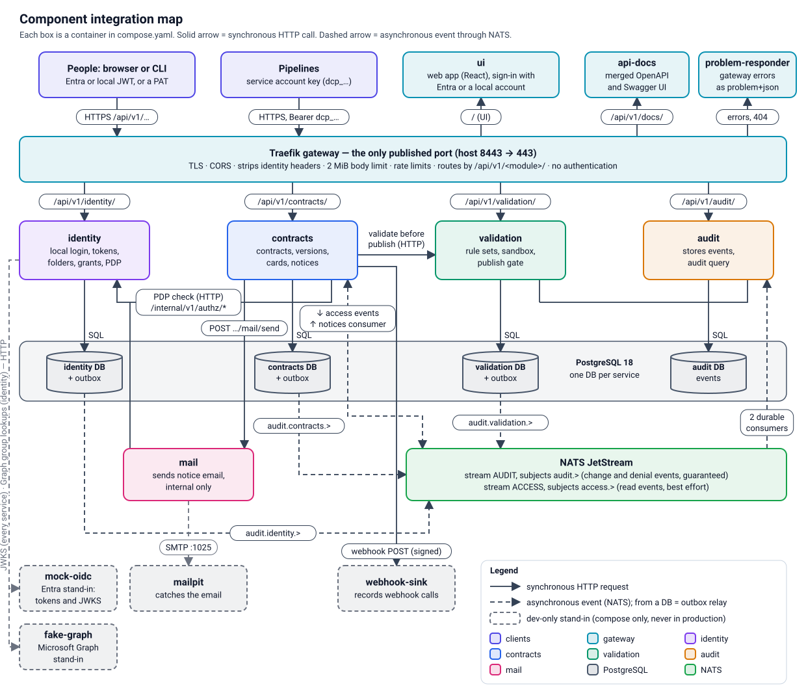
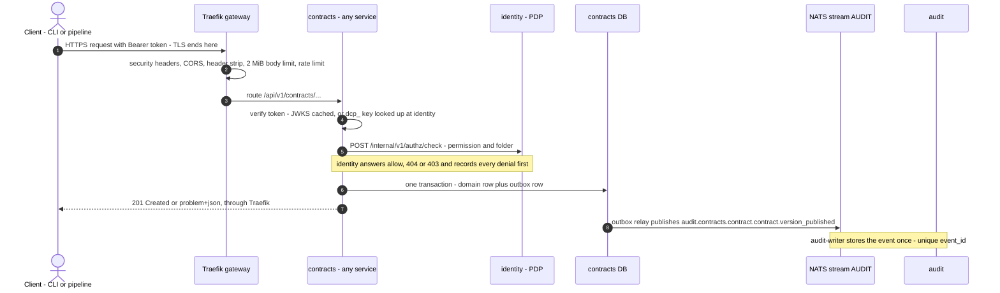

# 01. System overview

> **In short.** Contractum is a set of small services behind one gateway. Clients send HTTPS requests to Traefik, which routes them by URL prefix to four services: identity, contracts, validation and audit. Every service checks the caller's token itself and asks identity whether the caller may do the action. Every write saves an audit event in the same database transaction, and a relay later moves that event through NATS to the audit service.



*Edit this diagram: [drawio/01-system-overview.drawio](drawio/01-system-overview.drawio), page "Component map".*

Two example flows cross the map:

- **Flow 1 (a read).** An engineer fetches a published contract version. Then an access event goes to NATS and audit stores it.
- **Flow 2 (a write).** An engineer publishes a draft. Then the change event goes from the outbox through NATS to audit.

Both flows are explained step by step [below](#the-two-example-flows).

## The components

Every box in the map is one container in `compose.yaml`.

| Component | What it does | Database | Reached from outside? |
|---|---|---|---|
| **Traefik** (gateway) | Terminates TLS. Applies CORS, a 2 MiB body limit and rate limits. Strips client headers that look like identity claims. Routes `/api/v1/<module>/` to the right service. Performs **no** authentication. | none | Yes. It is the only published port (host `8443` → container `443`). |
| **ui** | The web app: a React single-page app, served as static files by nginx at `/`. It signs people in (Entra with PKCE, or a local account) and calls the same public API as any other client, so it can do only what the API allows that person. | none | Through Traefik (`/`) |
| **problem-responder** | A tiny stdlib app. It turns the errors Traefik itself makes (404 for unknown paths, 413, 429, 5xx) into `application/problem+json`. | none | Only through Traefik |
| **api-docs** | At start-up it fetches each service's `/openapi.json`, merges them and serves `/api/v1/openapi.json` with Swagger UI at `/api/v1/docs/`. | none | Through Traefik |
| **identity** | The local identity provider: logins, tokens, the JWKS endpoint. Also owns the folder tree, users, groups, grants, personal access tokens and service accounts. It is also the **policy decision point (PDP)**, the one place that answers "may this principal do this here?". | `identity` | `/api/v1/identity/` |
| **contracts** | Stores ODCS contracts in folders of any kind, byte for byte. Handles drafts, publishing, the version lifecycle, templates, subscriber cards and notices (webhook and email). | `contracts` | `/api/v1/contracts/` |
| **validation** | Stores versioned rule sets written by Policy Managers. Runs every rule in a sandboxed worker process and gives the publish verdict. | `validation` | `/api/v1/validation/` |
| **audit** | Consumes events from NATS, stores each one exactly once and serves the audit query. | `audit` | `/api/v1/audit/` |
| **mail** | Sends one plain-text email per call over SMTP for contracts' notice worker. | none | No. It has an internal route only. |
| **postgres** | PostgreSQL 18, with one database and one database role per service. | | No |
| **nats** | NATS JetStream with two streams: `AUDIT` (subjects `audit.>`) and `ACCESS` (subjects `access.>`). | | No |
| **dev-init** | A one-shot job. It generates every secret, key and the dev TLS certificate into a Docker volume. | | No |
| **\*-migrate** | One-shot Alembic jobs, one per service with a database. Each service starts only after its migration has finished. | | No |
| **mock-oidc** *(dev only)* | Stands in for Microsoft Entra ID (and a generic OIDC issuer). It issues tokens and serves their JWKS. | | Yes, dev only: Traefik routes `/entra/` to it, so the browser can sign in with it |
| **fake-graph** *(dev only)* | Stands in for Microsoft Graph, which identity calls to look up Entra users and group membership. | | No |
| **mailpit** *(dev only)* | Catches the email that the mail service sends. | | No |
| **webhook-sink** *(dev only)* | Records webhook deliveries from subscriber cards. | | No |

The shared libraries under `shared/` are not containers. They are linked into each service image:

- `dc-core`: app factory, route policies, problem details, unit of work, outbox relay and events.
- `dc-auth`: token checks, the identity client and the role tables.
- `dc-odcs`: ODCS parsing, the vendored JSON Schemas and the breaking-change classifier.
- `dc-rules`: the CEL and JSONPath rule engine.

## The two example flows

**Flow 1: read a published version** (`GET /api/v1/contracts/contracts/{contract_id}/versions/latest`)

1. The client sends an HTTPS request with `Authorization: Bearer <token>` to Traefik.
2. Traefik matches the `/api/v1/contracts/` prefix and forwards the request to `contracts:8000`.
3. contracts verifies the token. It then asks identity `POST /internal/v1/authz/check` for the permission `contract:read-published` on the contract's folder.
4. identity answers allow. contracts reads the stored bytes from its own database and returns them, with an `ETag`.
5. contracts puts an **access event** (subject `access.contracts.contract.read`) on a small in-memory queue. A background task publishes it to the NATS stream `ACCESS`.
6. audit's consumer `audit-access-writer` stores it with category `access`.

**Flow 2: publish a draft** (`POST /api/v1/contracts/contracts/{contract_id}/drafts/{draft_id}/publish`)

1. The request arrives through Traefik as in flow 1. contracts asks identity for `contract:publish`.
2. contracts sends the draft to validation (`POST /internal/v1/validation/folders/{folder_id}/runs`) with the caller's own token. Validation runs every rule set that applies and answers with a verdict.
3. If the verdict allows publishing, contracts writes in **one transaction**: the version becomes immutable, and an `outbox` row holds the audit event `contract.version_published`.
4. The client gets `201 Created`.
5. contracts' **outbox relay** reads the new outbox row and publishes it to NATS as `audit.contracts.contract.contract.version_published` (stream `AUDIT`). The subject is `audit.<service>.<aggregate type>.<action>`, and the action `contract.version_published` brings its own dot, which is why `contract` appears twice.
6. audit's consumer `audit-writer` stores it. contracts' own consumer `contracts-notices` also reads `audit.contracts.>` and creates notices for subscriber cards.

## Integration matrix

Who calls whom, and what happens when the callee is down. "Fail-closed 503" means the caller refuses with `503` problem+json and never treats the outage as "allowed" or "valid".

| Caller → callee | How | Route or subject | Purpose | If the callee is down |
|---|---|---|---|---|
| Client → Traefik | sync HTTPS | `https://<host>:8443/api/v1/...` | Every public call | No access at all |
| Traefik → identity, contracts, validation, audit | sync HTTP | `/api/v1/<module>/` | Route by prefix | Traefik's 5xx is rendered as problem+json by problem-responder |
| Traefik → api-docs | sync HTTP | `/api/v1/openapi.json`, `/api/v1/docs/` | Merged API docs | 5xx problem+json |
| Traefik → problem-responder | sync HTTP | `/404`, `/{status}` | Gateway errors as problem+json | Unhealthy at start: Traefik waits for it |
| every service → identity | sync HTTP | `GET /.well-known/jwks.json` (and mock-oidc's JWKS) | Keys to verify JWTs. They are cached for 5 minutes and fetched again on an unknown `kid`. | Cached keys keep working. If a key is needed and cannot be fetched: fail-closed 503 `service-unavailable`. |
| every service → identity | sync HTTP | `POST /internal/v1/authz/principal` | Resolve a `dcp_` token (PAT or service account key) on **every** request, with no cache, so a revoked key fails at once | Fail-closed 503 `service-unavailable` |
| every service → identity | sync HTTP | `POST /internal/v1/authz/check` | The PDP decision for one permission on one folder | Fail-closed 503 `service-unavailable`. Decisions are not cached. |
| contracts → identity | sync HTTP | `POST /internal/v1/authz/accessible-folders` | Which folders the caller may see, to trim lists | 503. Never an unfiltered list. |
| contracts → identity | sync HTTP | `POST /internal/v1/authz/grantees`, `POST /internal/v1/authz/members/check` | Card membership and whether a group may be linked to a card | 503, or the uniform 404 for card reads |
| validation → identity | sync HTTP | `POST /internal/v1/authz/principals/resolve` | Do the users and groups a contract names exist? | The answer is `unverifiable`, never a false `not_found` |
| identity → Microsoft Graph (dev: fake-graph) | sync HTTPS | `transitiveMemberOf`, `users`, `servicePrincipals`, `groups` | Entra group membership and registration checks | Fail-closed 503 `service-unavailable` for Entra callers. Failures are never cached. |
| contracts → validation | sync HTTP | `POST /internal/v1/validation/folders/{folder_id}/runs` | Publish gate. Also validation on save and on demand. | **Publish:** fail-closed 503 `validation-unavailable`, nothing is published. **Save:** the save succeeds and the response shows `"validation": {"status": "unavailable"}`. **Validate on demand:** 503. |
| contracts → validation | sync HTTP | `GET /internal/v1/validation/runs/{run_id}` | Show a version's stored validation report | 503 `validation-unavailable`, never an empty report |
| contracts → validation | sync HTTP | `GET /api/v1/validation/folders/{folder_id}/available-rule-sets/{rule_set_id}`, `GET /api/v1/validation/rule-sets/{rule_set_id}` | May this rule set be attached? Which folder owns it? | 503 `validation-unavailable` |
| contracts → validation | sync HTTP | `POST /internal/v1/validation/rule-sets/{rule_set_id}/dry-run`, `POST /internal/v1/validation/folders/{folder_id}/drift` | Rule impact: dry runs and drift | 503 |
| identity → contracts, validation | sync HTTP | `GET /internal/v1/{contracts,validation}/folders/{folder_id}/usage` and `POST .../purge` | A folder delete: what does the folder still hold, and purge its leftovers. Sent with the caller's own bearer. | Fail-closed 503 `service-unavailable`, nothing deleted |
| contracts → mail | sync HTTP | `POST /internal/v1/mail/send` | One notice email, sent with the notifier service account key | The delivery worker retries on a schedule, then marks the delivery `failed`. No user write is blocked. |
| mail → identity | sync HTTP | `/internal/v1/authz/principal`, `/internal/v1/authz/check` | Authenticate the notifier key and check `mail:send` | 503 to contracts, which retries |
| mail → SMTP server (dev: mailpit) | SMTP | port `1025` in dev | Hand the email over | 503 `service-unavailable` to contracts, which retries |
| contracts → webhook URL (dev: webhook-sink) | sync HTTPS | the card's `webhook_url` | Signed Standard Webhooks call for a notice | Retried on a schedule, then `failed` |
| identity, contracts, validation → NATS | async (outbox relay) | `audit.<service>.<aggregate type>.<action>`, stream `AUDIT` | Change and denial events | Rows wait in the outbox. Writes keep working, and the relay catches up later (at least once). |
| contracts → NATS | async, direct | `access.contracts.contract.read`, stream `ACCESS` | Access events for content reads | Best effort. A bounded queue (10,000) drops the oldest events and counts every loss. Reads keep working. |
| NATS → audit | async, durable pull consumers | `audit-writer` on `AUDIT`, `audit-access-writer` on `ACCESS` | Store events once (unique `event_id`) | Events wait in the stream until audit is back. A poison message goes to a dead-letter table. |
| NATS → contracts | async, durable pull consumer | `contracts-notices` on `AUDIT`, filter `audit.contracts.>` | Turn lifecycle events into card notices | Events wait in the stream |
| audit → identity | sync HTTP | `POST /internal/v1/authz/accessible-folders` | Trim the audit query to what the caller may see | 503. Never an unfiltered page. |
| api-docs → each service | sync HTTP, at start-up | `GET /openapi.json` | Build the merged document | api-docs stays unhealthy (503) and serves no partial document |

*Where in the code:* `shared/dc-auth/src/dc_auth/remote.py`, `opaque.py`, `jwks.py`, `verify.py`; `contracts/src/dc_contracts/validation_client.py`, `delivery.py`, `mailer.py`, `notice_consumer.py`; `shared/dc-core/src/dc_core/relay.py`, `access.py`, `events.py`; `audit/src/dc_audit/consumer.py`; `infra/nats/nats.conf.tmpl` (who may publish which subjects).

## The life of one API request



*Edit this diagram: [drawio/01-system-overview.drawio](drawio/01-system-overview.drawio), page "Request journey".*

The example is the publish call from flow 2. Every protected route in every service follows the same steps.

1. **TLS at Traefik.** The client connects to `https://<host>:8443`. Traefik ends TLS (TLS 1.2 minimum) with the certificate under `/run/secrets`. Plain HTTP is not offered.
2. **Gateway checks and rate limit.** On every API router Traefik runs its middlewares in a fixed order:
   - security headers (HSTS), outermost, so they also land on the errors the gateway renders;
   - CORS;
   - the problem+json error renderer;
   - removal of client headers such as `X-User` or `X-Principal`;
   - the 2 MiB body limit (413 above it);
   - a rate limit: 50 requests per second with a burst of 100, or 5 per second with a burst of 10 on `/api/v1/identity/auth/` (429 when exceeded).
3. **Route to the service.** The path prefix picks the service, here `/api/v1/contracts/` → `contracts:8000`. Traefik never routes `/internal/...`, `/healthz`, `/readyz` or `/.well-known/...`: a low-priority catch-all answers 404 problem+json for them.
4. **Authenticate the token.** The service itself checks the bearer token. It never relies on the gateway for this.
   - A JWT must come from a trusted issuer in `DC_AUTH_ISSUERS`: the local identity, or Entra (mock-oidc in dev). Its signature is checked with that issuer's JWKS, which is cached.
   - A `dcp_` token (a personal access token or a service account key) is sent to identity's `/internal/v1/authz/principal` on every request.
   - The result is a typed **principal**, such as `local:<uuid>`, `entra:<tid>:<oid>` (tenant id and object id) or `sa:<uuid>`.
5. **PDP check at identity.** The route's policy names one permission, for example `require("contract:publish")`. The service sends `POST /internal/v1/authz/check` with the caller's own token, the permission and the target folder. identity works out the principal from the token, never from the request body.
   - It checks that the principal is still active (and, for Entra, still registered).
   - It reads the caller's grants on that folder and its parent folders, and answers allow, deny-as-404 or deny-as-403.
   - Before it answers a denial, identity commits a `check.denied` row to its own outbox. If it cannot write that row, it answers 503.
6. **Handler, transaction and outbox row.** The handler does its work in one **unit of work**, which is one database transaction. Every business write calls `uow.audit(...)` exactly once. That call adds an `outbox` row holding the event, with before and after snapshots of allow-listed fields only, so secrets never enter events. The domain change and the outbox row commit together, or neither does. For publish, the validation call happens before this transaction starts.
7. **Response.** The client gets the result, here `201 Created` with the version metadata. Every error is `application/problem+json` with a `type` such as `urn:dc:problem:contract-validation-failed`. Each response carries an `X-Request-ID`, which also ends up in the audit trail.
8. **Relay to NATS, then audit.** Each service with an outbox runs one relay task (guarded by a Postgres advisory lock, so one replica relays).
   - The relay polls about every 0.5 s and claims rows with `FOR UPDATE SKIP LOCKED`.
   - It publishes each event to `audit.<service>.<aggregate type>.<action>` with the header `Nats-Msg-Id` set to the event id, so JetStream drops duplicates.
   - It marks the row sent.
   - audit's `audit-writer` consumer inserts the event. `event_id` is unique, so a redelivered event changes nothing.

The same journey as a sequence diagram:



## Networks

Compose defines two networks. The **edge** network (`172.28.0.0/24`) holds Traefik (`172.28.0.10`), problem-responder, ui, api-docs, the four public services and mock-oidc. The **backend** network is `internal: true`: it has no route to the internet and no host ports. Postgres, NATS, mail, the migrate jobs, dev-init and the other dev stand-ins (fake-graph, mailpit, webhook-sink) sit only on the backend network. The four public services, api-docs and mock-oidc sit on both. The services trust forwarded headers only from Traefik's fixed address (`--forwarded-allow-ips 172.28.0.10`). The draw.io file has a "Network topology" page. [06-platform-and-operations.md](06-platform-and-operations.md) covers the networks in detail.

## Design principles in plain words

- **Deny by default.** Every route declares either `require("<permission>")` or `public()`. A route with neither fails at start-up. A walker test lists every route, so a new unguarded route breaks the build. Nobody has access until a grant gives it. If the PDP cannot answer, the answer is 503, never "allowed".
- **Authority never comes from the token.** A token says *who* you are, never *what you may do*. Identity's tokens carry a fixed, small claim set (`iss, sub, aud, iat, nbf, exp, jti, ptype, scope, name`). Roles and group grants are read from identity's database on every check. A revoked grant or a deactivated user takes effect on the next request.
- **The gateway has no auth logic, so it can be swapped.** Traefik does TLS, CORS, limits and routing only. Each service checks tokens and asks the PDP itself, and refuses suspicious encoded paths on its own. Services keep their real `/api/v1/<module>` prefix, so APIM, an ingress or a load balancer can replace Traefik without code changes.
- **One database per service.** identity, contracts, validation and audit each own a database, a database role and a migration history. No service reads another's tables. They talk over HTTP or through NATS events. The import linter enforces that services import only the shared `dc_*` libraries, never each other.
- **Every write is audited atomically.** The audit event is written in the same transaction as the change (the transactional outbox). A change without its event, or an event without its change, cannot exist. A NATS outage delays events but never loses them.
- **Published versions are immutable.** Publishing freezes a version's bytes and its validation pins, and a database trigger refuses later edits. A fix is a new version. A bad version can be unpublished or deprecated, but never rewritten.
- **No user code runs.** Rules are declarative: CEL expressions over JSONPath targets. They run in separate worker processes with time, memory and iteration limits. There is no `eval` and no plug-in code.

## Repo map

```text
.
├── identity/        identity service: local IdP, folders, grants, PDP (dc_identity)
├── contracts/       contracts service: contracts, versions, cards, notices (dc_contracts)
├── validation/      validation service: rule sets, sandbox, publish gate (dc_validation)
├── audit/           audit service: NATS consumers, audit store and query (dc_audit)
├── mail/            mail service: internal SMTP sender (dc_mail)
├── shared/          libraries every service uses
│   ├── dc-core/     app factory, policies, problems, unit of work, outbox relay, events
│   ├── dc-auth/     token checks, issuer registry, PDP client, role tables
│   ├── dc-odcs/     ODCS parsing, vendored JSON Schemas, breaking-change classifier
│   └── dc-rules/    CEL + JSONPath rule engine and sandbox worker
├── ui/              web app: React single-page app served by nginx
├── clients/python/  Python SDK and the `contractum` CLI
├── gateway/         Traefik config, problem-responder, api-docs merge and server
├── infra/           Dockerfiles, dev-init secret generator, Postgres init, NATS config,
│                    and the dev stand-ins (mock-oidc, fake-graph, webhook-sink)
├── deploy/helm/     Helm chart for Kubernetes
├── tests/           cross-service tests: repo rules, integration, end-to-end (e2e)
├── scripts/         ci.sh (fast gate by default, --full for the full gate), e2e.sh,
│                    e2e-ui.sh, skeleton-smoke.sh
├── docs/            the docs site: user/, admin/ and dev/ (this architecture guide
│                    is under dev/architecture/)
├── compose.yaml     the whole platform; compose.test.yaml adds the e2e and ui-e2e runners
├── run.sh, run.ps1  one-command start, check, smoke, e2e, reset
└── pyproject.toml   uv workspace root (one uv.lock for every package)
```

Each service folder has the same shape: `src/dc_<name>/` (with `main.py`, `settings.py`, `models.py`, `migrations/`), `tests/unit` and `tests/integration`, and a `CLAUDE.md` with that module's rules.

Next: [02. Identity and access](02-identity-and-access.md).
