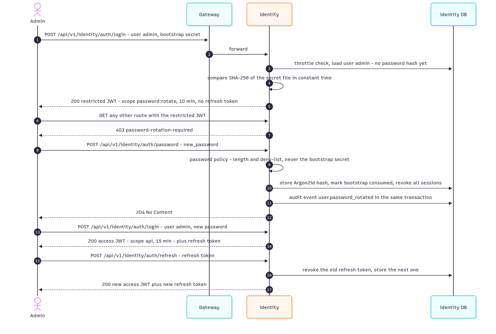
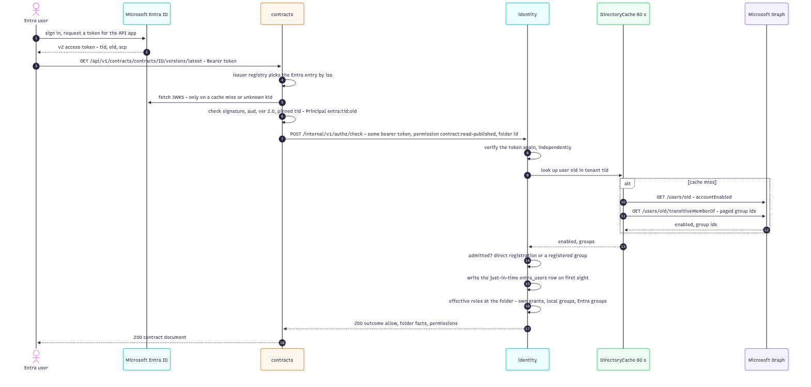
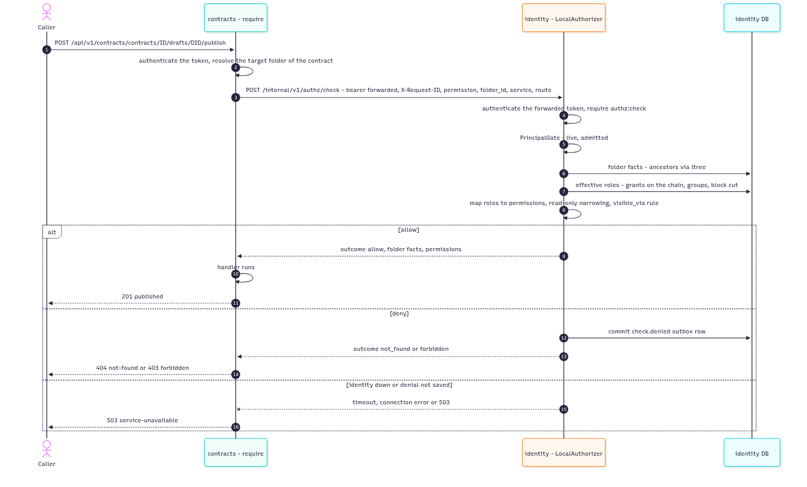
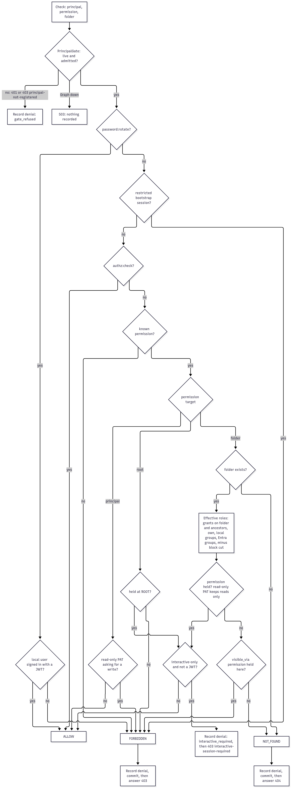

# 02 · Identity and access

> **In short.** Every API call carries a bearer token. The service that receives it checks who the
> caller is (**authentication**), then asks the **identity** service whether this caller may do this
> action on this folder (**authorization**). Permissions come only from role grants stored in
> identity's database, never from the token. Grants are made on folders and flow down the tree. Each
> refusal is written to the audit trail before the caller gets the answer.

*Edit this diagram: [drawio/02-identity-and-access.drawio](drawio/02-identity-and-access.drawio) (page "Auth flow").*

The numbers match the picture:

1. **A request arrives** with `Authorization: Bearer <token>`. The Traefik gateway only routes it.
   It does no authentication, so the gateway can be replaced by another one without losing any
   security check.
2. **The service authenticates the token** (`authenticate()` in `dc_auth`). A JWT is checked
   against the **issuer registry** and the issuer's signing keys (JWKS). An opaque `dcp_` token is
   sent to identity, which says who owns it.
3. **The route's policy runs.** Every route declares `require(permission, target=...)` or `public()`.
   `require()` asks identity: "may this caller do *permission* on *folder*?"
4. **Identity's gate checks the caller is live.** The account must exist and be active. An Entra
   caller must also exist in Microsoft Graph and be registered.
5. **Identity decides.** It reads the roles the caller holds on the folder and its ancestors,
   directly or through groups, and maps them to permissions.
6. **A refusal is recorded first.** If the answer is not "allow", identity writes one
   `check.denied` audit row and commits it *before* it answers. The outbox relay later sends it
   over NATS to the audit service.
7. **The caller gets the result.** Allow lets the handler run. "Not found" becomes 404, "forbidden"
   becomes 403, and if identity cannot answer the result is 503. The system never fails open.

## Terms used on this page

| Term | Meaning |
|---|---|
| Principal | The verified caller: a person, an application or a machine credential. It has a stable id such as `local:<uuid>`, `entra:<tenant>:<object>` or `sa:<uuid>`. |
| Permission | A named action, for example `contract:publish` or `folder:read`. The full list is in `shared/dc-auth/src/dc_auth/roles.py`. |
| Role | A named bundle of permissions, for example `team_editor`. It is granted on a folder. |
| Grant | One row in `role_assignments`. It says that a principal or group holds a role on a folder. |
| PDP | Policy decision point: the one place that answers "allow or not". Here it is identity. |
| Issuer registry | The list of token issuers every service trusts (`DC_AUTH_ISSUERS`). |
| JWKS | JSON Web Key Set: the public keys an issuer publishes so others can check its signatures. |
| PAT | Personal access token: an opaque `dcp_` token that acts for a person. |
| Service-account key | An opaque `dcp_` token that acts for a non-human account (`sa:<uuid>`). |

---

## 1. Who can call the API

Six kinds of principal exist. All of them end up as the same typed `Principal` object
(`shared/dc-auth/src/dc_auth/principal.py`). That object deliberately has **no roles and no
groups**.

| Principal | Id form | How it proves itself | `via` |
|---|---|---|---|
| **Local user** | `local:<uuid>` | Username and password at identity's login. Identity issues a short RS256 JWT and a refresh token. | `jwt` |
| **Bootstrap admin** | `local:<uuid>` (user `admin`) | A one-time secret file. It gives a restricted session that can only set a password. | `jwt` |
| **Entra user** | `entra:<tid>:<oid>` | A Microsoft Entra ID v2 access token with a delegated scope (`scp`). | `jwt` |
| **Entra service principal** | `entra:<tid>:<oid>` | An Entra v2 app-only token (`idtyp=app`, no `scp`), for daemons and pipelines. | `jwt` |
| **PAT** | the owner's id (`local:` or `entra:`) | An opaque `dcp_<public_id>_<secret>` token that identity looks up. | `pat` |
| **Service-account key** | `sa:<uuid>` | An opaque `dcp_` token that belongs to a service account. | `api_key` |

The **contracts notifier** is a special service account. Identity creates it at start-up with
the `notifier` role, which can only send mail. The contracts service uses it to send email through
the mail service (see [05-audit-and-events.md](05-audit-and-events.md) and
[06-platform-and-operations.md](06-platform-and-operations.md)).

> **Rule: a token never carries authority.** Identity's own JWTs carry only `iss, sub, aud, iat,
> nbf, exp, jti, ptype, scope, name`. Verifiers never read `roles` or `groups` from any token. The
> development Entra stand-in (`mock-oidc`) even mints `roles: [global_admin]` on purpose, to prove
> that such a claim grants nothing.

### 1.1 Local login, JWT, JWKS and refresh

Identity is a small identity provider of its own.

- **Login**: `POST /api/v1/identity/auth/login` with `username` and `password`. Passwords are
  hashed with Argon2id. A successful login returns:
  - an **access token**: an RS256 JWT, valid for 15 minutes (`access_token_ttl_s` = 900);
  - a **refresh token**: an opaque random string. It expires after 12 hours without use (an idle
    timeout, `refresh_token_ttl_s` = 43200, that restarts on every refresh), and a session never
    lasts longer than 7 days from the sign-in (`session_max_s` = 604800). A Global admin can
    change both under **Settings > Sign-in & security**. Only its SHA-256 digest is stored.
- **Signing keys and JWKS**: identity signs with an RSA key loaded from a mounted secret file. It
  publishes the public key at `/.well-known/jwks.json`, with `kid` set to the key's RFC 7638
  thumbprint. The previous public key stays in the set, so tokens that are still live survive a
  key rotation. Services fetch this document directly from `http://identity:8000` on the internal
  network. The gateway never routes `/.well-known/*` or `/internal/*`.
- **Refresh**: `POST /api/v1/identity/auth/refresh` exchanges a refresh token for a new access
  token *and* a new refresh token (rotation on every use). If an already-rotated token is
  presented again, it may have been stolen, so identity revokes the whole token family and
  answers 401.
- **Logout**: `POST /api/v1/identity/auth/logout` revokes the refresh-token family. It always
  answers 204, even for an unknown token.
- **Brute-force protection** lives inside identity (`throttle.py`), not only at the gateway. After
  5 failures per account or 20 per client IP, the lock grows exponentially up to 15 minutes, with a
  `Retry-After` header. Through the gateway a locked login shows as the generic 429
  `too-many-requests`.

### 1.2 The bootstrap admin and the first password rotation

On first start, identity creates the ROOT folder, the user `admin` and a `global_admin` grant at
ROOT. The admin has no password yet. Instead, identity reads a one-time secret from
`/run/secrets/bootstrap_admin_secret` (the dev-init container generates it; see
[06-platform-and-operations.md](06-platform-and-operations.md)).

Notes:

- The restricted session has no `api` scope, so `Principal.restricted` is true. Every
  `require(...)` route refuses it with 403 `password-rotation-required`. The only exception is
  `POST /auth/password`, which uses `allow_restricted=True`. This refusal happens before the PDP is
  asked, so it is not written to the audit trail as a denial.
- The secret works once. After rotation, the bootstrap state is "consumed" and a second attempt is
  409 `bootstrap-consumed`.
- A signed-in user changing their own password must send `current_password`. Failed attempts count
  toward the same throttle as logins.
- **Only the bootstrap admin is forced to rotate.** Users that an admin creates with
  `POST /api/v1/identity/users` get a password that meets the policy and are *not* forced to
  change it at first login. New users hold no role until someone grants one.

### 1.3 Entra users and service principals

Entra is configured as one more entry in the **issuer registry** (`DC_AUTH_ISSUERS`, read by every
service; `shared/dc-auth/src/dc_auth/issuers.py`). An entry names the `issuer`, `jwks_uri`,
`audiences`, a `namespace` and the `kind` (`oidc` or `entra`, plus a pinned `tenant_id` for Entra).
Adding another identity provider means adding another entry. No service code changes.

How a JWT is verified (`shared/dc-auth/src/dc_auth/verify.py`):

1. Only the token **header** is read before verification (`alg` and `kid`); the payload is never
   read unverified. The issuer is **chosen by full verification**: among the registry entries
   whose `algorithms` allow the `alg`, the entries whose key set already holds the `kid` are tried
   (all candidates when none does, for a key rotation or a cold start). The token belongs to the
   entry whose key verifies the signature and whose `aud`, `iss` and required claims all hold.
   An unconfigured issuer, a claim for one issuer signed with another issuer's key and a garbage
   token are all 401. Trade-off: an unknown `kid`
   while one issuer's key set is unreachable answers 503 instead of 401, because the token might
   belong to that issuer (fail closed, retryable).
2. The `alg` must be in the entry's allow-list. Only asymmetric algorithms are accepted, never
   `HS*` or `none`.
3. The `kid` selects a key from the **async JWKS cache** (`jwks.py`). Keys are kept for 5 minutes.
   An unknown `kid` triggers a refetch, at most once every 30 seconds per issuer. A known `kid`
   never triggers another issuer's fetch. If the issuer cannot be reached and the key is not
   cached, the answer is 503, not 401, so clients retry.
4. Signature, `aud`, `iss`, `exp` and the required claims are checked (30 seconds of clock leeway).
5. For an Entra entry, the token must be `ver` 2.0 and its `tid` must equal the pinned tenant. The
   key is `(tid, oid)`. An app-only token (`idtyp=app`, no `scp`) becomes a `service_principal`. A
   token with a non-empty `scp` becomes a `user`. Anything else, such as an ID token, is 401.

A valid Entra token proves only *who* the caller is. Two more things happen in identity's
**PrincipalGate** (`identity/src/dc_identity/gate.py`) on every decision:

- **Liveness**: identity asks Microsoft Graph about the object. If it is not found or disabled,
  the answer is 401. If Graph is unreachable, the answer is 503.
- **Admission**: the caller must have an active, direct registration of its own kind, or be a
  transitive member of a registered Entra group of the same tenant. Otherwise the answer is 403
  `principal-not-registered`. Registration admits, but it **grants no role**.

**Groups come from Graph, not from the token.** The API app registration keeps
`groupMembershipClaims: null`, so tokens carry no `groups` claim. Identity reads
`GET /users/{id}/transitiveMemberOf` or `GET /servicePrincipals/{id}/transitiveMemberOf` (paged,
following `nextLink` only on the Graph host). Because groups never travel in the token, Entra's
**200-group "overage" case cannot happen**: there is no truncated claim to repair.

Graph answers are cached in `DirectoryCache` (`identity/src/dc_identity/directory/cache.py`) for
60 seconds (`DC_DIRECTORY_CACHE_TTL_S`). The cache keys include the tenant, concurrent requests
share one lookup ("single flight"), and failures are never cached. When the cache misses and Graph
is down, the result is 503: there is no stale grace period and no fallback to direct grants.
Identity gets its Graph token with the OAuth client-credentials flow, using plain `httpx`. In
development, `fake-graph` stands in for Microsoft Graph and `mock-oidc` stands in for Entra.
See [Entra setup](../../admin/entra-setup.md) to connect a real tenant.

### 1.4 PATs and service-account keys: opaque `dcp_` tokens

Both use the format `dcp_<public_id>_<secret>`: 16 lowercase hex characters, then 43 URL-safe
characters. The fixed prefix makes leaked tokens easy for secret scanners to find. Identity stores
only the SHA-256 of the secret. It looks the token up by `public_id` and compares the hash with
`hmac.compare_digest`. No event, log line or later response ever carries the token, its secret,
its hash or its public id, and the platform logger also redacts `dcp_` values.

A service never parses a `dcp_` token itself. JWTs start with `eyJ`, so a token starting with
`dcp_` is never treated as a JWT. The service forwards it to identity's
`POST /internal/v1/authz/principal` (`shared/dc-auth/src/dc_auth/opaque.py`, `RemoteOpaqueResolver`)
on **every request, with no cache**.

What a PAT and a key may do:

- **A PAT is never an identity of its own.** It acts as its owner, with the owner's *current*
  grants. On every request the gate reloads the credential and re-proves that the owner is live
  and admitted. A PAT therefore never holds more than its owner holds now, and it never outlives
  the owner's access.
- **Read-only PAT**: created with `read_only: true`. It holds only the owner's permissions marked
  `access="read"` in `roles.py` (`READ_PERMISSIONS`). Every write is refused.
- **A service-account key** acts as the account `sa:<uuid>`. It holds only what grants and
  local-group memberships give that id.
- **Interactive-only actions are refused for both** (see §2.6).

---

## 2. The folder hierarchy and RBAC

*Edit this diagram: [drawio/02-identity-and-access.drawio](drawio/02-identity-and-access.drawio) (page "Folder hierarchy").*

Folders form a fixed four-level tree: **ROOT → Organization → Project → Team**. Contracts live in
folders of any kind. Each folder stores a Postgres `ltree` path, so "this folder and all its ancestors" is
a single indexed query (`identity/src/dc_identity/access.py`). Folders are never moved or re-slugged.
A Global admin deletes a folder only when nothing live is inside it (`folder:delete`,
`DELETE /api/v1/identity/folders/{folder_id}`; ROOT never): identity asks contracts and validation
what it still holds, with the caller's own bearer, and refuses with 409 `folder-not-empty` and a
`blockers` list. Already soft-deleted contracts, archived cards and rule sets that are not mandatory
are purged with the folder, the folder's grants go in the same transaction and one `folder.deleted`
audit event keeps the record.

1. A **role is granted on one folder**: `POST /api/v1/identity/folders/{folder_id}/grants`. The
   grantee is a user (`local:` or `entra:`), a local group, an Entra group, an Entra service
   principal or a service account.
2. The role applies **on that folder and every folder below it** (inheritance downward).
3. It **never reaches a parent or a sibling**. A caller with no role in the Marketing
   Organization cannot even see that its folders exist: they answer 404.
4. A **block-inheritance flag** (`PUT /api/v1/identity/folders/{folder_id}/block-inheritance`,
   allowed on Organization and Team folders only) cuts grants made *above* it. Grants made at the
   blocked folder or below still apply. `global_admin` is never cut. This is how an Organization
   can isolate itself from broad grants made higher up.

### 2.1 Roles and the level each binds to

A role can be granted only at its own folder level. A wrong level is 422 `role-level-mismatch`.

| Level | Roles |
|---|---|
| ROOT | `global_admin`, `global_reader`, `notifier` (for the contracts notifier only) |
| Organization | `org_admin`, `org_reader` |
| Project | `project_admin`, `project_editor` |
| Team | `team_admin`, `team_editor`, `team_reader` |
| Any level | `policy_manager`, `consumer` |

### 2.2 Roles to permissions

The tables below show `roles.py` grouped by topic. ✔ means the role holds the permission on its
folder and everything below it. Column keys: **GA** global_admin, **GR** global_reader, **OA**
org_admin, **OR** org_reader, **PA** project_admin, **PE** project_editor, **TA** team_admin,
**TE** team_editor, **TR** team_reader, **PM** policy_manager, **CO** consumer.

#### Folders, grants and identities

| Permission | GA | GR | OA | OR | PA | PE | TA | TE | TR | PM | CO |
|---|---|---|---|---|---|---|---|---|---|---|---|
| `folder:read` (see the folder) | ✔ | ✔ | ✔ | ✔ | ✔ | ✔ | ✔ | ✔ | ✔ | ✔ | ✔ |
| `folder:create` | ✔ | | ✔ | | ✔ | | | | | | |
| `folder:update` (rename) | ✔ | | ✔ | | ✔ | | ✔ | | | | |
| `folder:set-block` (checked on the parent) | ✔ | | ✔ | | ✔ | | | | | | |
| `folder:archive`, `folder:unarchive` | ✔ | | | | | | | | | | |
| `folder:delete` (an empty folder, never ROOT) | ✔ | | | | | | | | | | |
| `grant:read`, `grant:manage` | ✔ | | ✔ | | ✔ | | ✔ | | | | |
| `group:create`, `group:read`, `group:manage` | ✔ | | ✔ | | | | | | | | |
| `entra:read`, `entra:manage` (Entra registrations) | ✔ | | ✔ | | | | | | | | |
| `service-account:create`, `:read`, `:manage`, `:manage-keys`, `:deactivate` | ✔ | | ✔ | | | | | | | | |

#### Contracts and subscriber cards

| Permission | GA | GR | OA | OR | PA | PE | TA | TE | TR | PM | CO |
|---|---|---|---|---|---|---|---|---|---|---|---|
| `contract:read` (full content, drafts) | ✔ | ✔ | ✔ | ✔ | ✔ | ✔ | ✔ | ✔ | ✔ | | |
| `contract:read-metadata` | ✔ | ✔ | ✔ | ✔ | ✔ | ✔ | ✔ | ✔ | ✔ | ✔ | |
| `contract:read-published` | ✔ | ✔ | ✔ | ✔ | ✔ | ✔ | ✔ | ✔ | ✔ | | ✔ |
| `contract:view` (metadata by id) | ✔ | ✔ | ✔ | ✔ | ✔ | ✔ | ✔ | ✔ | ✔ | ✔ | ✔ |
| `contract:validate` (dry-run validation) | ✔ | ✔ | ✔ | ✔ | ✔ | ✔ | ✔ | ✔ | ✔ | ✔ | |
| `contract:create`, `:update`, `:publish`, `:delete` | ✔ | | ✔ | | ✔ | ✔ | ✔ | ✔ | | | |
| `contract:restore` (undo a soft delete) | ✔ | | ✔ | | | | | | | | |
| `card:create` | ✔ | | ✔ | | ✔ | | ✔ | | | | ✔ |
| `card:manage` (folder admin of cards) | ✔ | | ✔ | | ✔ | | ✔ | | | | |

#### Governance: templates, rule sets and impact

| Permission | GA | GR | OA | OR | PA | PE | TA | TE | TR | PM | CO |
|---|---|---|---|---|---|---|---|---|---|---|---|
| `ruleset:read-published` | ✔ | ✔ | ✔ | ✔ | ✔ | ✔ | ✔ | ✔ | ✔ | ✔ | ✔ |
| `ruleset:read`, `:create`, `:update`, `:publish`, `:deprecate`, `:mandate` | ✔ | | | | | | | | | ✔ | |
| `ruleset:dry-run` | ✔ | | | | | | | | | ✔ | |
| `governance:drift-read` | ✔ | | ✔ | | | | | | | ✔ | |
| `template:read-published` | ✔ | ✔ | | | | | | | | ✔ | |
| `template:read`, `:create`, `:update`, `:publish`, `:deprecate` | ✔ | | | | | | | | | ✔ | |

#### Audit and platform

| Permission | GA | GR | OA | OR | PA | PE | TA | TE | TR | PM | CO |
|---|---|---|---|---|---|---|---|---|---|---|---|
| `audit:query` (audit events in your subtree) | ✔ | ✔ | ✔ | | ✔ | | ✔ | | | | |
| `user:create`, `user:read`, `user:update`, `user:deactivate` (at ROOT) | ✔ | | | | | | | | | | |
| `audit:read` (internal audit read, at ROOT) | ✔ | | | | | | | | | | |
| `pat:read-all`, `pat:revoke-any` (at ROOT) | ✔ | | | | | | | | | | |
| `mail:send` (at ROOT) | ✔ | | | | | | | | | | |
| `settings:read`, `settings:write` (platform settings, at ROOT) | ✔ | | | | | | | | | | |
| `settings:seed-webhook-hosts` (the one-time webhook allow-list seed, at ROOT) | ✔ | | | | | | | | | | |

`notifier` holds two permissions: `mail:send` and `settings:seed-webhook-hosts`.

Some notes on the tables:

- A **Policy Manager** governs rules and templates and sees contract *metadata*. It never reads or
  writes contract content: it has no `contract:read`, `:update` or `:publish`.
- A **Consumer** sees only published versions, and it can record what it depends on in subscriber
  cards (see [03-contracts-and-lifecycle.md](03-contracts-and-lifecycle.md)).
- **Principal-level permissions** are allowed for any signed-in, unrestricted caller: `folder:list`,
  `contract:list`, `template:list`, `group:list`, `entra:list`, `service-account:list`, `pat:list`,
  `pat:manage`, `me:read`, `me:update`, `principal:read-names`, `card:read`, `card:write`,
  `card:manage-secret`, `audit:list`, `settings:read-public`, `settings:read-runtime`. The handler then trims
  the rows to what the caller can see, so a caller with no access gets an **empty page, not a 403**.
- Two **special permissions** have their own rules: `password:rotate` (a local user signed in with
  a JWT only) and `authz:check` (any unrestricted caller; this is what lets services call the PDP).
- An **unknown permission string is always refused**, even for a Global admin.

### 2.3 Groups

- **Local groups** are owned by ROOT or by an Organization (`POST /api/v1/identity/groups`). A
  group can hold grants like a user. Members are users or service accounts. An Organization admin
  manages only its own Organization's groups.
- **Entra groups** are registered by their Graph object id (`POST /api/v1/identity/entra/groups`).
  Graph confirms the GUID first. Membership is read live from Graph (§1.3), so a person removed
  from the group in Entra loses access within the 60-second cache window.
- **Adding a member counts as granting** every role the group holds. The grant ceiling (below)
  is therefore checked for each role and folder, and nobody can add themselves to a group.

### 2.4 Escalation guards

Every write that changes authorization goes through the same guards, in this order
(`identity/src/dc_identity/guards.py`):

1. **One lock** (`lock_authz_writes`, a transaction-scoped Postgres advisory lock), so a grant and
   a block-flag change can never interleave.
2. **Archived folders** are read-only: 409 `folder-archived`.
3. **Level binding**: the role must fit the folder kind, otherwise 422 `role-level-mismatch`.
4. **Grant ceiling**: you may grant (or revoke) only roles below your own, per this table, checked
   against your roles *at the target folder*. Otherwise 403 `grant-ceiling-exceeded`.

   | You hold | You may grant |
   |---|---|
   | `global_admin` | every role, including `global_admin` |
   | `org_admin` | `org_reader`, `project_admin`, `project_editor`, `team_admin`, `team_editor`, `team_reader`, `policy_manager`, `consumer` |
   | `project_admin` | `project_editor`, `team_admin`, `team_editor`, `team_reader`, `policy_manager`, `consumer` |
   | `team_admin` | `team_editor`, `team_reader`, `policy_manager`, `consumer` |
   | any other role | nothing |

5. **No self-grant**, directly or through a group: 403 `self-grant-forbidden`.
6. **The last direct Global admin** cannot be removed: 409 `last-global-admin`.

### 2.5 Organization isolation

- Inheritance only flows down, so a grant in one Organization never reaches another.
- **Owned principals stay in their Organization.** A local group, an Entra registration or a
  service account owned by an Organization can be granted only on folders inside that
  Organization. ROOT-owned ones can be granted anywhere. A **Global admin** may grant any owned
  principal on any folder; the owner confines everyone else (an Org admin's own groups stay in
  their Organization, even for an admin of several Organizations). A caller who can read the
  principal gets 422 `group-scope-mismatch` (or `principal-scope-mismatch`). Everyone else gets
  the same 404 as for an unknown principal. Subscriber-card member eligibility keeps the owner
  rule for everyone.
- An Organization or Team can set the **block-inheritance flag** to shut out grants made above it,
  except `global_admin`.

### 2.6 Interactive-only permissions

Some actions need a real sign-in (a JWT, `via == "jwt"`). A PAT or service-account key that tries
them gets 403 `interactive-session-required`, whatever its owner holds. A stolen token therefore
cannot create more credentials or change who has access. The interactive-only permissions are:

`grant:manage`, `group:manage`, `entra:manage`, `user:create`, `user:update`, `user:deactivate`,
`pat:manage`, `me:update`, `pat:revoke-any`, `card:manage-secret`, `service-account:create`, `service-account:manage`,
`service-account:manage-keys`, `service-account:deactivate`, `settings:write`.

This check runs **only after** the normal decision would allow the action. A caller who cannot
even see the folder still gets the plain 404, so this refusal never reveals that a hidden folder
exists. `ruleset:mandate` and `contract:publish` are deliberately *not* interactive-only, so a
pipeline can still do them.

---

## 3. The PDP: how every service asks identity

Identity is the single **policy decision point**. The other services (contracts, validation,
audit, mail) never compute permissions themselves.

### 3.1 `require()` and the PolicyRouter

- Every service builds its routes on a `PolicyRouter` (`shared/dc-core/src/dc_core/policy.py`).
  A route without `require(...)` or `public()` **fails at import time**, so the service does not
  start. A walker test also checks the finished app, with an allow-list for public routes.
- `require(permission, target=resolver)` (`shared/dc-auth/src/dc_auth/deps.py`) is a FastAPI
  dependency that:
  1. authenticates the bearer token;
  2. refuses a restricted bootstrap session (403 `password-rotation-required`);
  3. resolves the target folder id with the route's resolver, for example "the folder of this
     contract";
  4. calls the authorizer and maps the outcome: `not_found` → 404 `not-found`, `forbidden` → 403
     `forbidden`, unavailable → 503 `service-unavailable`;
  5. stores the `Decision` (folder facts and the permissions held there) on the request, so the
     handler can narrow what it shows.

### 3.2 RemoteAuthorizer: the call to identity

In contracts, validation, audit and mail, the authorizer is `RemoteAuthorizer`
(`shared/dc-auth/src/dc_auth/remote.py`). One instance is created per request. It forwards the
caller's own bearer token to identity's internal API:

| Internal route | Purpose |
|---|---|
| `POST /internal/v1/authz/check` | Allow or not for one permission on one folder |
| `POST /internal/v1/authz/accessible-folders` | The set of folders where the caller holds a permission, for list filtering |
| `POST /internal/v1/authz/principal` | Who owns this `dcp_` token |
| `POST /internal/v1/authz/grantees` | Which identities the caller answers to: itself, its local and Entra groups (used for card membership) |
| `POST /internal/v1/authz/members/check` | Whether groups or service accounts may be linked at a folder |
| `POST /internal/v1/authz/principals/resolve` | Whether user and group names in a contract exist (`found`, `not_found` or `unverifiable`) |

Key design points:

- **No confused deputy.** The principal is never sent in the request body. Identity verifies the
  forwarded token itself, so a service can only ask about the caller it is acting for.
- **Context for the audit trail.** Each check body carries the asking `service` and the matched
  **route template** (never the raw URL). The `X-Request-ID` header is forwarded too, so a denial
  row can be linked to the original request.
- **Timeout**: `DC_AUTH_AUTHZ_TIMEOUT_S`, default 2 seconds.
- Inside identity itself, the authorizer is `LocalAuthorizer` (`identity/src/dc_identity/authz.py`),
  called directly in process.

### 3.3 How a permission decision is made

### 3.4 404 or 403: hiding what you cannot see

- Each permission has a `visible_via` permission. If the caller is refused but holds `visible_via`
  on the target, the answer is **403** ("you can see it, but you may not do this"). Otherwise it is
  **404**, the same answer as for an id that does not exist.
- For most folder permissions, `visible_via` is `folder:read`. For contract writes it is
  `contract:read`. A Consumer or Policy Manager who tries to update a contract therefore gets the
  same 404 as for an unknown id, and cannot use the API to find out which contracts exist.
- For reads such as `contract:read`, the permission is its own `visible_via`, so a refused read is
  **always 404**.
- Root permissions such as `user:create` are refused with 403.
- Some handlers refuse later, based on `Decision.permissions`. For example, a published-only reader
  might ask for a draft. Such handlers call `recorded_refusal()`, which runs a real PDP check (so
  the denial is recorded) and then always answers the same uniform 404.

### 3.5 Caching and how fast changes apply

| What | Cached? | Effect |
|---|---|---|
| Permission decisions (`check`) | **No.** Every check is live. | A revoked grant stops working on the next request. |
| `dcp_` token resolution | **No.** Identity is asked on every request. | A revoked PAT or key fails on its next request. |
| Credential rows in identity | **No.** Only `last_used_at` is batched in memory and flushed every 60 s. | — |
| Signing keys (JWKS) | Yes, 5 minutes per issuer; an unknown `kid` is refetched at most every 30 s. | Key rotation is picked up quickly; an outage with no cached key gives 503. |
| Entra directory (Graph) | Yes, 60 s (`DC_DIRECTORY_CACHE_TTL_S`; set 0 to disable); failures never cached. | An Entra account disabled in Entra, or removed from a group, loses access within about 60 s. |

The `fresh` flag that `require()` sends for non-GET requests is accepted on the wire, but it does
not change anything today, because there is no decision cache to bypass.

### 3.6 `accessible_folders`: list filtering

List routes cannot ask "allow?" for every row. They ask once for the caller's **scope** instead:
`POST /internal/v1/authz/accessible-folders` with a permission, for example `contract:read`. The
answer is compact (`FolderScope` in `shared/dc-auth/src/dc_auth/authorizer.py`):

- `all`: true when the caller holds the permission at ROOT;
- `excluded_subtrees`: folders cut away from `all` by a block flag;
- `folder_ids`: the exact folders where the caller holds the permission.

The service then adds a `WHERE` filter to its own SQL query. Trimming a list is not a denial, so
this call never writes a denial row. A read-only PAT asking for a write scope, or a PAT asking for
an interactive-only scope, gets an empty scope. If identity cannot answer, the list route returns
503, never an unfiltered page.

### 3.7 Fail closed

- Identity unreachable, a timeout, a non-200 status or a malformed answer becomes
  `AuthorizerUnavailable`, and the caller gets **503 `service-unavailable`**. Never an allow.
- Identity's own 401 and its known 403 problems (`principal-not-registered`,
  `interactive-session-required`) are passed through unchanged, because they are real answers
  about the caller, not outages.
- A JWKS outage gives 503, so a client with a valid token retries instead of discarding the token.

---

## 4. Denial recording

**Every refused permission check is written to the audit trail before the answer is given.**
This happens in `DenialRecorder` (`identity/src/dc_identity/denials.py`).

1. `LocalAuthorizer.check` reaches an outcome other than ALLOW.
2. After its decision session has closed, it opens a new short transaction and inserts one row into
   identity's **outbox** table (`aggregate_type` `authz`, action `check.denied`).
3. The transaction **commits**. Only then does identity return the decision or raise the refusal.
4. If the row cannot be written, the check answers **503** instead. Identity never returns a
   refusal that was not recorded.
5. The outbox relay publishes the row to NATS as `audit.identity.authz.check.denied` on the
   `AUDIT` stream. The audit service stores it with category `denial`. Ingest is idempotent, so a
   redelivery is harmless (see [05-audit-and-events.md](05-audit-and-events.md)).

What the row contains:

| Field | Value |
|---|---|
| `detail.outcome` | `not_found`, `forbidden`, `gate_refused` (the gate's 401, or 403 `principal-not-registered`) or `interactive_required` |
| `detail.permission` | the permission that was asked for |
| `detail.service`, `detail.route` | the asking service and its route template, never a raw URL or query string |
| actor | the principal |
| `aggregate_id` | the folder id, `root` for a root permission, or `none` |
| `scope_path` | the folder's ancestors, so auditors of that subtree can see the denial; `[ROOT]` for root permissions; empty for unknown folders, which only ROOT auditors see |
| `request_id` | the caller's `X-Request-ID`, forwarded by the asking service |
| `before` / `after` | always null |

What is **not** recorded as a denial:

- ALLOW;
- `accessible_folders` trimming;
- a 503 from the gate (an outage is not a refusal);
- the `password-rotation-required` refusal inside `require()`, which happens before the PDP is
  asked.

When a gate refusal arrives through the remote path, it is recorded once as permission
`authz:check` on `/internal/v1/authz/check`. Identity's own guard on that route runs the gate
before it reads the requested permission. The forwarded request id still links the row to the
original request.

---

## 5. Machine identities

### 5.1 Personal access tokens (PATs)

| Action | Route | Who |
|---|---|---|
| Create | `POST /api/v1/identity/pats` (body `name`, `expires_at`, optional `read_only`) | A signed-in human user, local or Entra, using a JWT |
| List your own | `GET /api/v1/identity/pats` | Any caller |
| Revoke your own | `DELETE /api/v1/identity/pats/{credential_id}` | The owner, using a JWT |
| List all (metadata only) | `GET /api/v1/identity/admin/pats` | Global admin |
| Revoke anyone's | `DELETE /api/v1/identity/admin/pats/{credential_id}` | Global admin, using a JWT |

- **Expiry is mandatory.** It must be in the future and at most `DC_CREDENTIAL_MAX_TTL_DAYS`
  away (default 365). Otherwise the answer is 422 `expiry-out-of-range`.
- The 201 response shows the `dcp_` token **once**. It cannot be shown again.
- **Scope**: a PAT either has the owner's full current access, or with `read_only: true` only its
  read permissions. There are no finer-grained scopes.
- Listings show `status` (`active`, `expired` or `revoked`) and `last_used_at`. `last_used_at` can
  lag by up to the flush interval (`DC_CREDENTIAL_USAGE_FLUSH_S`, default 60 s).

### 5.2 Service accounts and keys

| Action | Route | Permission (on the owner folder) |
|---|---|---|
| Create account | `POST /api/v1/identity/service-accounts` (body `owner_folder_id`, `name`) | `service-account:create` |
| Rename | `PATCH /api/v1/identity/service-accounts/{id}` | `service-account:manage` |
| Create key | `POST /api/v1/identity/service-accounts/{id}/keys` (body `name`, `expires_at`) | `service-account:manage-keys` |
| List keys | `GET /api/v1/identity/service-accounts/{id}/keys` | `service-account:read` |
| Revoke key | `DELETE /api/v1/identity/service-accounts/{id}/keys/{key_id}` | `service-account:manage-keys` |
| Deactivate / reactivate | `POST .../{id}/deactivate`, `POST .../{id}/reactivate` | `service-account:deactivate` |

- An account is owned by ROOT or by an Organization (a Project or Team owner is 422
  `owner-not-allowed`). Its principal id is `sa:<uuid>`. It holds nothing until someone grants it a
  role.
- **At most two active keys** per account, so a pipeline can rotate without downtime. A third key
  is 409 `credential-limit-reached`, even under concurrent requests, because the account row is
  locked while the keys are counted.
- Key expiry follows the same rule as PATs (mandatory, at most 365 days). The key listing flags
  `expiring_soon` within 14 days (`credential_expiry_warning_days`).
- All management actions are interactive-only, so a key cannot mint more keys.

### 5.3 How fast revocation takes effect

| Event | Takes effect |
|---|---|
| Revoke a PAT or key | On its **next request**. Nothing about a credential is cached. |
| Deactivate a local user | On the next request. The gate checks `is_active`, so even a live access JWT gets 401. Refresh tokens and PATs are revoked in the same transaction. |
| Deactivate a service account | On the next request. All its keys are revoked. |
| Deactivate an Entra user or service principal (in identity) | On the next request. Our own `is_active` flag wins, even if Entra still says enabled. |
| Disable an account or remove it from a group in Entra | Within the directory cache window, about 60 s. |
| Revoke a grant or remove a group member | On the next request. Decisions are live. |
| Password rotation | Refresh tokens are revoked at once. An already-issued access JWT stays valid until it expires (at most 15 minutes). |
| Reactivation | Restores the account and its grants. Revoked tokens stay revoked, and every JWT issued at or before the reactivation is refused (`sessions_valid_after`). |

---

## Where in the code

| Topic | Location |
|---|---|
| Principal, issuer registry, JWT verification, JWKS cache | `shared/dc-auth/src/dc_auth/{principal,issuers,verify,jwks}.py` |
| `dcp_` token parsing and remote resolution | `shared/dc-auth/src/dc_auth/opaque.py` |
| `require()`, `recorded_refusal()`, `auth_lifespan` | `shared/dc-auth/src/dc_auth/deps.py` |
| `RemoteAuthorizer` and the internal wire models | `shared/dc-auth/src/dc_auth/remote.py`, `authz_wire.py` |
| Roles, permissions, grant ceiling, interactive-only | `shared/dc-auth/src/dc_auth/roles.py` |
| Reference model that the SQL is tested against | `shared/dc-auth/src/dc_auth/oracle.py` |
| `PolicyRouter`, `public()`, route walker | `shared/dc-core/src/dc_core/policy.py` |
| Login, refresh, logout, password | `identity/src/dc_identity/api/auth.py`, `sessions.py`, `tokens.py`, `keys.py`, `throttle.py` |
| Bootstrap admin and the notifier account | `identity/src/dc_identity/bootstrap.py` |
| The PDP and the internal API | `identity/src/dc_identity/authz.py`, `internal_api.py` |
| Gate, Graph directory and cache | `identity/src/dc_identity/gate.py`, `directory/` |
| Effective roles over the `ltree` chain | `identity/src/dc_identity/access.py` |
| Escalation guards | `identity/src/dc_identity/guards.py`, `grants.py`, `groups.py` |
| Denial recording | `identity/src/dc_identity/denials.py` |
| PATs, keys, service accounts, deactivation | `identity/src/dc_identity/credentials.py`, `service_accounts.py`, `deactivation.py` |
