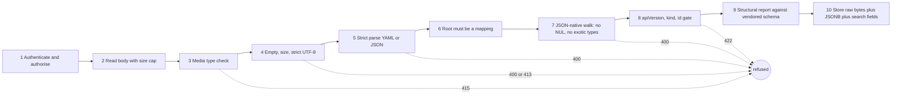
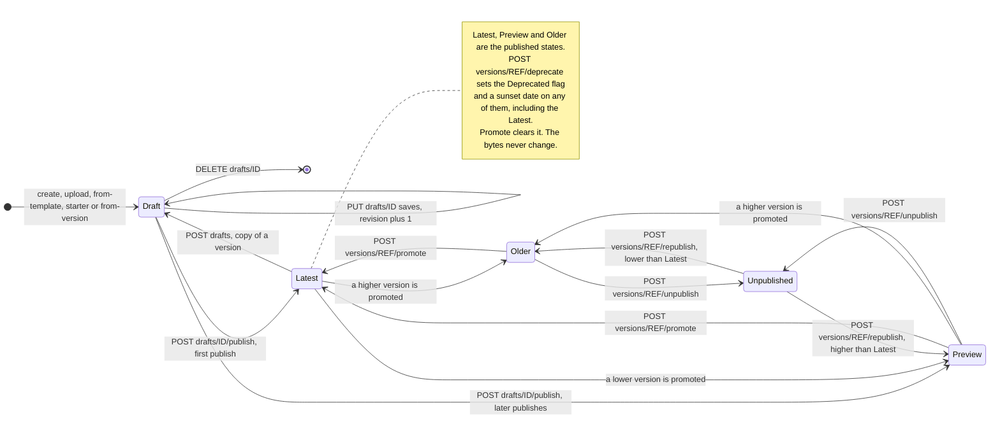
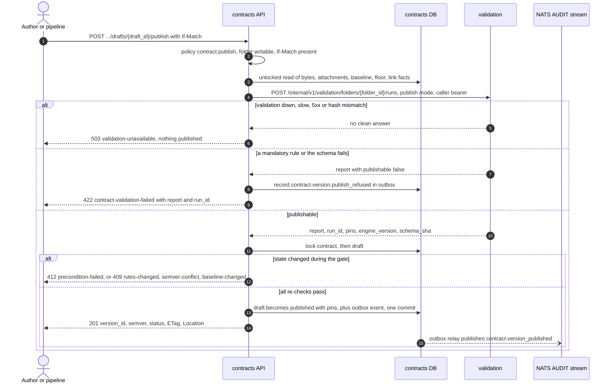
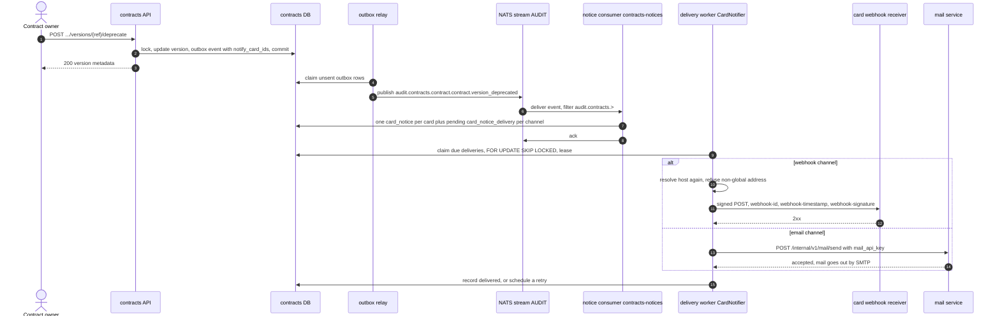

# 03 · Contracts and their lifecycle

> **In short.** The `contracts` service stores ODCS data contracts inside folders of any kind. It keeps
> every version exactly as the author sent it. A contract moves from editable **drafts** to
> immutable **published versions**. One version is the **Latest**; newer ones are **Previews**;
> lower ones are **older**. A draft can only be published after the `validation` service says
> it passes every mandatory rule. Consumers fetch versions by `latest` or by SemVer.
> **Subscriber cards** record which versions a consuming team depends on. The service warns them
> by webhook or email when those versions change.

*Edit these diagrams: [drawio/03-contracts-and-lifecycle.drawio](drawio/03-contracts-and-lifecycle.drawio)
(pages: lifecycle states, publish flow, notifications).*

Every route on this page starts with the service prefix `/api/v1/contracts`. A contract is
therefore at `/api/v1/contracts/contracts/{contract_id}`. To keep the text short, the tables
below leave out the prefix.

Related pages: [01 System overview](01-system-overview.md) ·
[02 Identity and access](02-identity-and-access.md) (permissions and folder scopes) ·
[04 Validation and rules](04-validation-and-rules.md) (the publish gate and the diff rules) ·
[05 Audit and events](05-audit-and-events.md) (outbox, NATS, access events) ·
[06 Platform and operations](06-platform-and-operations.md).

---

## 1. What a contract is

A **data contract** is a YAML or JSON document in the
[Open Data Contract Standard (ODCS)](https://bitol-io.github.io/open-data-contract-standard/).
It describes a dataset: its schema (tables and columns), its owner, its quality expectations and
its servers. The service accepts ODCS `apiVersion` **`v3.1.0`** and **`v3.2.0`**. Each document
must also have `kind: DataContract` and a string `id`.

In the database, a contract has two tables:

| Table | One row per | Main columns |
|---|---|---|
| `contract` | contract | `folder_id`, `ancestor_ids`, `organization_id` (copied from identity's folder facts, never from the client), `odcs_id`, `latest_version_id`, `version_counter`, `deleted_at`, `attachments_revision` |
| `contract_version` | draft or version | `state` (`draft`, `published`, `unpublished`), `raw_document` (bytes), `media_type`, `content_sha256`, `size_bytes`, `document` (JSONB), search fields, `semver` and its parts, `is_latest`, deprecation fields, and the validation pins |

### Byte-faithful storage

The service stores the document **byte for byte**:

- `raw_document` holds exactly the bytes the author sent. YAML comments, key order, quoting and
  line endings all stay. `content_sha256` is the SHA-256 of those bytes.
- `document` is a **JSONB** copy of the parsed document. It is derived from the bytes and used
  for search, references, diffs and validation.
- The document endpoints return the raw bytes by default. Only when the client asks for the
  other format with `Accept` (YAML ↔ JSON) does the service convert them. A conversion is not
  byte-faithful and gets its own ETag (`"<sha>-json"` or `"<sha>-yaml"`).
- The service never writes its own metadata into the document.

### Why the lifecycle state lives outside the document

ODCS has its own `status` field (`proposed`, `draft`, `active`, `deprecated`, `retired`). That
field belongs to the author and does not map one-to-one to the platform's lifecycle. The
lifecycle (draft, published, unpublished, Latest, deprecated, sunset date) is stored in
**columns next to the document**. That way the stored bytes never change when a version is
promoted, unpublished or deprecated. Consumers can rely on the bytes and the ETag staying the
same.

*Where in the code:* `contracts/src/dc_contracts/models.py` (`Contract`, `ContractVersion`).

---

## 2. The ingest pipeline (dc-odcs)

Every route that accepts document content uses the same pipeline. That covers upload, draft save,
the template routes, the starter and copies. The pure part lives in the shared library `dc-odcs`
(`dc_odcs.gate.parse_contract`). The service runs it in a worker thread (`asyncio.to_thread`)
so that parsing never blocks the event loop.

Step by step:

1. **Authenticate and authorise first.** The route's policy runs before any byte of the body
   is read. An anonymous client cannot make the service buffer or parse anything.
2. **Capped body read** (`dc_core.body.read_body_capped`). A `Content-Length` above
   `DC_MAX_DOCUMENT_BYTES` (default 1 MiB) is refused at once. A streamed body is cut off as
   soon as it passes the cap. Either way the answer is **413 `payload-too-large`**.
3. **Media type.** Only `application/yaml`, `application/x-yaml`, `text/yaml` and
   `application/json` are accepted (**415 `unsupported-media-type`**). Parameters such as
   `; charset=` are dropped and the type is lower-cased. This is the only normalisation done
   at ingest time.
4. **Empty body, size and encoding.** An empty body or bytes that are not valid UTF-8 are
   **400 `malformed-document`**. A leading byte-order mark is skipped for parsing only. The
   stored bytes and the hash keep it.
5. **Strict parse.** JSON uses a strict loader. YAML uses `StrictCLoader`, a safe libyaml loader
   with YAML 1.1 surprises turned off:
   - `yes`, `on`, `0755` and `12:30` stay strings;
   - duplicate keys, merge keys (`<<`), anchors and aliases are refused, so an "alias bomb" is
     never expanded;
   - nesting deeper than 128 levels is refused before it is parsed.
   Any parse error is **400 `malformed-document`**, with the line and column when known.
6. **Mapping root.** The document must be an object, not a list or a scalar.
7. **JSON-native walk.** The service walks the whole tree without recursion. It refuses anything
   PostgreSQL JSONB cannot store faithfully:
   - **NUL characters** (`U+0000`) in keys or values;
   - lone UTF-16 surrogates;
   - infinite or NaN numbers;
   - non-string keys;
   - any non-JSON type.
   The problem carries a JSON Pointer to the bad node.
8. **The `apiVersion` / `kind` / `id` gate.**
   - `apiVersion` must be a supported version (**422 `unsupported-odcs-version`**).
   - `kind` must be `DataContract`, and `id` must be a non-empty string of at most 255
     characters (**422 `validation-error`**).
   Only steps 2–8 can block a create or a save.
9. **Structural report (advisory).** `dc_odcs.validate.validate_structure` checks the document
   against the **vendored** ODCS JSON Schema for its *own* `apiVersion`. The schemas are
   `shared/dc-odcs/src/dc_odcs/schemas/odcs-json-schema-v3.1.0.json` and `-v3.2.0.json`. The
   service never fetches a moving "latest" URL. The report goes into the response as
   `structural_validation`. Schema errors **do not** block a save. They do block a *publish*,
   because the validation service runs the same schema check (section 4).
10. **Store.** The raw bytes, the media type, the hash, the size, the JSONB document and the
    search fields go into `contract_version`. The search fields are `name`, `domain`, `status`,
    `tags`, the description text and the ODCS `version`. One metadata-only audit event is
    recorded (`contract.created`, `contract.draft_updated`, and so on). Its ids, ODCS id, version,
    media type, hash and size are listed in the model's `__audit_fields__` allow-list. The
    document itself is never in an event, because `customProperties` may hold secrets or personal
    data.

After a save commits, the six routes that create or change a draft also add an advisory
**`validation`** field. It holds a save-mode report from the validation service. When validation
is slow or down, the field is just `{"status": "unavailable"}`, and the save still succeeds
(see [04](04-validation-and-rules.md)).

*Where in the code:* `shared/dc-odcs/src/dc_odcs/gate.py`, `loader.py`, `validate.py`;
`contracts/src/dc_contracts/ingest.py`, `convert.py`.

---

## 3. The version lifecycle

All drafts and versions are rows of the single table `contract_version`. A row has one of three
stored **states**:

| Stored state | Meaning |
|---|---|
| `draft` | Editable. Each save bumps a `revision` number, and the ETag is `"r<revision>"`. |
| `published` | Immutable. Visible to everyone who may read published versions. |
| `unpublished` | Hidden from consumers but kept. Only owners (`contract:publish`) still see it, so they can republish it. |

The labels consumers see are **derived** from those states, not stored
(`lifecycle.derive_status`):

| Derived status | Rule |
|---|---|
| **Latest** | The one published version that `contract.latest_version_id` points to. |
| **Preview** | A published version with a *higher* SemVer than the Latest. These are the "upcoming" versions. |
| **older** | A published version with a *lower* SemVer than the Latest. |
| **Deprecated** | A separate flag (`deprecated_at` plus `sunset_date`). Any published version can carry it, including the Latest. |

In the diagram, the paths are short forms of the routes under `/contracts/{contract_id}/`. `ID` is
a draft id and `REF` is a SemVer string.

The rules, one by one:

1. **A new contract starts as a draft.** All four create routes make the first row as a
   `draft`:
   - upload: `POST /folders/{folder_id}/contracts`;
   - `/from-template`;
   - `/starter`, a small server-made skeleton;
   - `/from-version`, a copy of another contract with a new `id`.
   Contracts live in folders of any kind (ROOT, Organization, Project or Team). An archived
   subtree is read-only (409). ODCS ids are unique per Organization scope, with one scope for
   contracts directly at ROOT.
2. **Parallel drafts.** `POST /contracts/{id}/drafts` starts another draft from a version
   (`from_version`) or a draft (`from_draft_id`). It can bump the declared version on the way
   (`bump`: `major`, `minor`, `patch` or `none`). The copy keeps the source's bytes; only the
   top-level `version` token is edited in place (`OdcsAdapter.copy_with`), so comments survive.
   A contract may have up to `DC_MAX_DRAFTS_PER_CONTRACT` drafts at the same time (default 25;
   above that, 409 `draft-limit-reached`).
3. **Saving needs `If-Match`.** `PUT .../drafts/{draft_id}` needs the draft's current ETag
   (`"r<revision>"`). Without it the answer is 428. With a stale ETag it is 412, so two editors
   cannot silently overwrite each other.
4. **Publishing turns the draft into the version in place.** The same row keeps the same id.
   Its state becomes `published` and it gets its SemVer columns. Details are in section 4.
5. **SemVer rules** (`lifecycle.validate_publish`).
   - The document's `version` must be a quoted SemVer 2.0.0 **string**, such as `"1.2.0"`.
     Otherwise the answer is 422 `invalid-version`.
   - It must be **strictly greater** than every published *and* unpublished version. Otherwise
     the answer is 409 `semver-conflict`.
   - Build metadata (`+build`) is ignored, and a number is never reused, even after an unpublish.
6. **First publish wins.** Two drafts may declare the same version. The first one to publish
   takes the number. The second gets 409 `semver-conflict` and must bump. The same draft
   published twice at once is safe too: the second call finds a row that is no longer a draft
   (409 `draft-already-published`).
7. **One Latest.** The **first** publish of a contract becomes its Latest automatically. Every
   later publish is above all existing versions, so it is a **Preview** until someone
   **promotes** it. The database enforces "exactly one Latest" in two ways. A partial unique
   index allows only one row with `is_latest = true` per contract. A deferred constraint trigger
   checks that `contract.latest_version_id` and the flag agree.
8. **Promote** (`POST .../versions/{ref}/promote`) moves the Latest to any published version,
   higher or lower. A higher one turns the old Latest into an older version; a lower one turns it
   into a Preview. Promote first clears the old flag, then sets the new one, and it also clears a
   deprecation on the target. Promoting the current Latest changes nothing.
9. **Unpublish** (`POST .../versions/{ref}/unpublish`) hides a version from consumers. It is
   refused with 409 when the version is the current Latest (`latest-version-protected`) or when a
   subscriber card pins it (`version-pinned`). A refusal lists **every** blocker in a `reasons`
   array, and the pinning cards are named.
10. **Republish** (`POST .../versions/{ref}/republish`) brings an unpublished version back with
    the same bytes and the same SemVer. It never becomes Latest automatically.
11. **Deprecate** (`POST .../versions/{ref}/deprecate` with a `sunset_date` of today or later)
    flags a published version. The version stays fetchable. Every fetch then carries the
    `Deprecation` (RFC 9745) and `Sunset` (RFC 8594) headers.
12. **Immutability is the database's job.** The trigger `trg_contract_version_guard` only lets a
    published row change the few lifecycle columns that are on its allow-list: Latest flag,
    unpublish and deprecation fields. `trg_contract_version_no_delete` refuses every delete of a
    version row. The application checks are a second line of defence, not the only one.
13. **Write routes name a version by SemVer only.** The alias `latest` is read-only, because
    under concurrency it could point at a different row by the time the write runs.

### Soft delete, restore and the reference guards

- **Delete** (`DELETE /contracts/{contract_id}`, permission `contract:delete`) is a **soft
  delete**. Only `deleted_at` and `deleted_by` are set. Every version row and the ODCS id stay.
  The contract disappears from every read.
- **Restore** (`POST /contracts/{contract_id}/restore`, permission `contract:restore`) clears the
  two fields again.
- **Reference guard on delete.** A published version of another contract may *link* to this one.
  ODCS documents can refer to other contracts, and these links are indexed in
  `contract_reference` at publish time. While such a link exists, the delete is refused with 409
  `contract-referenced`. Linking contracts that the caller cannot see are counted
  (`hidden_referrer_count`), never named.
- **Pin guard on delete.** A card that pins any version also blocks the delete
  (409 `contract-pinned`). When both apply, the `reasons` array lists both.
- **Guards in the other direction.** Republishing a version, or restoring a contract, is refused
  with 409 `contract-referenced` if a stored link of it now points at a soft-deleted contract. The
  answer gives only a `deleted_target_count`.

### Locks

Every lifecycle write takes its locks in the same order. That is why concurrent writes cannot
break the invariants:

1. the `contract` row (`FOR NO KEY UPDATE`; `FOR UPDATE` for delete and restore);
2. the version or draft rows;
3. any linked contracts (`FOR KEY SHARE`, sorted by id).

Subscribing a card takes the same contract lock. A pin and an unpublish therefore never both
succeed.

*Where in the code:* `contracts/src/dc_contracts/versions.py`, `lifecycle.py`, `locks.py`,
`references.py`, `drafts.py`, `notation.py`; migration `migrations/versions/0005_contract_version_lifecycle.py`.

---

## 4. Publishing

`POST /contracts/{contract_id}/drafts/{draft_id}/publish` needs the permission `contract:publish`
and an `If-Match` header with the draft's ETag. The numbers below match the picture at the top of
the page.

1. **Policy and If-Match.** The caller must hold `contract:publish` on the contract's folder,
   and the folder must not be archived. A missing `If-Match` is **428**. A stale one is
   **412 `precondition-failed`**. This cheap check runs before any slow work.
2. **Unlocked reads.** Without taking any lock, the service reads:
   - the draft's bytes;
   - the contract's rule-set attachments and their `attachments_revision`;
   - the **baseline**: the highest published version, which is what the breaking-change check
     compares against;
   - the **stable major floor**: the highest major among the published non-prerelease versions;
   - the **link facts**: for each contract the document links to, whether the caller sees it as
     `published`, `unpublished_or_draft_only` or `not_found`.
   The service then ends this read transaction, so no database connection waits while the next
   step makes its network call.
3. **The validation gate** (`ValidationPublishGate`). The service first re-runs the ingest gate
   locally. Then it posts the exact stored bytes to validation's internal route
   `POST /internal/v1/validation/folders/{folder_id}/runs` in **publish mode**. The call uses
   the **caller's own bearer token**, so validation checks the caller's permissions itself.
   Validation runs the ODCS JSON Schema check, every mandatory rule set that applies to the
   folder, the attached rule sets, and the breaking-change and SemVer check against the baseline
   (see [04](04-validation-and-rules.md)). The call times out after
   `DC_VALIDATION_PUBLISH_TIMEOUT_S` (default 12 s).
   - Not publishable → **422 `contract-validation-failed`**. The body carries the full report and
     the `run_id`. The service also records one `contract.version.publish_refused` audit event.
     It holds only rule keys and codes, never document values.
   - Down, slow, 5xx, an unexpected 4xx, or an answer for different bytes (hash mismatch) →
     **503 `validation-unavailable`**. The gate **fails closed**: no verdict means no publish. If
     no gate was installed at all, the fallback `FailClosedGate` refuses as well.
4. **Locks.** Now the service locks the contract row, and then the draft row.
5. **Re-checks under the lock.** Each check answers with its own status:
   - The `If-Match` and the content hash must still match what was gated. An edit during the gate
     is **412**.
   - The `attachments_revision` must be unchanged. Someone attached or detached a rule set →
     **409 `rules-changed`**.
   - The document `id` must still be the contract's ODCS id → otherwise **422 `odcs-id-mismatch`**.
   - SemVer rules → **422 `invalid-version`** or **409 `semver-conflict`**.
   - The baseline and the floor must be unchanged. Someone else published, unpublished or
     republished meanwhile → **409 `baseline-changed`**.
   - **Link-facts re-check.** The linked contracts are locked (`FOR KEY SHARE`) and recorded in
     `contract_reference`. The link facts are then recomputed from the database. A fact that got
     *worse* since the gate is also **409 `baseline-changed`**, for example a linked version that
     was unpublished or a linked contract that was deleted. A fact that got better is accepted.
   Every 409 here means "retry". The retry validates against the new state.
6. **Write.**
   - The draft row becomes `published`, with its SemVer columns, `published_at` and
     `published_by`.
   - It also stores the **rule pins**: `validation_run_id`, `pinned_rule_sets` (the exact
     versions of every rule set used), `engine_version` and `schema_sha`. The guard trigger
     freezes them with the rest of the row. You can therefore always tell which rules a version
     passed: `GET .../versions/{ref}/validation-report` returns that stored report.
   - The first publish also sets the Latest pointer.
7. **One audit event, in the same transaction.** `contract.version_published` goes into the
   service's **outbox** table together with the row change, so it is committed atomically. It
   carries metadata only, plus `pinned_rule_sets` and two lists used for notices:
   - `notify_card_ids`: every card with an active pin on the contract;
   - `notify_pins`: which version each card pins.
   The outbox relay later publishes it to NATS on
   `audit.contracts.contract.contract.version_published`, and the audit service stores it (see
   [05](05-audit-and-events.md)).
8. **Response 201.** The body has `version_id`, `semver`, `status` (`latest` or `preview`),
   `content_sha256`, `etag` and `fetch_url`. The `Location` header points at
   `/api/v1/contracts/contracts/{id}/versions/{semver}`.
9. **Notices, later and outside the publish.** The contracts notice consumer reads the event
   back from NATS and records card notices: "a new version was published" and, when the new
   version breaks a pinned one, "a breaking version was published". The publish itself never
   calls a webhook or the mail service (section 7).

*Where in the code:* `contracts/src/dc_contracts/api/drafts.py` (`publish_contract_draft`),
`versions.py` (`publish_draft`), `validation_client.py`, `compat.py`, `link_facts.py`,
`attachments.py`.

---

## 5. Consumer fetch

Consumers fetch versions with a bearer token: a user token, a personal access token (PAT) or a
service-account key. Reading published versions needs `contract:read-published` on the
contract's folder.

| Route (after `/api/v1/contracts`) | Permission | Returns |
|---|---|---|
| `GET /contracts?q=...` | `contract:list` | Contracts the caller can see, keyset-paged, no totals. Out-of-scope rows are left out: an empty page, never a 403. |
| `GET /contracts/{contract_id}` | `contract:view` | Contract metadata and its head row: the Latest, or the newest draft before the first publish. |
| `GET /contracts/{contract_id}/versions` | `contract:read-published` | Every visible version, highest SemVer first, each with its derived `status`. |
| `GET /contracts/{contract_id}/versions/latest` | `contract:read-published` | The Latest's exact bytes. |
| `GET /contracts/{contract_id}/versions/{semver}` | `contract:read-published` | A specific version: an older one or a Preview. |
| `GET /contracts/{contract_id}/versions/{ref}/metadata` | `contract:read-published` | The metadata of one version (`latest` or SemVer). |
| `GET /contracts/{contract_id}/versions/{ref}/validation-report` | `contract:read-published` | The report the version was published with (ETag `"run-<id>"`). |
| `GET /contracts/{contract_id}/diff?from=&to=` | `contract:read-published` | The classified changes between two refs (see section 9). |
| `GET /contracts/{contract_id}/document` | `contract:read` | The head row's document (team members). |
| `GET /contracts/{contract_id}/drafts/{draft_id}/document` | `contract:read` | A draft's document (team members). |

How a fetch works:

1. **Policy first.** The caller's permission is checked against the contract's folder. An
   unknown contract and a contract you may not see give the **same 404**, so ids do not leak.
2. **Resolve the ref.**
   - `latest` is resolved in one SQL statement through `contract.latest_version_id`, so a
     concurrent promote cannot tear the read.
   - Anything else must be a strict SemVer string.
   - Published rows are visible to every reader. Unpublished rows are visible only to holders of
     `contract:publish`. A draft is never returned by a version route.
3. **Pick the format.** By default the response is the stored bytes in their stored media type.
   An `Accept` for the other format returns a conversion. An `Accept` the service cannot meet is
   406.
4. **ETag and 304.** The ETag is the SHA-256 of the bytes (`"<sha256>"`). Send it back in
   `If-None-Match` and an unchanged version answers **304** with no body. The 304 still carries
   the `ETag`, `Vary: Accept`, `Cache-Control: private, no-cache` and, for a deprecated version,
   the `Deprecation` and `Sunset` headers. The ETag check runs *after* the authorization and
   visibility checks, so a 304 never reveals anything a 404 would hide.
5. **Access event.** Every **200** that returns document content records one access event. A 304
   records none. The event is published best effort on NATS subject
   `access.contracts.contract.read` (stream `ACCESS`). Its detail holds only `contract_id`,
   `version_id` or `draft_id`, `semver`, `ref` (`latest`, the resolved SemVer, `head` or `draft`)
   and `media_type`, never content. It never slows down or breaks the read. Copying another
   contract with `/from-version` also records an access event on the *source* contract.

*Where in the code:* `contracts/src/dc_contracts/api/versions.py` (`get_contract_version`,
`_fetch_headers`), `http_cache.py`, `access_events.py`, `search.py`.

---

## 6. Templates

A **template** is a reusable starting document that an Organization, a Project or the ROOT folder
offers to the teams below it.

- A template has **one editable draft** (last write wins) and **numbered, immutable published
  versions** (`template_version`, protected by a database trigger). Publishing locks the template
  row, so version numbers never have gaps. Publishing the same draft twice returns the version
  the first call created.
- Routes: create `POST /folders/{folder_id}/templates`, list `GET /templates`, read
  `GET /templates/{template_id}`, edit `PUT /templates/{template_id}/draft`, publish
  `POST /templates/{template_id}/publish`, list versions `GET /templates/{template_id}/versions`,
  deprecate `POST /templates/{template_id}/versions/{version_no}/deprecate`.
- **Availability.** `GET /folders/{folder_id}/available-templates` lists the templates published
  in that folder's ancestors. The list is keyed on the target folder's ancestor ids from
  identity, not on the caller's own grants. A "block inheritance" flag on a grant therefore
  cannot hide an Organization template.
- **Create from template.** `POST /folders/{folder_id}/contracts/from-template` builds a new
  draft from a published template version, with a new ODCS id and optional overrides. This is
  the one place where the stored document is *re-serialised* (as JSON, without YAML comments).
  `apiVersion`, `kind` and `id` cannot be overridden (`template-override-not-allowed`). A
  deprecated version is refused (`template-version-deprecated`). The result passes the same
  ingest gate and size cap.

*Where in the code:* `contracts/src/dc_contracts/templates.py`, `api/templates.py`.

---

## 7. Subscriber cards and subscriptions

A **subscriber card** describes one consuming team or application. It records which contract
versions that team depends on and how to reach it.

### Cards and members

- **A card belongs to one folder of any kind** (Root, Organization, Project or Team). Create one with
  `POST /folders/{folder_id}/cards` (`card:create`). A card has a `name`, a `description`,
  `contacts` (kinds `email`, `url`, `text`) and two channel switches, `email_enabled` and
  `webhook_enabled`. Its creator and the folder's admins manage it (`PATCH /cards/{card_id}`,
  `POST /cards/{card_id}/archive`).
- **Cards are invisible to outsiders.** Anyone who cannot read the card's folder gets the same
  404 for an existing card as for a missing one, even during an identity outage. Nobody can
  probe which card ids exist.
- **Members.** A manager can link local groups, Entra groups and service accounts
  (`POST /cards/{card_id}/members`), after identity confirms they exist (422 `invalid-member`).
  Members can read the card and manage its pins, but cannot manage the card itself (403).

### Pinned versions

- **Subscribe** (`POST /cards/{card_id}/subscriptions` with `contract_id` and `version`) pins
  one concrete **published** version.
  - The acting person or service must already be allowed to read that version
    (`contract:read-published`).
  - A pin records a **dependency, not access**. It never grants anyone the right to fetch the
    contract.
- **Move** (`.../subscriptions/{subscription_id}/move`) switches a pin to another version.
  **Unsubscribe** (`.../unsubscribe`) ends it.
- Pin rows are history. They are never deleted, only ended once, with a reason: `moved`,
  `unsubscribed`, `removed_by_admin` or `card_archived`. The one exception is deleting a folder:
  its purge removes ended pins of the soft-deleted contracts and archived cards that go with it
  (see "Folder deletion" under [Roles and inheritance](../api-design-decisions.md#roles-and-inheritance)).
- Pins are written under the same contract lock as the lifecycle writes.

### The owner view

- `GET /contracts/{contract_id}/subscribers` (`contract:read`) shows contract owners who depends
  on each version. For each active pin it gives only the card's name, description, contacts, pin
  time and pinner. It never shows members, channels, webhook URLs or the card's pins on other
  contracts.
- An owner with `contract:publish` can remove a pin with a reason
  (`POST /contracts/{contract_id}/subscriptions/{subscription_id}/remove`). The card is told.

### The unpublish guard

A pinned version cannot be unpublished (409 `version-pinned`), and a contract with pins cannot be
deleted (409 `contract-pinned`). The refusal names every pinning card, across organizations, so
the owner knows whom to talk to. A refused unpublish is still recorded as
`contract.version_unpublish_blocked`, so the pinning cards get a notice. These notices are
throttled to one per card and version per `DC_BLOCKED_NOTICE_COOLDOWN_S` (default one day).

### Notices: from event to webhook or email

The numbers match the picture above.

1. **A lifecycle write commits** one audit event in the contracts **outbox**, in the same
   transaction as the change. The event lists the cards to tell (`notify_card_ids`), read under
   the contract lock. Nothing is sent yet, and nothing is written to a notice table inside the
   lifecycle write. These events lead to notices:

   | Action | Notice type |
   |---|---|
   | `contract.version_published` | `contract.version.published`, plus `contract.version.breaking_published` |
   | `contract.version_promoted` | `contract.latest.changed` |
   | `contract.version_deprecated` | `contract.version.deprecated` |
   | `contract.version_unpublish_blocked` | `contract.version.unpublish_blocked` |
   | `card.subscription_removed` | `card.subscription.removed` |

2. **The outbox relay** publishes the event to NATS JetStream, stream `AUDIT`, on a subject under
   `audit.contracts.>`.
3. **The notice consumer** (`notice_consumer.py`) is the durable pull consumer
   `contracts-notices` on stream `AUDIT`, filter `audit.contracts.>`. Every contracts replica
   runs it, and they share the work. The NATS permissions in `infra/nats/nats.conf.tmpl` let
   contracts create exactly this consumer and nothing else. The consumer hands each event to
   `notices.handle_payload`.
4. **Materialise.** `handle_payload` writes **one `card_notice` per card and event**. A unique
   dedupe key such as `event:<event_id>` keeps a redelivered event from creating a second notice.
   It also writes one pending `card_notice_delivery` row per channel the card has enabled.
   - For a publish, the consumer also compares each pinned version with the new one, using the
     same diff classifier as validation. Cards whose pinned version the new one breaks get a
     separate `contract.version.breaking_published` notice. It lists at most 50 changes per
     pinned version and a diff URL.
   - Payloads carry identifiers, SemVer and change codes only. Document text, contacts and
     members are refused by a forbidden-key list.
   - Cards can read their notices at `GET /cards/{card_id}/notices`.
5. **The delivery worker** (`CardNotifier`, `delivery.py`) runs in one replica at a time; it holds
   the advisory lock `dc-card-notifier`.
   - Every `DC_NOTIFY_POLL_INTERVAL_S` it claims due deliveries with `FOR UPDATE SKIP LOCKED` and
     leases them (`DC_NOTIFY_LEASE_S`, 120 s).
   - It sends each one **outside any transaction**, then records the result in a second short
     transaction.
   - Failures retry on `DC_NOTIFY_RETRY_SCHEDULE_S` (default 1 min, 5 min, 30 min, 2 h, 6 h,
     12 h, with jitter) up to `DC_NOTIFY_MAX_ATTEMPTS` (7), then the delivery is `failed`. A
     failure never switches off the card's channel.
6. **Webhook channel.** The worker sends a signed POST in the
   [Standard Webhooks](https://www.standardwebhooks.com/) format:
   - headers `webhook-id: msg_<delivery id>`, `webhook-timestamp` and `webhook-signature`;
   - one `v1` HMAC signature per valid secret, so receivers keep working during a secret
     rotation.
   The secret (`whsec_...`) is shown **once**, when the webhook is enabled or the secret is
   rotated with `POST /cards/{card_id}/webhook-secret`. Both need an interactive sign-in; PATs and
   service-account keys are refused. In the database the secret is Fernet-encrypted with the
   `webhook_secret_key` Docker secret.
7. **Email channel.** The worker renders a plain-text email. It POSTs it to the **mail
   service** at `DC_MAIL_URL` + `/internal/v1/mail/send`, authenticated with the notifier service
   account's key (the `mail_api_key` Docker secret). The recipients are the card's email
   contacts, read at send time. The mail service talks SMTP and never retries; the contracts
   worker owns the retries. In local development the SMTP server is Mailpit.

### The sunset scheduler

`SunsetScheduler` (`scheduler.py`) warns pinned cards before a deprecated version's sunset.

- Every `DC_SUNSET_SCAN_INTERVAL_S` (default one hour), one replica runs a scan; it holds the
  advisory lock `dc-card-sunset`.
- The scan writes a `contract.version.sunset_approaching` notice per active pin and lead time.
  The lead times are `DC_SUNSET_LEAD_DAYS`, by default 30 and 7 days, and dates are UTC.
- A missed scan sends only the closest lead time, not every earlier one.
- The notice goes straight into `card_notice`, with no outbox event, and is delivered by the
  same worker.

### SSRF protections for webhooks

A webhook URL is chosen by a user, so the service treats it as untrusted. The risk is
server-side request forgery (SSRF): using the service to reach internal hosts.

- **On save** (`PATCH /cards/{card_id}`): the URL must be `https`, must have no user info, and
  its host must resolve only to **globally routable** addresses. Private, loopback, link-local
  and multicast addresses are refused.
- **On every attempt** the worker resolves the host again (`check_resolved_host`), because DNS
  answers can change. A bad address is recorded as `ssrf-blocked`, and a name that does not
  resolve as `dns-error`. In both cases no connection is opened.
- The request connects to the **validated IP address**, with the `Host` header and TLS SNI still
  set to the hostname (`pinned_request_parts`). A second DNS lookup cannot redirect it.
  Redirects are not followed.
- `last_error` holds only a code from a fixed list, never a response body, URL or secret.
- In local development, `compose.yaml` allows the `webhook-sink` host
  (`DC_WEBHOOK_ALLOWED_PRIVATE_HOSTS`) and plain HTTP (`DC_WEBHOOK_REQUIRE_HTTPS=false`).
  Production leaves the allow-list empty and requires HTTPS.

*Where in the code:* `contracts/src/dc_contracts/cards.py`, `api/cards.py`, `subscriptions.py`,
`pins.py`, `notices.py`, `notice_consumer.py`, `delivery.py`, `webhooks.py`, `mailer.py`,
`scheduler.py`; `infra/nats/nats.conf.tmpl`.

---

## 8. Rule-set attachments, in one paragraph

A contract owner can attach extra rule sets to a contract, beyond the mandatory ones its folder
already enforces:

- list them with `GET /contracts/{contract_id}/rule-sets`;
- attach or re-pin one with `PUT /contracts/{contract_id}/rule-sets/{rule_set_id}`;
- detach one with `DELETE /contracts/{contract_id}/rule-sets/{rule_set_id}`.

Every change bumps `contract.attachments_revision`. That is why a publish that raced with a
change answers 409 `rules-changed`. Rule sets themselves are explained in
[04](04-validation-and-rules.md).

---

## 9. Version diffs and compatibility (overview)

The service can compare two documents and classify every change as **breaking**,
**non-breaking** or **informational**.

- **First normalise.** Lists such as `schema[]` and `properties[]` are keyed by name, so
  reordering them is not a change.
- **Then walk.** The classifier walks both documents and classifies each difference with a fixed
  rule table (`dc_odcs.diff`, classifier version `odcs-compat-1`).

The service uses it in three places:

1. **At publish**, validation compares the draft with the baseline. A breaking change without a
   new major version above the stable major floor is a blocking finding
   (`semver-breaking-change`), so the publish answers 422. There is no override.
2. **On demand**, `GET /contracts/{contract_id}/diff?from=&to=` returns the classified changes
   between two refs: SemVer, `latest`, or a draft id for team members. The response includes the
   `required_bump` (`major`, `minor`, `patch` or `none`). It is computed on the fly, never stored,
   and paged with a cursor.
3. **For notices**, the breaking-change notice compares each pinned version with the newly
   published one (section 7).

The rule table, the floor logic and the report format are described in
[04 Validation and rules](04-validation-and-rules.md).

*Where in the code:* `shared/dc-odcs/src/dc_odcs/diff/`, `contracts/src/dc_contracts/diffs.py`,
`compat.py`.
