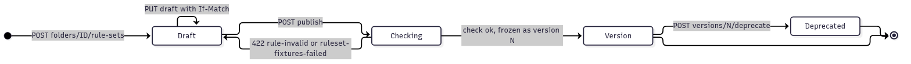
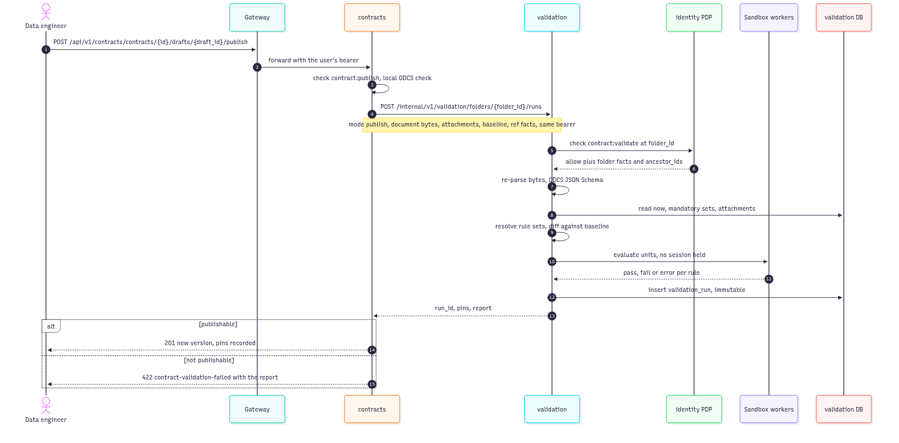
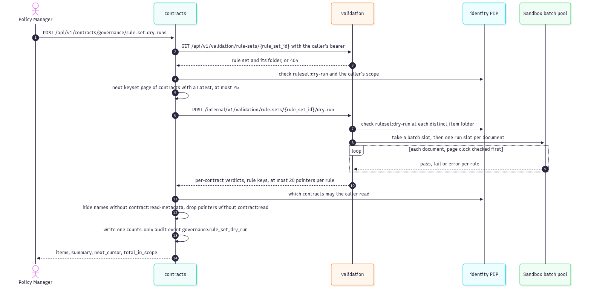

# 04 · Validation and rules

> **In short.** The `validation` service decides whether a contract may be published. Policy
> Managers write **rules** as data: a JSONPath target that picks parts of the contract, plus a CEL
> condition that must be true for each part. Rules are grouped into versioned **rule sets**. A
> **mandatory** rule set applies to its folder and to every folder below it. Rules run in separate
> worker processes with hard limits. If anything goes wrong, the answer is "no", never "yes".



Edit the diagrams on this page: [drawio/04-validation-and-rules.drawio](drawio/04-validation-and-rules.drawio)
(pages: *Mandatory inheritance*, *Sandbox*, *Dry run*).

Related pages: [01 System overview](01-system-overview.md) ·
[02 Identity and access](02-identity-and-access.md) (permissions and the folder tree) ·
[03 Contracts and lifecycle](03-contracts-and-lifecycle.md) (drafts, publish, versions) ·
[05 Audit and events](05-audit-and-events.md).

---

## Contents

1. [What a rule is](#1-what-a-rule-is)
2. [Rule sets](#2-rule-sets)
3. [Mandatory inheritance](#3-mandatory-inheritance)
4. [The sandbox](#4-the-sandbox)
5. [The validation run](#5-the-validation-run)
6. [Semantic checks](#6-semantic-checks)
7. [Error codes](#7-error-codes)

Some terms used on this page:

| Term | Meaning |
|---|---|
| **ODCS** | Open Data Contract Standard, the YAML or JSON format of every contract. |
| **JSONPath** | A query language that selects nodes in a JSON document (RFC 9535), for example `$.schema[*]` for every table. |
| **JSON Pointer** | An exact address of one node (RFC 6901), for example `/schema/0/properties/1`. Reports use it to say *where* a problem is. |
| **CEL** | Common Expression Language. A small language for true/false conditions. It cannot loop forever, read files or call the network. |
| **Rule set** | A named group of rules. It has one editable draft and immutable numbered versions. |
| **Mandatory** | A flag on a rule set: it applies to its folder and to every folder below it. |
| **Warn / enforce** | The mode of a mandatory version. `warn` reports problems but never blocks. `enforce` blocks a publish. |
| **Sandbox** | The pool of worker processes that run rules, with time and memory limits. |
| **Fail closed** | When the system cannot decide, it refuses. An error is never treated as a pass. |
| **PDP** | Policy decision point: identity's authorization check (`POST /internal/v1/authz/check`). |

---

## 1. What a rule is

A rule is **data, not code**. Nobody can upload a script. Each rule has:

| Field | What it does |
|---|---|
| `key` | A stable name inside the set, lower case with dashes (`^[a-z][a-z0-9-]{0,62}$`). |
| `target` | A JSONPath that selects the nodes to check. The default is `$` (the whole document). |
| `condition` | A CEL expression. It must be `true` for a node to pass. |
| `severity` | `error`, `warning` or `info`. Only `error` can block a publish. |
| `message` | A fixed text that the author writes. It is shown when the rule fails. |
| `match` | `each` (every node must pass, the default) or `any` (at least one node must pass). |
| `on_empty` | What happens when the target matches nothing: `pass` (default) or `fail`. |
| `fixtures` | Example documents: at least one that must **pass** and one that must **fail**. They prove the rule works before it can be published. |
| `description` | Optional notes for other authors. |

A rule set also declares `dsl_version`. New drafts are always `cel-2`. The older `cel-1` exists
only so that old published versions keep working exactly as before.

### Worked example

This rule says: "every column (ODCS `property`) must have a description". It is shaped like the
real API model (`RuleSetContent` and `RuleDef`) and can be sent as the body of
`PUT /api/v1/validation/rule-sets/{rule_set_id}/draft`:

```yaml
dsl_version: cel-2
rules:
  - key: property-has-description
    description: Every column explains what it holds.
    target: "$.schema[*].properties[*]"
    condition: >-
      type(this) == map
      && has(this.description)
      && type(this.description) == string
      && this.description.trim() != ''
    severity: error
    message: Every property needs a non-empty description.
    match: each
    on_empty: pass
    fixtures:
      pass:
        - document:
            schema:
              - name: orders
                properties:
                  - {name: id, logicalType: string, description: Order id}
      fail:
        - document:
            schema:
              - name: orders
                properties:
                  - {name: id, logicalType: string}
```

Now take this small contract:

```yaml
apiVersion: v3.1.0
kind: DataContract
id: orders-contract
version: 1.0.0
status: active
schema:
  - name: orders
    properties:
      - name: id
        logicalType: string
        description: Order id
      - name: amount
        logicalType: number
```

How the rule is evaluated:

1. **Select.** The target `$.schema[*].properties[*]` finds two nodes:
   `/schema/0/properties/0` (`id`) and `/schema/0/properties/1` (`amount`).
2. **Bind.** For each node, the engine binds the node to the variable `this`. It also binds
   `contract` (the whole document) and `ctx` (the folder kind, path and organization). `cel-2`
   rules also see `ctx.operation` (`save` or `publish`) and `previous` (the last published version), `changes` (the classified changes
   since then) and `refs` (reference facts, see [section 6](#6-semantic-checks)).
3. **Evaluate.** For `id` the condition is `true`, so it passes. For `amount` there is no
   `description`, so `has(this.description)` is `false` and the condition is `false`.
4. **Report.** The result is one finding. It has `outcome: fail`, the author's `message`, and the
   location `{"pointer": "/schema/0/properties/1", "path": "$['schema'][0]['properties'][1]"}`.
   The rule's outcome is `fail`. Because `severity` is `error`, the finding blocks if the rule set is
   enforced or attached.

**Why the guards (`type(this) == map && has(...)`) matter.** In CEL, reading a field that does not
exist is an **error**, not `false`. For example, `this.description != ''` on `amount` gives
`no_such_key`. An error is its own outcome (see below), and in a rule that would block, an error
blocks too. Good rules therefore check `has(...)` and the type first. The platform's own rules all
do this.

**Three outcomes, never two.** Every rule ends as `pass`, `fail` or `error`. An error is never
counted as a pass. One bad node does not stop the others: the engine keeps going and reports each
node.

**Safety built into the languages.**

- CEL runs regular expressions with RE2, which has no catastrophic backtracking.
- CEL has an iteration budget. A huge nested loop stops with `budget_exceeded`.
- The JSONPath `match()` and `search()` functions are removed. They use Python regular expressions,
  which can backtrack for a very long time. Authors use CEL `matches()` instead.
- A target may match at most 10,000 nodes (`max_matches`). If the condition reads the whole
  document (`contract` or `previous`), the limit is 100 (`max_matches_with_contract`). More is
  `too_many_matches`.
- `cel-2` adds one pure helper, `dc.type_coherent(logicalType, physicalType)`. It checks that, for
  example, a `string` column is not declared as `int`.

Where in the code: `shared/dc-rules/src/dc_rules/model.py` (the rule model),
`shared/dc-rules/src/dc_rules/evaluator.py` (one rule against one document),
`shared/dc-rules/src/dc_rules/cel_engine.py` (CEL), `shared/dc-rules/src/dc_rules/targets.py`
(JSONPath), `shared/dc-rules/src/dc_rules/functions.py` (`dc.*` helpers).

---

## 2. Rule sets

A rule set lives in a folder (any level: ROOT, Organization, Project or Team), or in the special
**platform** scope, which has no folder.



### Draft and versions

1. A Policy Manager creates a rule set in a folder they manage:
   `POST /api/v1/validation/folders/{folder_id}/rule-sets` with `{name, description}`
   (`ruleset:create`). The name must be unique in the folder (409 `rule-set-name-taken`).
2. They edit the **draft**: the whole draft with `PUT .../rule-sets/{id}/draft`, or one rule with
   `PUT|DELETE .../draft/rules/{rule_key}`. Every save needs `If-Match` with the draft's `ETag`
   (`"r<draft_revision>"`); without it the answer is 428, with a stale one 412. The body may be
   JSON or YAML.
3. A draft save **never fails because of a bad rule**. It saves and returns an advisory `check`
   report. Only a body of the wrong shape (unknown fields, a missing `key`) is 422.
4. `POST .../draft/check` runs the full check again without saving anything.
5. `POST .../publish` (with `If-Match`) checks the draft in the sandbox and freezes **exactly the
   checked content** as the next numbered version. If the draft changed between the check and the
   database lock, the answer is 412. Publishing the same content twice returns the existing
   version (200) and writes nothing.

**Versions are immutable.** A database trigger refuses any change to a version's content and any
delete. A rule set with a published version can never be deleted (409 `rule-set-published`),
because contract versions may pin it (the only exception: deleting the folder that holds a rule set
that is not mandatory removes it with all its versions, see
"Folder deletion" under [Roles and inheritance](../api-design-decisions.md#roles-and-inheritance)). To retire a version, deprecate it
(`POST .../versions/{n}/deprecate`). A deprecated version stays readable and keeps working
wherever it is pinned or already enforced. It cannot be newly attached to a contract, and an
existing `latest` attachment moves on to the newest version that is not deprecated.

### The check before publish

The check runs in the sandbox (section 4), with a total budget of `DC_CHECK_BUDGET_S` (15 s).
For each rule it runs, in order:

| Step | What is checked | Problem codes |
|---|---|---|
| Static limits | Size of the condition (`max_expression_bytes`, 2048) and target (`max_target_chars`, 512), at most 200 rules, no duplicate keys, at least one rule. No engine work is done on an oversized rule. | `expression_too_large`, `target_too_long`, `too_many_rules`, `duplicate_rule_key`, `empty_rule_set` |
| Compile | The CEL condition compiles, returns a boolean, and the JSONPath is valid. Compiled size is capped (`max_compiled_bytes`). | `compile_error`, `not_boolean`, `target_invalid`, `ast_too_large` |
| Fixtures | Each `pass` fixture really passes and each `fail` fixture really fails. At least one of each, at most 5 per kind, each at most 64 KiB. | `missing_pass_fixture`, `missing_fail_fixture`, `too_many_fixtures`, `fixture_too_large`, `fixture_misbehaved`, `fixture_changes_unavailable` |
| Scale probe | The rule runs against a synthetic contract of **100 tables × 100 columns** (10,000 properties). For `cel-2` it also gets a 200-entry `changes` list and 100-entry `refs` maps. If the rule runs out of budget, time or memory there, it would not scale to real contracts. | `scale_probe_failed` |

If any problem is found, publish answers **422**. The slug is `ruleset-fixtures-failed` when every
problem is a fixture problem, otherwise `rule-invalid`. The response carries the full check report
(`ok`, `rule_set_problems`, `rules[].problems[]`). The report never contains a condition or a
fixture document.

Where in the code: `shared/dc-rules/src/dc_rules/checks.py`,
`validation/src/dc_validation/rulesets.py`, `validation/src/dc_validation/api/rulesets.py`.

### The platform rule sets

Four rule sets ship with the platform. They have `platform` scope: no folder holds them, so no
permission can exist on them, and every authoring route answers 404 for them. Their rules change
only through a new database migration. At ROOT, a caller with `ruleset:mandate` can still enforce
a version early, move its `enforce_at` date, or pause the whole set (see
[Warn first, then enforce](#warn-first-then-enforce)).

| Rule set | Rules | Mode |
|---|---|---|
| `odcs-structural` (`cel-1`) | `property-names-unique` (error), `schema-names-unique` (error), `primary-key-positions-valid` (error), `logical-type-option-bounds` (warning) | Mandatory, **enforced from version 1** |
| `odcs-consistency` (`cel-2`) | `logical-physical-coherent`, `partition-key-position`, `pii-needs-classification`, `pii-needs-retention` (warnings); `primary-key-required-unique`, `quality-element-resolves`, `relationship-target-resolves`, `sla-element-resolves` (errors) | Mandatory, starts in **warn** for `DC_MANDATORY_WARN_DAYS` |
| `odcs-references` (`cel-2`) | `linked-contract-published`, `server-reference-exists` (errors); `team-exists`, `team-member-exists` (warnings) | Mandatory, starts in **warn** |
| `odcs-publication` (`cel-2`) | Version 1: `published-status-active` (warning): at publish, the document's ODCS `status` is `active`. Version 2 adds `released-status-active` (error): a released version (no prerelease part) needs `status: active`; `published-status-active` then judges only prerelease (Preview) publishes | Mandatory; each version starts in **warn**. After version 2 is enforced, a released version without `status: active` is blocked |

Every run also checks the official ODCS JSON Schema first (the `structural` part of the report).
A schema violation always makes a contract unpublishable.

### Attaching rule sets to a contract

Besides mandatory sets, a contract owner can **attach** extra published rule sets to one contract
(contracts service, `contract:update`):

- `PUT /api/v1/contracts/contracts/{contract_id}/rule-sets/{rule_set_id}` with
  `{"version": "latest" | n}`
- `DELETE /api/v1/contracts/contracts/{contract_id}/rule-sets/{rule_set_id}`
- `GET /api/v1/contracts/contracts/{contract_id}/rule-sets`

An attached set's error-severity findings block, just like an enforced mandatory set. `latest`
means the newest non-deprecated version. A set that is already mandatory for the folder counts
once, as mandatory. You can only add rules this way, never remove a mandatory one.

### Visibility: platform and ancestors only

A contract in a folder can only use rule sets held by **the platform, its own folder or one of its
ancestors**. A rule set in a sibling branch, or below the contract's folder, is invisible.

- Authors (Policy Managers and admins) read drafts with `ruleset:read`.
- Anyone who can read a folder (editors, readers, consumers) reads the published rules that apply
  there with `GET /api/v1/validation/folders/{folder_id}/available-rule-sets` and its by-id
  variants (`ruleset:read-published`). This is on purpose: an editor must be able to read the rule
  that blocks them.
- An attachment that does not resolve (unknown, invisible, never published, missing version) is
  **never skipped**. In a stored attachment it becomes a blocking finding with `error_code`
  `unresolvable_rule_set`. In an ad-hoc `?rule_set=` on the validate route it is 422
  `rule-set-not-attachable`.

---

## 3. Mandatory inheritance


The picture shows one ROOT, one Organization, two Projects and three Teams.

1. **Platform sets apply everywhere.** `odcs-structural` is enforced for every folder.
   `odcs-consistency`, `odcs-references` and `odcs-publication` are in warn grace.
2. **A mandatory set at the Organization** (`org-naming`, enforced) applies to every Project and
   Team below it.
3. **A mandatory set at Project A** (`pii-policy`) has version 1 enforced and version 2 in warn.
   Both appear for every Team under Project A. Project B does not see it.
4. **A Team can only add.** Team A2 attaches `team-extra`. Nothing at a lower level can remove,
   pause or weaken a mandatory set from above.

### How the flag works

- A Policy Manager at the rule set's folder or above sets the flag with
  `PUT /api/v1/validation/rule-sets/{rule_set_id}/mandatory` (`ruleset:mandate`). The set must
  already have a published version (otherwise 422 `rule-set-not-published`).
- The set is found through the folder's `ancestor_ids`, which identity's PDP reports. A
  "block inheritance" flag on a folder cuts access grants only. It **never** stops a mandatory set.
- There is no override, exemption or per-contract bypass.

### Warn first, then enforce

Each published version of a mandatory set has an `enforce_at` time.

1. **Setting the flag** stamps the newest version with `enforce_at = now + DC_MANDATORY_WARN_DAYS`
   (default 14 days; `0` enforces at once).
2. **Publishing a new version** of a mandatory set stamps that version the same way.
3. **Mode is computed, never scheduled.** At each run, validation reads the database clock once.
   A version whose `enforce_at` has passed is `enforce`; one in the future is `warn`.
4. **`enforce_at` can move to any date.**
   `POST /api/v1/validation/rule-sets/{rule_set_id}/versions/{n}/enforce-now` moves a warning
   version to now. On an already enforced version it does nothing.
   `PUT /api/v1/validation/rule-sets/{rule_set_id}/versions/{n}/enforce-at` (body
   `{"enforce_at": "<timestamp with a timezone>"}`) moves it to any time: a future date makes the
   version warn until then (postponing an enforced version is allowed), and now or a past date
   enforces it at once. Both need `ruleset:mandate` and are audited
   (`ruleset.enforced_early`, `ruleset.enforcement_rescheduled`). Platform sets use the same two
   routes at ROOT, under
   `/api/v1/validation/folders/{root_folder_id}/platform-rule-sets/{rule_set_id}/versions/{n}/`.
   A platform set can also be paused with
   `PUT /api/v1/validation/folders/{root_folder_id}/platform-rule-sets/{rule_set_id}/paused`
   (body `{"paused": true}`): its rules still run and report, but never block, until it is
   resumed (audited as `ruleset.paused` and `ruleset.resumed`).
5. **Clearing the flag** is the audited break-glass. It records which version was enforced
   (`cleared_enforced_version_no`). **Setting it again** restores that version as enforced at once
   and gives only newer versions a new grace period. Clear-then-set never weakens what was
   enforced.

### Which rules apply to a contract

For each mandatory set reachable from the contract's folder (platform, ROOT, …, the folder
itself):

- the **enforced** version is the newest one with `enforce_at <= now`. It can block;
- every **newer** version still in grace is added as its own `warn` entry. It is reported, but
  never blocks. No step of a rollout is skipped;
- older versions drop out once a newer one is enforced;
- the same set reached twice counts once.

Then explicit attachments and ad-hoc sets are added (always `enforce`). Everything is evaluated in
a fixed order: holder depth (platform first, then ROOT down to the folder), rule-set name, then
rule key. The same input always gives the same report.

**When a finding blocks.** `blocking` is true only for a `severity: error` finding (fail **or**
error outcome) from an enforced mandatory version, an explicit attachment, an ad-hoc set, or a
native finding (section 6). Warnings, info findings and anything from a `warn` version never
block. `publishable = structural.valid and blocking_count == 0`.

Where in the code: `validation/src/dc_validation/resolution.py` (pure, with an injected clock),
`validation/src/dc_validation/rulesets.py` (`set_mandatory`, `enforce_now`, `load_mandatory`).

---

## 4. The sandbox



### Why rules run in separate processes

The CEL engine cannot be interrupted once it starts an evaluation, and its memory use is not
bounded. So the **web process never loads the engine at all**. An import-linter contract ("The
validation web process never loads the rule engine") and a subprocess test enforce this. Rules run
in long-lived worker processes (`python -m dc_rules.worker`) that talk to the web process with one
JSON line per message over stdin and stdout. Workers never touch the network or a database.

### How a request flows through the sandbox

The numbers match the picture.

1. **Queue.** A run asks for a run slot. At most `DC_MAX_CONCURRENT_RUNS` (4) runs hold the
   sandbox at once. A run waits up to `DC_QUEUE_WAIT_S` (2 s) for a slot and a worker. If none
   frees up, the answer is **503 `validation-unavailable`** with `Retry-After: 1`. A busy sandbox
   is never a pass.
2. **Evaluate.** The run sends its rules (units) to one of `DC_EVAL_WORKERS` (2) workers. The
   worker writes a `start` marker before each unit and a result after it.
3. **Watch the clock.** Each unit has a deadline of `DC_RULE_TIMEOUT_MS` (500 ms), measured in the
   worker's own CPU time where Linux reports it (`/proc/<pid>/stat`). A worker that is only slow
   because the host is busy gets more time, up to a hard wall-clock cap of 8 × the timeout.
4. **Kill and respawn.** A worker that burns its time is killed. The unit named by the last `start`
   marker becomes `timeout`. A fresh worker is started and gets the remaining units. If a worker
   dies before it starts any unit, the job is retried once on a fresh worker, so rule 1 is not
   blamed for an infrastructure failure.
5. **Results.** Results go back to the run. When the whole run's budget `DC_RUN_BUDGET_S` (5 s) is
   spent, every unit that has not run yet becomes `run_budget_exceeded`. A rule is never silently
   skipped.

### Limits on a worker

| Limit | Setting (default) | What happens |
|---|---|---|
| Memory | `DC_WORKER_MEMORY_BYTES` (1 GiB, `RLIMIT_AS`, Linux only) | The unit becomes `memory_exceeded`. |
| CPU per job | `RLIMIT_CPU`, re-armed before every job | The worker dies; the unit becomes `timeout`. |
| Per-rule deadline | `DC_RULE_TIMEOUT_MS` (500) | Kill, respawn, `timeout`. |
| Run budget | `DC_RUN_BUDGET_S` (5) | Units left over become `run_budget_exceeded`. |
| CEL iteration budget | built into the engine | `budget_exceeded`. |
| Recycling | `DC_WORKER_MAX_JOBS` (200) | A worker is replaced after 200 jobs. |
| Start-up | `DC_WORKER_READY_TIMEOUT_S` (5) | A worker that does not start is 503. |
| Batch pool | `DC_BATCH_SLOTS` (below `DC_EVAL_WORKERS`) | Dry-run and drift pages use a smaller pool, so at least one worker is always left for save and publish. |

No database session or lock is held while the sandbox runs. Every error is a **fixed text per
code**. The engine's own error text is never shown, because it could echo values from the
document.

Where in the code: `validation/src/dc_validation/sandbox.py`,
`shared/dc-rules/src/dc_rules/worker.py`, `shared/dc-rules/src/dc_rules/protocol.py`,
`validation/src/dc_validation/settings.py`.

---

## 5. The validation run

A **run** checks one document at one folder and returns a report. The same pipeline serves three
callers:

| Mode | Who calls | Stored? |
|---|---|---|
| `save` | contracts, when a draft is saved (advisory), and `POST .../drafts/{draft_id}/validate` | No |
| `publish` | contracts, at the publish gate | **Yes, forever and immutable** |
| on demand | `POST /api/v1/validation/folders/{folder_id}/validate` (raw YAML or JSON upload) | No |



1. **The caller's own bearer.** contracts forwards the end user's token. Validation checks
   `contract:validate` itself through identity's PDP. contracts never acts with its own
   authority.
2. **Ancestry comes from identity, never from the body.** The PDP's answer carries the folder's
   kind, path and `ancestor_ids`. A caller cannot weaken governance by sending a shorter ancestor
   list.
3. **A pure function of the request.** Validation re-parses the bytes itself, and it never calls
   contracts. Everything it needs (the document, the previous version, link facts) is in the
   request. The internal routes are on the compose network only: they are not in OpenAPI and the
   gateway does not route them.
4. **Value-free reports.** Every text in a report is either the rule author's static message or a
   fixed text per error code or schema keyword. Locations are JSON Pointers. No document value is
   ever copied in. The one addition is the unknown-property structural sentence, which names the
   offending property keys (never values; at most 5 names of 64 characters, control characters
   removed, then "and N more"). A report lists at most `DC_MAX_FINDINGS` (200) findings, with
   `findings_total` and `findings_truncated`.
5. **Stored runs are immutable.** A publish run is inserted into `validation_run` with its report,
   the `pins` (every rule-set version applied), the engine version and the ODCS schema hash. A
   database trigger refuses any `UPDATE` or `DELETE`. Later,
   `GET /api/v1/contracts/contracts/{contract_id}/versions/{ref}/validation-report` returns the
   report a version was published with.
6. **Fail closed.** If validation is down, slow or busy, publish is 503 `validation-unavailable`.
   A draft save still succeeds and shows `validation: {"status": "unavailable"}`.

Where in the code: `validation/src/dc_validation/runs.py`, `validation/src/dc_validation/api/runs.py`,
`validation/src/dc_validation/report.py`, `contracts/src/dc_contracts/validation_client.py`.

---

## 6. Semantic checks

Structure is not enough. A contract can be valid ODCS and still break every consumer. Validation
adds four kinds of semantic checks.

### 6.1 Breaking changes and semver

On publish, contracts sends the previous published version as the `baseline`, and the highest
stable major version published so far as `stable_major_floor`. Validation compares the two
documents with the classifier in `dc_odcs.diff` (`classifier_version` `odcs-compat-1`):

1. **Normalise.** Lists such as `schema[]` and `properties[]` are keyed by `name`, so reordering
   is not a change.
2. **Walk** both documents and collect every difference.
3. **Classify** each difference with an explicit rule table as `breaking`, `warning` or `info`.
   A difference no row matches is `unclassified` (a warning).

Main rows of the table:

| Change | Class |
|---|---|
| Table (`object`) or column (`property`) removed | breaking |
| Table or column renamed (same `id`, new name) | breaking |
| New column that is `required: true` | breaking |
| `logicalType`, `physicalType` or `physicalName` changed | breaking |
| `required` or `unique` turned on or off | breaking |
| `primaryKey` or `primaryKeyPosition` changed | breaking |
| A bound tightened (for example `maxLength` smaller) | breaking |
| `pattern` added; `format` or `multipleOf` added or changed | breaking |
| An `enum` value removed | breaking |
| A relationship removed or pointed elsewhere | breaking |
| A server removed | breaking |
| A bound widened | warning |
| `pattern` changed or removed; `format` removed | warning |
| An `enum` value added | warning |
| `classification`, partitioning or timezone changed | warning |
| A relationship added; quality rule changed or removed; SLA changed or removed | warning |
| Server connection details changed; contract `status` changed | warning |
| Table or optional column added; quality rule, SLA or server added | info |
| `physicalType` differs only in case or spaces | info |
| `apiVersion` changed | info |
| Descriptions, tags, examples, team and support details and other documentation | info (`metadata-changed`) |

**The semver rule.** The only enforced rule is: **a breaking change needs a new major version.**
The declared major must be above `stable_major_floor`. If it is not, validation adds the **native
finding** `semver-breaking-change` (location `/version`), which tells you the smallest passing
version, for example `2.0.0`. While only prereleases exist (`floor` is `null`), any version
passes and the changes are still listed. Warning changes suggest a minor bump and info changes a
patch bump, but these are advice only.

Native findings belong to the platform, not to a rule set (`source: "native"`, `rule_set` all
null). They always block, are listed first, and nothing can switch them off. In publish mode, a
baseline that cannot be compared gives the native finding `compatibility-unavailable`, so the gate
fails closed.

The report's `compatibility` section lists up to 200 changes with name-keyed paths
(`schema.orders.properties.amount`), JSON Pointers into both documents, and `before` / `after`
values only for a short allow-list of structural attributes. Descriptions and other free text never
appear.

### 6.2 Cross-field and reference-integrity checks

`cel-2` rules can read three extra bindings:

- `previous`: the baseline document (or `null`);
- `changes`: the full classified change list;
- `refs`: **reference facts** that validation builds once per run, before any rule runs. There are
  five maps: `elements` and `servers` (resolved inside the document), `contracts` (link facts sent
  by contracts), and `principals` and `teams` (asked of identity with the caller's token, cached
  for `DC_PRINCIPAL_CACHE_TTL_S`, 45 s). Each value is `found`, `not_found` or `unverifiable`.
  **Only `not_found` can fail a rule.** At most `DC_MAX_REFS_PER_KIND` (200) are resolved per kind;
  the rest are `unverifiable`.

`cel-2` rules also read `ctx.operation`, `"publish"` in the publish gate (and in the batch dry-run
and drift evaluations, which judge stored versions as the gate would) and `"save"` in a draft save
and every on-demand validation. It is the run's server-side mode, never a caller value, and
`cel-1` rules never see it. The seeded set `odcs-publication` uses it: its rules fire only in
publish runs. Version 2 also reads the document's own ODCS `version`, which is the SemVer contracts
publishes. A released version without `status: active` is the error `released-status-active`. A
prerelease one gets the warning `published-status-active`.

The seeded sets `odcs-consistency` (cross-field: keys, PII, type coherence, element references)
and `odcs-references` (links, teams, members, servers) use these bindings.

### 6.3 Version diffs

`GET /api/v1/contracts/contracts/{contract_id}/diff?from={ref}&to={ref}` runs the same classifier
between any two versions (or drafts) the caller can read. It is computed on the fly, never stored,
and paged (`limit`, `cursor`). It returns `required_bump`, `counts` and the `changes`.

### 6.4 Rule dry-run and drift

Before a Policy Manager makes a rule set mandatory, they want to know: *"Which published contracts
would this block?"* After rules change, they want to know: *"Which contracts no longer pass the
rules now in force?"*



- **Dry-run**: `POST /api/v1/contracts/governance/rule-set-dry-runs` with
  `{rule_set_id, version: n | "draft", folder_id?, cursor?}` (`ruleset:dry-run` at the rule set's
  folder; a draft also needs `ruleset:read`). Each contract's Latest version is evaluated **as if
  the version were enforced**. The summary counts `would_fail`, `would_error` and `pass`.
- **Drift**: `GET /api/v1/contracts/governance/drift?folder_id=&cursor=`
  (`governance:drift-read`). Each contract's Latest is evaluated against the current mandatory
  rules of its own folder. Status: `drifted` (an enforced version blocks it), `at_risk` (only
  warn versions fail) or `compliant` (counted, not listed). Items show `pinned_rule_sets` next to
  `current_versions`, so you can see which set moved.



1. contracts learns the rule set's folder from validation, with the caller's token. An unknown
   set, an unreadable one and a platform set all give the same 404.
2. contracts lists the next **keyset page** of in-scope contracts that have a Latest version
   (`DC_IMPACT_PAGE_SIZE` 25, at most 20 folders, at most 4 MiB of documents). Walking every
   `next_cursor` visits each contract exactly once.
3. validation re-checks the permission at **every** item folder and requires it to be inside the
   scope. It checks the batch caps (`DC_MAX_BATCH_ITEMS`, `DC_MAX_BATCH_BYTES`,
   `DC_MAX_BATCH_FOLDERS`) before anything else.
4. A page holds one slot of the smaller batch pool, and a run slot only while one document is
   evaluated. Before each document it checks the page budget (`DC_BATCH_PAGE_BUDGET_S`, 25 s) and
   whether the caller is still connected. So publishes are never starved.
5. Results are value-free: ids, counts, rule keys, messages and at most 20 JSON Pointers per rule.
   contracts removes pointers for callers without `contract:read`, and names for callers without
   `contract:read-metadata` (counted in `summary.hidden`).
6. Nothing is stored and no notice is sent. contracts writes one counts-only audit event per page
   (`governance.rule_set_dry_run` or `governance.drift_read`).

Where in the code: `shared/dc-odcs/src/dc_odcs/diff/` (`table.py` is the rule table),
`validation/src/dc_validation/compat.py`, `validation/src/dc_validation/facts.py`,
`validation/src/dc_validation/batch.py`, `validation/src/dc_validation/api/impact.py`.

---

## 7. Error codes

### Rule outcomes and `error_code`

A finding with `outcome: error` carries one of these codes and a fixed message. In a rule that
would block, an error blocks too.

| `error_code` | Meaning | What to do |
|---|---|---|
| `no_such_key` | The condition read a field that does not exist. | Rule author: guard with `has(...)`. |
| `type_error` | An operator got values of the wrong type. | Rule author: guard with `type(x) == ...`. |
| `invalid_argument` | A function got an invalid argument. | Rule author: check the inputs. |
| `not_boolean` | The condition did not return true or false. | Rule author: make it boolean. |
| `budget_exceeded` | The CEL iteration budget ran out. | Rule author: narrow the target so each node does less work. |
| `memory_exceeded` | The worker hit its memory limit. | Rule author: simplify the rule. |
| `timeout` | The rule ran longer than `DC_RULE_TIMEOUT_MS`. | Rule author: simplify; avoid scanning `contract` from every node. |
| `run_budget_exceeded` | The whole run ran out of time before this rule. | Retry; if it repeats, tell the operators or the rule authors. |
| `too_many_matches` | The target matched more nodes than allowed. | Rule author: narrow the target. |
| `target_error` | The target could not run on this document (for example too deeply nested). | Check the document's shape. |
| `engine_error` | An unexpected engine error. | Report it to the operators. |
| `unresolvable_rule_set` | An attached rule set could not be found or is not visible (`rule_key` `*`). | Contract owner: fix or detach the attachment. |

### Problem slugs (HTTP errors)

All errors use RFC 9457 problem details. The `type` ends with the slug.

| Status | Slug | When | What to do |
|---|---|---|---|
| 422 | `contract-validation-failed` | Publish refused: the report is not publishable. The body carries the report and the run id. | Fix the blocking findings, or bump the major version for `semver-breaking-change`. |
| 503 | `validation-unavailable` | The sandbox is busy (`Retry-After: 1`), or validation cannot be reached. | Retry after the given time. |
| 503 | `service-unavailable` | Identity could not be reached. | Retry later. |
| 409 | `rules-changed` | The contract's attachments changed during the publish. | Retry the publish. |
| 409 | `baseline-changed` | The previous version or link facts changed during the publish. | Retry the publish. |
| 413 | `payload-too-large` | Document over `DC_MAX_DOCUMENT_BYTES` (1 MiB), or draft over `DC_MAX_DRAFT_BYTES`. | Make it smaller. |
| 415 | `unsupported-media-type` | Not `application/yaml` or `application/json`. | Fix the `Content-Type`. |
| 422 | `malformed-document` | Not valid YAML or JSON. | Fix the syntax. |
| 422 | `unsupported-odcs-version` | `apiVersion` is not a supported ODCS version. | Use a supported version. |
| 422 | `validation-error` | The body does not have the expected shape. | Read the JSON pointers in the problem. |
| 422 | `rule-invalid` | Rule-set publish refused: compile, size or scale problems. | Read the `check` report and fix the rules. |
| 422 | `ruleset-fixtures-failed` | Rule-set publish refused: only fixture problems. | Fix the fixtures or the condition. |
| 422 | `rule-set-not-attachable` | An attached or ad-hoc rule set is not published and visible at this folder. | Use a set from this folder, an ancestor or the platform. |
| 422 | `rule-set-not-published` | Making a set mandatory before it has a version. | Publish a version first. |
| 409 | `rule-set-not-mandatory` | `enforce-now` on a version with no `enforce_at`. | Make the set mandatory first. |
| 409 | `rule-set-name-taken` | A rule set of that name already exists in the folder. | Choose another name. |
| 409 | `rule-set-published` | Deleting a rule set that has a version. | Deprecate the version instead. |
| 409 | `folder-archived` | The folder is archived and read-only. | Unarchive it first. |
| 428 | `precondition-required` | A draft write or publish without `If-Match`. | Send the current `ETag`. |
| 412 | `precondition-failed` | The draft changed since you read it. | Reload and retry. |
| 404 | `not-found` | Unknown, invisible, or a platform rule set on an authoring route. | Check the id and your access. |

Where in the code: `shared/dc-rules/src/dc_rules/ports.py` (`ErrorCode`, `ERROR_MESSAGES`); the problem
types are in the [API guide](../../user/api-guide.md#errors-rfc-9457-problem-details), every route in the
[HTTP API reference](../../user/reference/http-api.md).
