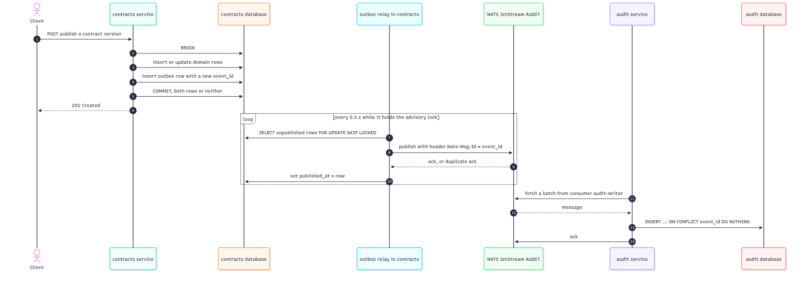
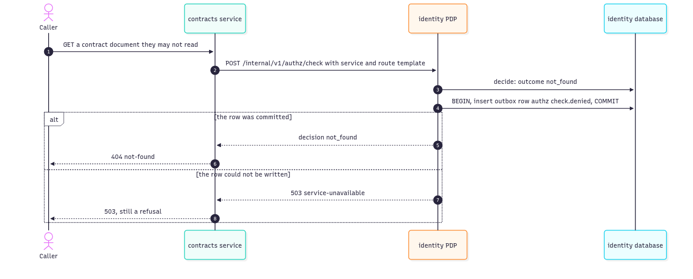
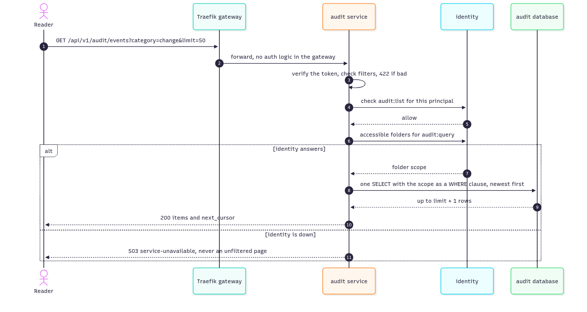

# 05 · Audit and events

> **In short.** Every change in the platform produces exactly one audit event. The event is written
> in the same database transaction as the change itself (the *transactional outbox*), so a change
> can never happen without its record. A background relay moves these events to NATS JetStream,
> and the audit service stores them, once each, in its own database. Contract reads (*access
> events*) travel a faster, best-effort path, and refused permission checks (*denial events*) are
> guaranteed. Anyone with the right role can then query the trail at `GET /api/v1/audit/events`.



*Edit this diagram: [drawio/05-audit-and-events.drawio](drawio/05-audit-and-events.drawio)*

The numbers in the picture match the steps below.

1. A service (identity, contracts or validation) handles a write. It saves the domain row **and**
   an `outbox` row in one Postgres transaction.
2. The service's **outbox relay** reads unpublished outbox rows and publishes each one to NATS
   JetStream on a subject such as `audit.contracts.contract.contract.version_published`.
3. JetStream keeps the message in the `AUDIT` stream until a consumer acknowledges it.
4. The audit service's durable consumer `audit-writer` pulls the message, checks it and inserts it
   into the `audit_event` table. A redelivered message is ignored, because `event_id` is unique.
5. A reader calls `GET /api/v1/audit/events` through the gateway. The audit service asks identity
   which folders the reader may see, and returns only those events.

Access events (blue lane) skip the outbox: contracts puts them in an in-memory queue and publishes
them to the `ACCESS` stream. Denial events (red lane) are written by identity to its own outbox,
so they follow the same guaranteed path as changes.

---

## Words used on this page

| Term | Meaning |
|---|---|
| **Audit event** | One record of something that happened: who did what, to which object, in which folder, when. |
| **Outbox** | A table in each producing service's database. An event is first written here, in the same transaction as the change. |
| **Relay** | A background task in each producing service that copies outbox rows to NATS. |
| **NATS JetStream** | The message broker. *JetStream* is the part of NATS that stores messages on disk until they are acknowledged. |
| **Stream** | A named, stored log of messages in JetStream, selected by subject (`AUDIT`, `ACCESS`). |
| **Subject** | The dotted address of a NATS message, for example `audit.identity.authz.check.denied`. |
| **Durable consumer** | A named reader of a stream. JetStream remembers which messages it has acknowledged, even across restarts. |
| **Category** | `change`, `access` or `denial`. The audit service derives it from the subject; it never trusts the producer's claim. |
| **`scope_path`** | The folder ids from ROOT down to the folder the event belongs to. It decides who may see the event. |

---

## 1. The transactional outbox

The problem the outbox solves: a service must never commit a change and then fail to record it,
and it must never record a change that was rolled back. Writing to the database and to a broker
are two separate systems, so they cannot share one transaction. The outbox makes the event part
of the database transaction, and moves it to the broker afterwards.



### How a handler writes an event

1. The route gets a **unit of work** (`UnitOfWork`, one per request). It is bound to the *actor*,
   the audit view of the verified caller. The actor always comes from the verified token, never
   from the request body or a header.
2. The handler changes rows, then calls `uow.audit(action, aggregate_type, aggregate_id,
   before=..., after=..., scope_path=...)` **once**. A second call raises an error: one business
   operation means one event.
3. `uow.commit()` flushes the domain rows, adds one outbox row (with a fresh UUIDv7 `event_id`
   and the request id) and commits.
4. Two safety nets run inside the session:
   - Every audited table carries `created_by`, `created_at`, `updated_by` and `updated_at`. They
     are stamped from the actor and the database clock just before the flush, overwriting
     anything the code set.
   - A **tripwire** runs before commit. If audited rows were written but no outbox row was added,
     the commit fails with `AuditTripwireError`. A forgotten audit call can't slip through.
5. `before` and `after` are **snapshots**: built only from each model's `__audit_fields__`
   allow-list. Password hashes, token hashes, keys and contract document content are never in an
   event. A repo test (`tests/repo/test_audit_no_secrets.py`) pins every allow-list.

### How the relay delivers it

1. Each producing service (identity, contracts, validation) runs one relay task, started by the
   shared app factory when NATS is configured. The audit and mail services have no outbox.
2. Only one replica of a service relays at a time. The relay holds a Postgres **advisory lock**
   (`pg_try_advisory_lock`, keyed on the service name) on a dedicated connection. Other replicas
   wait and retry.
3. It claims up to 100 rows where `published_at IS NULL`, in id order, with
   `FOR UPDATE SKIP LOCKED`. Rows locked by another transaction are skipped, not waited for.
4. For each row it builds the subject and the JSON envelope, and publishes with the header
   `Nats-Msg-Id` set to the `event_id`. JetStream drops a second message with the same id seen
   within its 120-second duplicate window, and answers with a "duplicate" ack. The relay counts
   that as success too.
5. It sets `published_at` on every row that was acknowledged.
6. On the first failure it stops the batch, commits the rows already sent, adds 1 to the failed
   row's `attempts`, and logs only the event id and the error class (never the payload). The loop
   then backs off: 0.5 s, doubling up to 30 s.

**Delivery is at least once.** If the relay crashes after publishing but before marking the row,
the row is published again. JetStream's duplicate window catches most repeats; the unique
`event_id` in the audit table catches all of them.

**When NATS is down,** writes still succeed. Events wait in the outbox and are delivered when NATS
comes back. An event can therefore arrive late; see "Ordering" below.

*Where in the code:* `shared/dc-core/src/dc_core/uow.py` (unit of work, tripwire, outbox columns),
`shared/dc-core/src/dc_core/relay.py` (relay), `shared/dc-core/src/dc_core/app.py` (`_relay_hook`).

---

## 2. NATS JetStream

### Subjects

A subject is built by `subject_for()` as:

```text
<prefix>.<service>.<aggregate_type>.<action tokens>
```

- `prefix` is `audit` for change and denial events, `access` for access events.
- Actions are dotted, and every dot becomes a new subject token. The action
  `contract.version_published` on aggregate type `contract` gives
  `audit.contracts.contract.contract.version_published`.
- Each token may contain only letters, digits, `_` and `-`.
- Because the number of tokens varies, streams and permissions always use the multi-token
  wildcard `>`, never `*`.

### Streams

The audit service creates both streams at start-up if they are missing.

| Stream | Subjects | Storage | Duplicate window | Limits | Who writes | Who reads |
|---|---|---|---|---|---|---|
| `AUDIT` | `audit.>` | file | 120 s | none: events are kept | the relays of identity, contracts, validation | `audit-writer` (audit), `contracts-notices` (contracts) |
| `ACCESS` | `access.>` | file | 120 s | max age 7 days, max 1 GiB, **discard oldest** | contracts' access log | `audit-access-writer` (audit) |

`ACCESS` is bounded on purpose. Both streams share one JetStream store on the `natsdata` volume.
If the audit service stopped reading, unbounded access events could fill the disk and block the
guaranteed `AUDIT` stream. With the limits, old access events are thrown away instead.

On start, the audit service brings `ACCESS`'s age, size and discard limits up to date in place.
It never edits anything else of an existing stream. Any other stream change on an existing stack
needs `docker compose down -v`.

### Durable consumers

| Consumer | Stream | Filter | Owner | Batch | What it does |
|---|---|---|---|---|---|
| `audit-writer` | `AUDIT` | `audit.>` | audit | 50 | Stores change and denial events |
| `audit-access-writer` | `ACCESS` | `access.>` | audit | 200 | Stores access events |
| `contracts-notices` | `AUDIT` | `audit.contracts.>` | contracts | | Turns contract lifecycle events into subscriber notices (email, webhook); see [03-contracts-and-lifecycle.md](03-contracts-and-lifecycle.md) |

All are pull consumers with explicit acks. The audit consumers use `max_deliver` 10 and an ack
wait of 30 s.

### Per-service NATS users

The NATS server config is a template, `infra/nats/nats.conf.tmpl`. The `dev-init` container fills
in a generated password per service and writes it to the `nats` container's secret directory.
Each service logs in as its own user, with only the rights it needs:

| User | May publish to | Why |
|---|---|---|
| `identity` | `audit.identity.>` | Its own change and denial events only |
| `validation` | `audit.validation.>` | Its own change events only |
| `contracts` | `audit.contracts.>`, `access.contracts.>`, plus four JetStream API subjects for its `contracts-notices` consumer (consumer info, create **with the filter token** `audit.contracts.>`, fetch next, ack) | Its own events, its own access events, and reading only its own events back |
| `audit` | `$JS.API.>`, `$JS.ACK.>` | Creates the streams and runs the consumers |

Every user may subscribe only to `_INBOX.>` (its reply inbox). A producer therefore cannot publish
as another service, and cannot read the stream. The contracts user can only create its consumer
through a subject that carries the filter, and the server refuses a request whose filter differs,
so the permission itself limits what contracts can read. `max_payload` is set to 1 MB.

The exact lists are pinned by `tests/repo/test_nats_permissions.py`.

---

## 3. The audit service

The audit service is the only consumer that stores events. It has no outbox of its own: it emits
nothing.

### Idempotent ingest

For every message, `handle_payload()`:

1. Decodes the JSON and validates it as an `AuditEnvelope`. Unknown fields are refused
   (`extra="forbid"`), `actor.id` is required, and `schema_version` must be `1`.
2. **Checks the subject.** The subject must equal `subject_for(service, aggregate_type, action)`
   built from the envelope itself. So a producer cannot claim to be another service: NATS stops
   it publishing on another service's subject, and this check stops it lying inside the body.
3. **Derives the category** (next section).
4. Computes `changes`, an RFC 6902 JSON Patch from `before` to `after` (with the `jsonpatch`
   library), so a reader can see what changed without diffing.
5. Inserts the row with `ON CONFLICT (event_id) DO NOTHING`. A redelivered event changes nothing.
6. Acknowledges the message.

### Category: change, access or denial

The category is **derived, never trusted**:

| Arrived on | Envelope | Stored category |
|---|---|---|
| a subject starting `access.` | anything valid | `access` |
| `audit.` | service `identity`, aggregate type `authz`, action `check.denied` | `denial` |
| `audit.` | anything else | `change` |

An envelope that claims a different `category` is refused. Access and denial envelopes must have
`before` and `after` set to null, so no content can be smuggled through them. The optional
`detail` object must be flat and small: at most 16 keys matching `^[a-z_]{1,32}$`; values are
strings (up to 512 characters), integers, booleans or null.

### The dead letter

A message that fails is negatively acknowledged with a growing delay (2, 4, 8 … seconds, capped at
30 s). After 10 deliveries it is written to the `audit_dead_letter` table (subject, payload text,
error, delivery count) and **acknowledged**, so one bad message can never block the stream.
Inspect that table when an expected event never shows up.

### The stored row

The `audit_event` table holds the envelope fields plus:

- `received_at`: when audit stored it;
- `category` (checked to be one of the three values);
- `changes`: the JSON Patch;
- `leaf_folder_id`: a **stored generated column**, `scope_path[array_upper(scope_path, 1)]`, the
  last folder in the path. It is `STORED` explicitly, because PostgreSQL 18 makes generated
  columns virtual by default, and a virtual column cannot be indexed. The visibility filter uses
  it.

Indexes support the query shapes: newest-first time order, by leaf folder, by aggregate, by actor
id, by service and action.

*Where in the code:* `audit/src/dc_audit/consumer.py`, `audit/src/dc_audit/ingest.py`,
`audit/src/dc_audit/models.py`.

---

## 4. Access events: best effort

An **access event** records that someone read contract content (a published version, a draft, a
preview). They are frequent, and a read must never be slowed or failed by its log entry. So they
take a lighter path, and some loss is accepted.



1. A contracts route that returns content calls `record_content_read()` just before it returns a
   200. A 304 or an error records nothing.
2. The helper builds a value-free envelope: subject `access.contracts.contract.read`, a fresh
   UUIDv7 `event_id`, `before`/`after` null, and a `detail` with only `contract_id`, `version_id`,
   `draft_id`, `semver`, `ref` and `media_type`.
3. It calls `AccessLog.record()`. This is synchronous and constant-time: it appends to a
   `deque` with a maximum length (10,000 by default) and never waits. It never raises.
4. **If the queue is full, the oldest event is dropped** to make room (reason `queue_full`).
5. A flusher task wakes when 100 events are waiting, or every second, and publishes batches of up
   to 100 to the `ACCESS` stream, each publish with a 10 s timeout.
6. If a publish fails, the rest of that batch is dropped (reason `publish_failed`) and the flusher
   backs off, from 1 s doubling to 30 s.
7. On shutdown it tries to flush for 2 s; whatever is left is dropped (reason `shutdown`).

Every loss is counted by reason, and a warning `access_events_dropped` is logged on the first drop
and at every further 1,000.

**What is lost when NATS is down:** every access event the service tries to publish during the
outage, plus the oldest ones once 10,000 are queued. Reads keep working normally. Change and
denial events are **not** affected: they wait in the outbox.

*Where in the code:* `shared/dc-core/src/dc_core/access.py`,
`contracts/src/dc_contracts/access_events.py`.

---

## 5. Denial events: guaranteed

A **denial event** records a refused permission check. Services ask identity for every permission
decision (see [02-identity-and-access.md](02-identity-and-access.md)). Identity writes the denial
**before** it returns the answer.



1. Every outcome that is not "allow" is recorded: `not_found`, `forbidden`, `gate_refused` (an
   inactive or unregistered principal) and `interactive_required` (a token or key tried an action
   that needs an interactive sign-in).
2. The row goes into identity's outbox in its own short transaction, with aggregate type `authz`
   and action `check.denied`. The `detail` has exactly `permission`, `outcome`, `service` and
   `route`. Only the route **template** is stored, never the raw URL or query string.
3. If the row cannot be written, identity answers 503. It never returns an unrecorded denial.
4. The relay then delivers it like any change: subject `audit.identity.authz.check.denied`,
   stream `AUDIT`, stored with category `denial`.

A 503 caused by an outage (for example the directory) is not a denial and is not recorded.
Trimming a list to the folders a caller may see is not a denial either.

*Where in the code:* `identity/src/dc_identity/denials.py`, `identity/src/dc_identity/authz.py`.

---

## 6. The event envelope

Every event on the wire has this shape (`dc_core.events.build_envelope` and
`build_access_envelope`).

| Field | Type | Meaning |
|---|---|---|
| `event_id` | UUID (v7) | Unique id; also the `Nats-Msg-Id`. The idempotency key. |
| `occurred_at` | RFC 3339 time | When the change committed (outbox) or the read happened. |
| `service` | string | The emitting service: `identity`, `contracts` or `validation`. |
| `aggregate_type` | string | Kind of object: `contract`, `folder`, `rule_set`, `authz` … |
| `aggregate_id` | string | Id of that object. |
| `aggregate_version` | integer or null | Version counter, when the object has one. |
| `scope_path` | list of UUIDs | Folder ids from ROOT to the object's folder. Decides visibility. |
| `action` | string | Dotted verb, for example `contract.version_published`. |
| `actor` | object | `type` (`user`, `service_principal`, `pat`, `service_account`, `system`), `id`, `display`, `via` (`jwt`, `pat`, `api_key`, `system`), optional `credential_id`, `on_behalf_of`. |
| `request_id` | string or null | The `X-Request-ID` of the request that caused it. |
| `before` | object or null | Allow-listed snapshot before the change. Null for creates, access and denials. |
| `after` | object or null | Allow-listed snapshot after the change. Null for deletes, access and denials. |
| `schema_version` | integer | Always `1`. |
| `category` | string, optional | Sent by access events as `access`. Audit derives the real value anyway. |
| `detail` | object, optional | Flat facts: denial and access events only. |

The audit store adds `received_at`, `category` and `changes` when it returns an event.

Example: a denial, as `GET /api/v1/audit/events` returns it (no secrets are ever part of an event):

```json
{
  "event_id": "0193f6a2-4c1e-7b8a-9d10-2f3e4a5b6c7d",
  "occurred_at": "2026-11-14T09:30:12.481203+00:00",
  "received_at": "2026-11-14T09:30:12.902114+00:00",
  "service": "identity",
  "category": "denial",
  "aggregate_type": "authz",
  "aggregate_id": "6c1d0b8e-3f2a-4e5b-9c7d-1a2b3c4d5e6f",
  "aggregate_version": null,
  "action": "check.denied",
  "actor": {
    "type": "user",
    "id": "local:3e9a7c21-5b4d-4f60-8a1e-9b2c3d4e5f60",
    "display": "dana",
    "via": "jwt",
    "credential_id": "8f14e45f-ceea-467f-a0b2-6c1d2e3f4a5b",
    "on_behalf_of": null
  },
  "request_id": "b2f1c9d4e8a7465b9c3d2e1f0a9b8c7d",
  "scope_path": [
    "00000000-0000-7000-8000-000000000001",
    "5a4b3c2d-1e0f-4a9b-8c7d-6e5f4a3b2c1d",
    "6c1d0b8e-3f2a-4e5b-9c7d-1a2b3c4d5e6f"
  ],
  "before": null,
  "after": null,
  "changes": [],
  "detail": {
    "permission": "contract:read",
    "outcome": "not_found",
    "service": "contracts",
    "route": "/api/v1/contracts/contracts/{contract_id}/document"
  }
}
```

The values above are invented; the shape and the field names are the real ones. A change event has
the same fields with `before`, `after` and a non-empty `changes`, and no `detail`.

---

## 7. Querying the audit trail



### Routes

| Route | Returns |
|---|---|
| `GET /api/v1/audit/events` | A page of events, newest first: `{"items": [...], "next_cursor": "..." or null}` |
| `GET /api/v1/audit/events/{event_id}` | One event. An unknown event and one you may not see give the same 404 `not-found`. |

### Filters

All filters are optional and combined with AND.

| Query parameter | Meaning |
|---|---|
| `aggregate_type` | Object type, for example `contract` |
| `aggregate_id` | Object id |
| `actor_id` | Actor id, for example `local:<uuid>` or `sa:<uuid>` |
| `service` | Emitting service |
| `action` | Exact action, or a prefix when it ends with a dot (`contract.version.`) |
| `category` | `change`, `access` or `denial` |
| `from` | Inclusive lower bound on `occurred_at`; must include a time-zone offset |
| `to` | Exclusive upper bound on `occurred_at`; must include an offset |
| `limit` | 1 to 200, default 50 |
| `cursor` | The `next_cursor` from the previous page |

Bad input is a 422 `validation-error` with a JSON pointer such as `/query/from`, before identity
is even asked: a NUL character, a time without an offset, `from` after `to`, or a cursor that was
not produced by the server.

**Paging** is keyset paging on `(occurred_at, id)`. The cursor is opaque (base64url text). The
server reads one extra row to know whether another page exists; `next_cursor` is non-null exactly
when it does.

### Who can see what

1. **The route gate** is `audit:list`. It is allowed for any signed-in principal that is not
   restricted, including personal access tokens and service-account keys. (A *restricted*
   principal is a bootstrap session whose only scope is `password:rotate`: the first admin login
   before the password change.)
2. **The rows** are trimmed to the folders where the caller holds `audit:query`. These roles hold
   it: Global admin, Global reader, Organization admin, Project admin and Team admin. Grants are
   inherited downward, so an Organization admin sees every event in that Organization.
3. The trimming happens **in SQL**, in the same statement as the filters. A page is never filtered
   afterwards in Python.
4. An event is visible when its `leaf_folder_id` is in the caller's folders, or when the caller
   holds `audit:query` at ROOT (minus any excluded subtrees).
5. Events with an empty `scope_path`, or with only `[ROOT]` (for example a denial on an unknown
   folder id, or a root-level permission), are visible **only** to holders at ROOT.
6. A caller who can see nothing gets an empty 200 page, not a 403.
7. **If identity is down**, the answer is 503 `service-unavailable`. The service never falls back
   to an unfiltered query.

### Ordering

Events are ordered by `occurred_at`. An event that waited in an outbox during a NATS outage keeps
its original time, so it can land behind a page a client has already read. If you need every
event, re-query the time window after an outage.

### The internal read

`GET /internal/v1/events` exists on the compose network only (never routed by the gateway, not in
OpenAPI). It needs `audit:read`, which only a Global admin holds, and returns `change` rows unless
`category` is given. The end-to-end tests use it to poll for delivery. Use the public route for
everything else.

*Where in the code:* `audit/src/dc_audit/api.py`, `audit/src/dc_audit/query.py`,
`audit/src/dc_audit/internal_api.py`, `shared/dc-auth/src/dc_auth/roles.py`.

---

## Quick reference: what happens when something is down

| Down | Changes | Denials | Access events | Audit query |
|---|---|---|---|---|
| NATS | Saved; wait in the outbox; delivered later | Saved in identity's outbox; delivered later | Lost (counted and logged) | Works; new events appear late |
| audit service | Wait in the `AUDIT` stream | Wait in the `AUDIT` stream | Wait in `ACCESS` up to 7 days or 1 GiB | 5xx problem from the gateway |
| identity or its database | Every request that needs a permission check fails closed | A denial that can't be written becomes a 503, never an unrecorded refusal | Reads fail too, so none are produced | 503 |

Next: [06-platform-and-operations.md](06-platform-and-operations.md).
