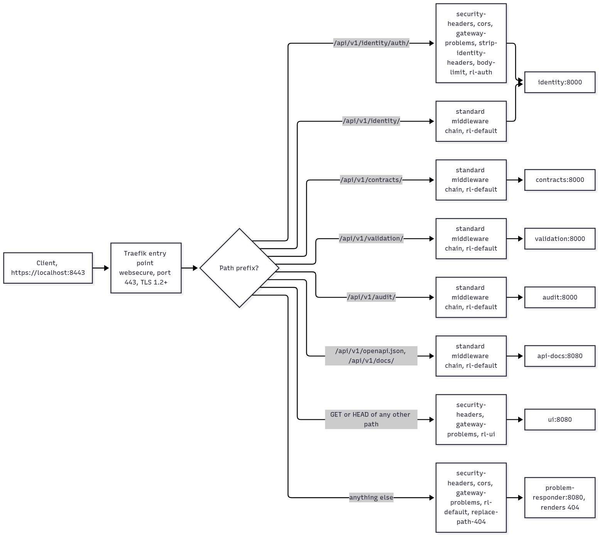
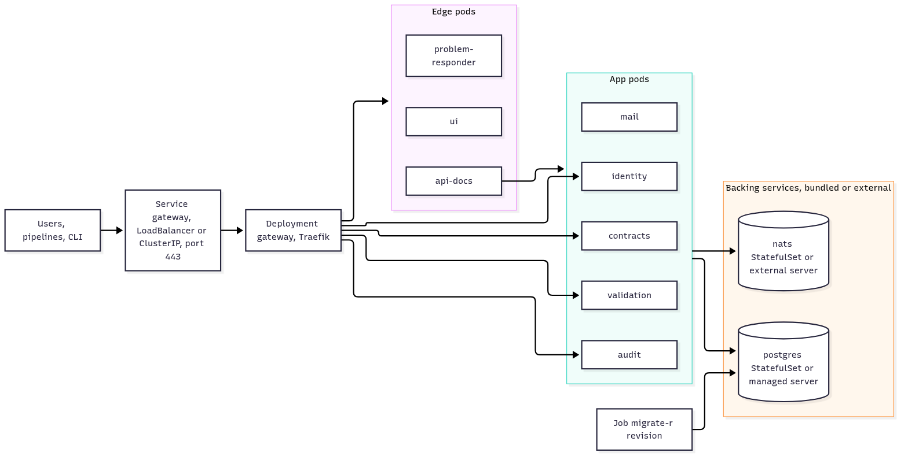

# 06 · Platform and operations

> **In short.** In production the platform runs on Kubernetes with the Helm chart. On a developer
> machine it runs with one `docker compose up`: a one-shot `dev-init` container generates every
> secret, then Postgres and NATS start, each service migrates its own database, the services start,
> and Traefik exposes them on **one** host port, 8443. In both, the gateway only does TLS, CORS,
> limits and routing; every security check lives in the services. This page explains the
> containers, the two topologies, the shared libraries, errors, health, configuration, testing and
> troubleshooting.


*Edit this diagram: [drawio/06-platform.drawio](drawio/06-platform.drawio) (pages "Startup order", "Network topology" and "Gateway routing")*

The picture shows the local compose stack. The numbers match the startup stages below.

1. **`dev-init`** runs once and exits. It writes every secret and certificate into the
   `dev-secrets` volume.
2. **Postgres, NATS** and the development stand-ins (`fake-graph`, `webhook-sink`) start once
   `dev-init` has finished. `mock-oidc`, `mailpit`, `problem-responder` and `ui` need nothing and
   start straight away. **Traefik** also starts here: it waits for `dev-init` to finish and for
   `problem-responder` and `ui` to be healthy. (The picture does not show the `ui` container.)
3. The four **migrate jobs** (`identity-migrate`, `contracts-migrate`, `validation-migrate`,
   `audit-migrate`) run `upgrade head` once Postgres is healthy, then exit.
4. **identity** starts after its migration, Postgres, NATS and `fake-graph` are ready.
5. **contracts, validation and audit** start after their own migration and after identity is
   healthy (they fetch identity's signing keys to verify tokens). **mail** starts after identity
   and `mailpit`.
6. **api-docs** starts when all four public services are healthy, then fetches and merges their
   OpenAPI documents.

Until a service is healthy, Traefik answers requests for it with a 5xx problem body. `run.sh`
and `scripts/e2e.sh` wait for the whole stack (`docker compose up --wait`).

---

## 1. The gateway



Traefik v3.8 is configured by files only: `gateway/traefik.yml` (static) and
`gateway/dynamic/*.yml` (routers, middlewares, TLS).

### Routers

There is one router per module. Each uses a `PathPrefix` that ends in a slash, so
`/api/v1/identity-evil` never matches `/api/v1/identity/`.

| Router | Rule | Service |
|---|---|---|
| `identity-auth` | `/api/v1/identity/auth/` | identity, with the stricter `rl-auth` limit |
| `identity` | `/api/v1/identity/` | identity |
| `contracts` | `/api/v1/contracts/` | contracts |
| `validation` | `/api/v1/validation/` | validation |
| `audit` | `/api/v1/audit/` | audit |
| `api-docs` | `/api/v1/openapi.json`, `/api/v1/docs`, `/api/v1/docs/…` | api-docs |
| `ui` | `GET` or `HEAD` of any path that is not an API, internal, well-known or health path, priority 2 | ui |
| `mock-oidc-dev` | `/entra/` (dev only, `gateway/dynamic/dev-mock-oidc.yml`) | mock-oidc |
| `catchall-problem` | everything else, priority 1 | problem-responder (always 404) |

So `/internal/...`, `/healthz`, `/readyz` and `/.well-known/...` are **never** reachable from
outside; the catch-all answers 404 for them. The mail service has no router at all.

### Middleware order

Every module router applies, from outside in:

1. **`security-headers`**: adds HSTS (`Strict-Transport-Security`, one year, with subdomains).
   It is outermost so the header also lands on the errors the gateway renders.
2. **`cors`**: answers browser preflight `OPTIONS` itself and adds CORS headers (allowed origin
   `http://localhost:5173`). It comes next so the CORS headers land on error responses too.
3. **`gateway-problems`**: Traefik's `errors` middleware. For 413, 429 and 500–599 it asks the
   problem responder for an RFC 9457 body. It sits outside the limiters so it sees their 413 and
   429. It forwards only `X-Request-ID` to the responder, never `Authorization` or cookies.
   Statuses the services render themselves (400, 401, 403, 404, 409, 422 …) pass unchanged.
4. **`strip-identity-headers`**: blanks `X-User`, `X-Forwarded-User`, `X-Remote-User` and
   `X-Principal`. Services never read them anyway; this is defence in depth.
5. **`body-limit`**: refuses bodies over 2 MiB (2,097,152 bytes) with 413.
6. **`rl-default`** (50 requests/s average, burst 100) or **`rl-auth`** on the credential routes
   (5/s, burst 10). Over the limit: 429.

The `ui` router (static single-page-app files, `GET` and `HEAD` only) uses `security-headers`,
`gateway-problems` and its own **`rl-ui`** (300/s, burst 600), because a cold page load fetches
dozens of assets at once. It has no `cors` (same origin) and no body limit. The dev-only
`mock-oidc-dev` router (`/entra/`, `gateway/dynamic/dev-mock-oidc.yml`) uses only
`security-headers`.

### The problem responder

`gateway/problem-responder/responder.py` is a tiny standard-library ASGI app. It renders a fixed
`application/problem+json` body for a status (`/404`, `/413`, `/429`, `/502` …). It never echoes
the path, query or headers, except a well-formed `X-Request-ID`. So even errors the gateway makes
itself look like every other error in the platform.

### TLS

`dynamic/tls.yml` loads `tls.crt` and `tls.key` from `/run/secrets` and sets TLS 1.2 as the
minimum. In development the certificate is signed by a dev CA that `dev-init` creates, with the
names `localhost`, `traefik` and `127.0.0.1`. To use an enterprise certificate, replace those two
files.

### Why the gateway holds no auth logic

The infrastructure team may later put APIM, an ingress or a load balancer in front, or replace
Traefik entirely. If a security check lived only in the gateway, it would disappear with it. So
every service verifies tokens, asks identity for each permission, rejects encoded slashes and
NULs in paths, and caps the size of uploaded documents **itself**. The gateway's limits are a first line, not the only
one. In the compose stack, services trust `X-Forwarded-*` headers only from Traefik's fixed
address `172.28.0.10`. In the Helm chart they trust `global.trustedProxies`, which defaults to `*`;
that is safe only while the network policies keep every path to the services through the
gateway.

Traefik's access log is JSON and drops every request header by default, so `Authorization` and
`Cookie` never reach the logs.

*Where in the code:* `gateway/traefik.yml`, `gateway/dynamic/`, `gateway/problem-responder/`.

---

## 2. API docs

The `api-docs` container serves one merged OpenAPI document and Swagger UI:

- `https://localhost:8443/api/v1/openapi.json`: the merged document;
- `https://localhost:8443/api/v1/docs/`: Swagger UI (its dropdown also lists each service's own
  document).

How it works:

1. Each service publishes its own document at `/api/v1/<service>/openapi.json`. The shared
   `build_openapi` adds tags, the security scheme (from each route's policy), and the common
   problem responses, so every service uses the same `Problem` schema.
2. At start, `gateway/api-docs/server.py` fetches the four documents from
   `http://<service>:8000` on the backend network, retrying until all answer.
3. `merge.py` merges them. Every path must sit under its owner's `/api/v1/<service>/` prefix.
   The same path or `operationId` in two services is an error. Components with the same name must
   be byte-identical (like `Problem`), otherwise it is an error.
4. On any merge error the container stays **unhealthy**, and the document answers 503 problem+json.
   A partial document is never served. Fix a collision by renaming the model in a service.
5. The merge runs once per container start. After changing a service outside `docker compose
   up`, run `docker compose restart api-docs`.

Swagger UI (`swagger-ui-dist` 5.35.0) is downloaded at image build time and checked against a
pinned SHA-256. The server uses only the Python standard library and runs as an unprivileged user.

---

## 3. The local (dev) topology: Docker Compose

This is the topology of the local trial and development stack (`compose.yaml`). Production uses
the Kubernetes topology in the next section.


There are two networks:

- **`edge`** (subnet `172.28.0.0/24`): where Traefik talks to the services. Traefik has the fixed
  address `172.28.0.10`. The picture leaves out two things: `ui` sits on edge only, and `mock-oidc`
  sits on both edge and backend.
- **`backend`** (`internal: true`): the private network for databases, NATS and service-to-service
  calls. "Internal" means Docker gives it no route to the outside world.

Only Traefik publishes a host port: **`8443 → 443`**.

### Every container

| Container | What it does | Network | Volumes and mounts | Health check |
|---|---|---|---|---|
| `dev-init` | One-shot: generates secrets and certificates, then exits | backend | `dev-secrets` at `/out`; `./infra` read-only; `./.dev` at `/out-host` | disabled (must exit 0) |
| `postgres` | Postgres 18; one database and one login role per service | backend | `pgdata`; `infra/postgres/init` (creates the roles, databases and the `ltree` extension); `dev-secrets/postgres` | `pg_isready` over TCP |
| `nats` | NATS 2.15.3 with JetStream | backend | `natsdata` at `/data`; `dev-secrets/nats` (holds `nats.conf`) | `wget http://127.0.0.1:8222/healthz` |
| `mock-oidc` | **Dev only.** Mock OIDC server; plays a generic IdP and an Entra tenant. Traefik routes `/entra/` to it, so the browser can sign in with it | backend, edge | `infra/mock-oidc` config | none |
| `fake-graph` | **Dev only.** Microsoft Graph stand-in that identity's real Graph client calls | backend | `infra/fake-graph`; `dev-secrets/fake-graph` | `GET /healthz` |
| `mailpit` | **Dev only.** Catches the mail the mail service sends | backend | none | `mailpit readyz` |
| `webhook-sink` | **Dev only.** Receives subscriber webhooks, can be told to fail | backend | `infra/webhook-sink` | `GET /healthz` |
| `identity-migrate`, `contracts-migrate`, `validation-migrate`, `audit-migrate` | One-shot: `python -m dc_<svc>.migrate upgrade head` | backend | `dev-secrets/<svc>` | disabled (must exit 0) |
| `identity` | Users, tokens, groups, grants, the permission decision point | edge, backend | `dev-secrets/identity` | `GET /healthz` |
| `contracts` | Contracts, versions, lifecycle, subscriber cards and notices | edge, backend | `dev-secrets/contracts` | `GET /healthz` |
| `validation` | Rule sets and contract validation, with sandboxed rule workers | edge, backend | `dev-secrets/validation` | `GET /healthz` |
| `audit` | Stores and serves the audit trail | edge, backend | `dev-secrets/audit` | `GET /healthz` |
| `mail` | Sends plain-text notices for contracts; internal route only | backend | none | `GET /healthz` |
| `problem-responder` | Renders problem bodies for gateway errors | edge | `gateway/problem-responder` | `GET /healthz` |
| `api-docs` | Merged OpenAPI and Swagger UI | edge, backend | none | `GET /healthz` (503 until merged) |
| `ui` | The web app: static single-page-app files served by nginx | edge | none (read-only root file system, `/tmp` as tmpfs) | `wget http://127.0.0.1:8080/healthz.txt` |
| `traefik` | The gateway | edge (`172.28.0.10`) | `gateway/traefik.yml`, `gateway/dynamic`, `dev-secrets/traefik` | `traefik healthcheck --ping` |

The test overlay `compose.test.yaml` adds two more containers (profile `test`): `e2e`, on both
networks, and `ui-e2e` (the browser tests), on edge only; see "Testing" below. Both run non-root,
as the user who starts them, with the group 10001 that may read `dev-secrets/e2e`. Only `e2e`
mounts the Docker socket and joins its group.

The `dev-init`, `fake-graph`, `webhook-sink` and `problem-responder` containers reuse the identity
image, with their code bind-mounted read-only. Health checks run every 5 s, with up to 30 retries.

Every image under `infra/docker` also declares its own `HEALTHCHECK`, so a plain `docker run`
reports health. The service image probes `GET /healthz` on port 8000; a container that reuses it
for another server overrides the check (or sets `DC_HEALTHCHECK_URL`), and the one-shot jobs above
disable it. The test runners `e2e` and `ui-e2e` are healthy while they can reach the gateway.
Kubernetes ignores image health checks and uses the chart's probes.

---

## 4. The Kubernetes topology (Helm)

Production runs the same images on Kubernetes with the Helm chart in `deploy/helm/contractum`. How
to install, configure and upgrade it: [Deploy on Kubernetes](../../admin/deploy-kubernetes.md).



| Piece | What the chart creates |
|---|---|
| Gateway | Deployment and Service `gateway` (`gateway.enabled`, default on). Traefik with the same static and dynamic configuration as compose, copied into the chart's `files/gateway` and kept identical by `tests/repo/test_helm_chart_sync.py`. The Service is `LoadBalancer` by default, or `ClusterIP` behind your own load balancer or ingress, on port 443. The TLS certificate comes from the `kubernetes.io/tls` Secret `dc-gateway-tls`. Disable the gateway to use your own ingress |
| Edge pods | Deployments and Services `ui`, `api-docs` (`apiDocs.enabled`) and `problem-responder`, port 8080 |
| App pods | Deployments and Services `identity`, `contracts`, `validation`, `audit` and `mail`, port 8000. The services address each other by these fixed Service names, as in compose, so a release owns its namespace |
| Waiting for migrations | Each of the four services with a database has an init container `wait-for-migrations` that runs `python -m dc_<service>.migrate check` until its database is at head. No pod serves traffic against an old schema |
| Migrations | One Job `migrate-r<revision>` per install or upgrade. Its init containers run `python -m dc_<service>.migrate upgrade head` for identity, contracts, validation and audit in turn, each retrying while the database starts |
| Postgres | A single-pod StatefulSet `postgres` (Postgres 18, 10 GiB volume) when `postgres.bundled` is true, for evaluation. Production points `postgres.host` at a managed server instead |
| NATS | A single-pod StatefulSet `nats` (NATS 2.15 with JetStream, 5 GiB volume) when `nats.bundled` is true, or an external server through `nats.url` |
| Mail catcher | A `mailpit` Deployment only when `mailpit.enabled` is true, for evaluation. It catches mail and never delivers it |
| Network policies | With `networkPolicy.enabled` (default on): ingress is denied by default; anyone may reach the gateway on 443; the gateway reaches the edge and app pods; app and edge pods reach the app pods; only app pods reach Postgres and NATS. Egress stays open for DNS, a managed database, SMTP, Entra and Microsoft Graph |
| Secrets | The chart never creates a Secret. Create them first with `deploy/helm/contractum/scripts/create-secrets.sh` or your secret manager: `dc-identity`, `dc-contracts`, `dc-validation`, `dc-audit`, `dc-gateway-tls`, the optional `dc-mail`, and `dc-postgres` and `dc-nats` for the bundled backing services. Each pod mounts only its own Secret at `/run/secrets`, as in compose |

What differs from the compose stack:

- There is no `dev-init`. Secrets come from Kubernetes Secrets that you create.
- There is no `mock-oidc`, `fake-graph` or `webhook-sink`. Entra sign-in needs a real tenant.
- The four compose migrate containers become one Job per Helm revision, and the services wait in
  their own init container.
- No pod calls the Kubernetes API, so service account tokens are not mounted.

---

## 5. dev-init secrets

No secret has a value or a default anywhere in the repository. On first start `dev-init`
(`infra/dev-init/generate.py`) creates them in the `dev-secrets` volume.

1. **Canonical values** go to `/out/_canonical` (readable by root only). Each is created only if
   missing, so running `dev-init` again changes nothing.
2. **Each consumer gets only its own copy** in `/out/<consumer>/`, owned by that container's user,
   mode 0400. The one exception is `e2e`: the test runners run as the user who starts them, so
   their copy is also readable by the group 10001 that they join (0440). Compose mounts just that
   subdirectory at `/run/secrets` (a volume *subpath*), read only. No container can read another
   one's secrets.
3. Only file **names** are printed, never values.

| Consumer (`/run/secrets` in…) | Files |
|---|---|
| `postgres` | `postgres_password`, `<svc>_db_password` for each of the four services |
| `identity` | `db_password`, `nats_password`, `jwt_signing_key.pem` (RSA 3072) and the optional `jwt_previous_public_key.pem` (the JWKS rotation overlap), `bootstrap_admin_secret`, `graph_client_secret`, `notifier_credential` (public id and SHA-256 hash only) |
| `contracts` | `db_password`, `nats_password`, `webhook_secret_key` (encrypts webhook secrets), `mail_api_key` |
| `validation`, `audit` | `db_password`, `nats_password` |
| `fake-graph` | `graph_client_secret` |
| `nats` | `nats.conf`, rendered from `infra/nats/nats.conf.tmpl` with each service's NATS password |
| `traefik` | `tls.crt`, `tls.key` (leaf certificate from the dev CA) |
| `e2e` | `ca.crt`, `bootstrap_admin_secret` |

The dev CA is valid for 10 years. The leaf certificate is valid for 825 days and is renewed
automatically when fewer than 30 days remain. `nats.conf` is rewritten whenever the template
changes, so new NATS permissions apply on the next `up`.

**Mirrored to `.dev/` on the host** (git-ignored, mode 0600), so an engineer can use them:

- `.dev/ca.crt`: trust it, for example `curl --cacert .dev/ca.crt https://localhost:8443/...`;
- `.dev/bootstrap_admin_secret`: the one-time password of the first `admin` login.

`run.sh smoke` also stores the rotated admin password in `.dev/admin_password`. Nothing else is
ever mirrored. `docker compose down -v` deletes the volume, and the next start generates new
secrets.

---

## 6. Shared libraries

All services are built from the same libraries in `shared/`. The libraries never import a
service; `uv run lint-imports` enforces it.

| Library | What it gives the services |
|---|---|
| **`dc-core`** | **App factory** `create_app`: every service gets the same middleware (request id, encoded-path guard), problem handlers, `/healthz` and `/readyz`, and the outbox relay. **Policies**: every route must declare `require(permission)` or `public()`, or the app refuses to start (`PolicyRouter`). **Problems**: `ProblemError` and RFC 9457 rendering. **Unit of work**: one audited transaction per request, audit columns and the outbox tripwire. **Outbox, events, relay** and the best-effort **access log** (see [05-audit-and-events.md](05-audit-and-events.md)). **NUL guard**: refuses NUL characters and lone UTF-16 surrogates in query parameters and JSON bodies with 422, because Postgres can't store them. **OpenAPI**: `build_openapi` adds tags, security and problem responses. Also settings, logging, migrations, a capped body reader and `If-Match` handling. |
| **`dc-auth`** | Token verification for every issuer (local IdP, Entra, mock), an async JWKS cache, the typed `Principal`, opaque `dcp_` token resolution, the `Authorizer` client that asks identity for every decision, the `require()` dependency, and the role and permission tables. See [02-identity-and-access.md](02-identity-and-access.md). |
| **`dc-odcs`** | ODCS parsing, the vendored ODCS JSON Schemas (v3.1.0 and v3.2.0), structural validation, the breaking-change classifier and reference extraction. See [03-contracts-and-lifecycle.md](03-contracts-and-lifecycle.md). |
| **`dc-rules`** | The declarative rule engine: rule model, CEL and JSONPath adapters, the evaluator and the sandboxed worker process. Pure, with no I/O. See [04-validation-and-rules.md](04-validation-and-rules.md). |

---

## 7. Errors: problem+json

Every error a client sees, from a service or from the gateway, is an RFC 9457 problem with media
type `application/problem+json`.

| Field | Meaning |
|---|---|
| `type` | `urn:dc:problem:<slug>`, for example `urn:dc:problem:not-found` |
| `title` | Short summary |
| `status` | The HTTP status |
| `detail` | Human-readable explanation; never echoes your input |
| `instance` | The request path |
| `request_id` | The `X-Request-ID`; quote it when you report a problem |
| `errors` | 422 only: a list of `{pointer, detail}`, where `pointer` is a JSON Pointer |

Example, a bad cursor on the audit query:

```http
HTTP/1.1 422 Unprocessable Content
Content-Type: application/problem+json
```

```json
{
  "type": "urn:dc:problem:validation-error",
  "title": "Unprocessable Content",
  "status": 422,
  "detail": "The request failed validation.",
  "instance": "/api/v1/audit/events",
  "request_id": "b2f1c9d4e8a7465b9c3d2e1f0a9b8c7d",
  "errors": [
    { "pointer": "/query/cursor", "detail": "cursor is not valid" }
  ]
}
```

The full list of slugs is in the [API guide](../../user/api-guide.md#errors-rfc-9457-problem-details).
A 500 carries only a generic detail. The one exception to "always problem+json": syntactically
invalid HTTP (for example a path with `%zz`) is refused by Traefik before routing with an empty 400.

---

## 8. Health

Every service built with `create_app` has two endpoints, both public and not in OpenAPI:

| Endpoint | Answers 200 when | Used by |
|---|---|---|
| `/healthz` | the process is running (liveness) | compose health checks; the Kubernetes readiness and liveness probes |
| `/readyz` | the database answers `SELECT 1` (readiness); otherwise 503 `service-unavailable` | operators |

Both are reachable only inside the compose network or the cluster. The gateway never routes them.

---

## 9. Configuration

Each service reads a `Settings` class (pydantic-settings) from:

1. **Environment variables** with the prefix `DC_`: for example `DC_DB_HOST`, `DC_DB_NAME`,
   `DC_DB_USER`, `DC_NATS_URL`, `DC_NATS_USER`, `DC_LOG_LEVEL`. Auth settings use `DC_AUTH_`:
   `DC_AUTH_ISSUERS` (the list of trusted token issuers, as JSON) and
   `DC_AUTH_IDENTITY_INTERNAL_URL`.
2. **Secret files** in `/run/secrets`, named after the field **without** the prefix:
   `db_password`, `nats_password`, and service-specific ones such as `jwt_signing_key.pem`.

Secrets are never set as environment variables. `compose.yaml` holds the non-secret values; a
shared block (`x-app-env`) gives every service the NATS URL, identity's internal URL and the issuer
list. On Kubernetes the chart sets the same variables from `values.yaml`. A real Entra tenant is
one more entry in `DC_AUTH_ISSUERS`; see [Entra setup](../../admin/entra-setup.md).

*Where in the code:* `shared/dc-core/src/dc_core/settings.py`, `shared/dc-auth/src/dc_auth/issuers.py`,
each service's `settings.py`.

---

## 10. The testing strategy

Tests are marked, and each kind answers a different question.

| Kind | Marker | Needs | What it proves |
|---|---|---|---|
| Unit | `unit` | nothing | Logic, route policies (a route with neither `require()` nor `public()` fails the build), config rules (gateway, NATS permissions, compose topology, no default secrets), the OpenAPI merge |
| Integration | `integration` | Docker | Real Postgres 18 and NATS through **testcontainers** (throw-away containers started by the tests): migrations, SQL, the outbox, the consumers, NATS permission refusals |
| End to end | `e2e` | the compose stack | Whole journeys through the real gateway, run from the `e2e` container on the compose networks |

Two e2e checks cover the API contract as a whole:

- **Schemathesis** (`tests/e2e/test_phase7_schemathesis.py`) reads the merged OpenAPI document and
  sends generated requests to every operation through the gateway. It fails when a response's
  status, content type or body does not match the document, or when there is a server error.
- **The operation coverage gate** (`tests/e2e/test_zz_operation_coverage.py`) runs last. Every
  public `operationId` must get a 2xx or 3xx answer in some test, or be listed with a reason in
  `tests/e2e/operation_exemptions.json`. It writes `.dev/phase7-operation-coverage.json`.

How to run them:

| Command | What it runs |
|---|---|
| `uv run pytest -m unit` | Unit tests |
| `uv run pytest -m integration` | Integration tests (Docker needed) |
| `./run.sh e2e [paths]` or `bash scripts/e2e.sh [paths]` | E2E tests on a warm stack (default `tests/e2e`, about 10 minutes) |
| `bash scripts/ci.sh` | The CI gate: lock check, lint, format, mypy, import rules, unit, integration |
| `CI_E2E=1 bash scripts/ci.sh` | The CI gate plus a cold start (volumes removed) and the whole e2e suite |
| `bash scripts/skeleton-smoke.sh` or `./run.sh smoke` | A quick login through the gateway |

See [Local stack](../local-stack.md) for every command, and the scripts in `scripts/`.

---

## 11. Troubleshooting

This table is for the local compose stack. For a Kubernetes deployment, see
[Troubleshooting](../../admin/troubleshooting.md).

| Symptom | Where to look |
|---|---|
| `run.sh` stops before starting | It prints what is missing: Docker not running, Compose older than 2.21, or port 8443 busy |
| A container stays "starting" or "unhealthy" | `docker compose ps`, then `docker compose logs <service>` |
| A `*-migrate` job failed | `docker compose logs <svc>-migrate`; the service will not start until it succeeds |
| `dev-init` failed with "CA state inconsistent" | One of the CA files is missing. Reset with `./run.sh reset` (or `docker compose down -v`) |
| Browser or curl TLS error | Trust `.dev/ca.crt`, or use `curl --cacert .dev/ca.crt` |
| Admin login fails after a reset | Secrets were regenerated. Use the new `.dev/bootstrap_admin_secret`; `./run.sh smoke` redoes the bootstrap |
| Every request answers 404 problem | The path is wrong or not routed. Only `/api/v1/<module>/…` and the docs paths are routed |
| 502 or 503 problem from the gateway | The target service is down or not yet healthy: `docker compose ps`, `docker compose logs <service>` |
| 429 `too-many-requests` | The gateway's rate limit (50/s; 5/s on `/api/v1/identity/auth/`). Slow down or run load tests on the backend network |
| 413 `payload-too-large` | Body over 2 MiB at the gateway, or over a service's own document limit |
| `/api/v1/openapi.json` answers 503 | `docker compose logs api-docs`: a merge collision names both services. After a service change: `docker compose restart api-docs` |
| Publish answers 503 `validation-unavailable` | `docker compose logs validation` and `docker compose logs contracts`; see [04-validation-and-rules.md](04-validation-and-rules.md) |
| An audit event never appears | Is NATS healthy? Check the producer's `outbox` table (`published_at`, `attempts`) and logs for `outbox_relay_publish_failed`; then `audit_dead_letter` in the audit database |
| Access events missing | Expected under NATS trouble: look for `access_events_dropped` in the contracts logs |
| Audit query answers 503 | identity is down or overloaded; the query fails closed |
| NATS permission errors after editing the template | `docker compose up` again: `dev-init` re-renders `nats.conf`. A stream change other than ACCESS's limits needs `docker compose down -v` |
| Notices (email, webhook) don't arrive | They are asynchronous: outbox → NATS → `contracts-notices` consumer → delivery worker. Check Mailpit and the webhook sink from the backend network |

Next: [README.md](README.md) for the reading order and the glossary.
