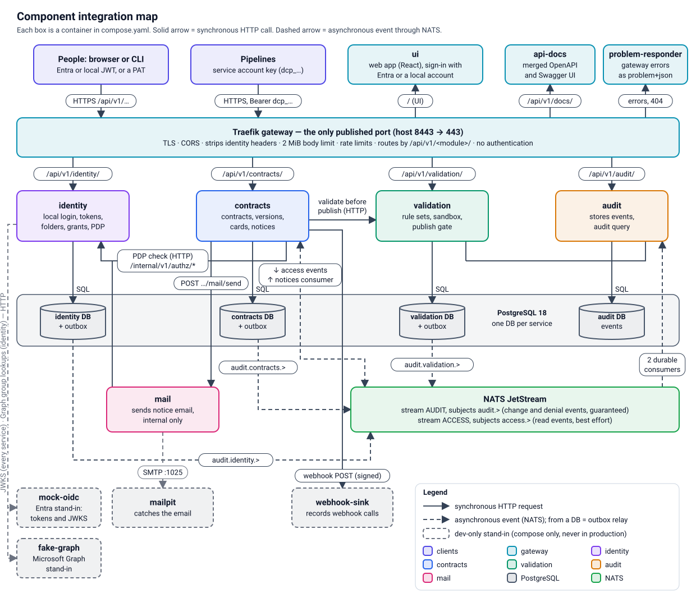

# Contractum architecture guide

> **In short.** This guide explains how the Contractum platform works and how its parts fit together. Start with the system overview, then read the page for the area you care about. Every page opens with a short summary and a picture, then explains the details step by step. A glossary of terms is at the end of this page.

## What the system is

Contractum is a central service where data-engineering teams store, version and publish **data contracts** in the ODCS format. Contracts live in a folder tree that mirrors the company: ROOT → Organization → Project → Team. **Policy Managers** write reusable, versioned validation rules. A contract that breaks a mandatory rule for its place in the tree cannot be published. Engineers and their pipelines fetch the exact version they need (the latest, an older one, or an upcoming preview) through an authenticated HTTPS API. Every change, access and refusal is recorded in an audit trail. The platform is a set of Python (FastAPI) services with PostgreSQL databases, NATS JetStream for events and a Traefik gateway. In production it runs on Kubernetes with the Helm chart in `deploy/helm/contractum`; on a developer machine it runs with Docker Compose.

## Reading order

| # | Page | What it covers |
|---|---|---|
| 01 | [System overview](01-system-overview.md) | The big picture: every component, who calls whom, the life of one request, design principles and the repo map. |
| 02 | [Identity and access](02-identity-and-access.md) | Logins and tokens (local, Entra, PATs, service account keys), the folder tree, roles and grants, and how the PDP decides. |
| 03 | [Contracts and lifecycle](03-contracts-and-lifecycle.md) | Creating contracts, drafts, publishing, Latest, Preview and older versions, deprecation, fetching, subscriber cards and notices. |
| 04 | [Validation and rules](04-validation-and-rules.md) | Rule sets, mandatory rules and their warn and enforce periods, the sandbox, the publish gate, validation reports and breaking-change checks. |
| 05 | [Audit and events](05-audit-and-events.md) | The outbox, NATS streams, audit events, access events and denials, and the audit query. |
| 06 | [Platform and operations](06-platform-and-operations.md) | The gateway, the local (compose) and Kubernetes (Helm) topologies, secrets, start-up order, health checks, configuration, tests and running the stack. |

Related documents outside this folder:

- [Local stack](../local-stack.md): start the stack locally with Docker Compose.
- [Deploy on Kubernetes](../../admin/deploy-kubernetes.md): the production deployment with the Helm chart.
- [API guide](../../user/api-guide.md): sign-in, the URL scheme, versions, paging and every problem type.
- [HTTP API reference](../../user/reference/http-api.md): every route, generated from the OpenAPI document.
- [API design decisions](../api-design-decisions.md): why the API looks the way it does.
- [Entra setup](../../admin/entra-setup.md): connect a real Microsoft Entra tenant.

## Which page answers my question?

| Question | Page |
|---|---|
| What are the parts of the system and how do they talk to each other? | [01](01-system-overview.md) |
| What happens, step by step, when I call the API? | [01](01-system-overview.md#the-life-of-one-api-request) |
| What happens when one service is down? | [01](01-system-overview.md#integration-matrix), [06](06-platform-and-operations.md) |
| How do I log in, or get a token for a pipeline? | [02](02-identity-and-access.md) |
| Why do I get 404 for something I know exists? | [02](02-identity-and-access.md) (unreadable things look exactly like missing ones) |
| Who may grant which role, and how are roles inherited down the tree? | [02](02-identity-and-access.md) |
| How do I fetch the latest contract, or a specific version? | [03](03-contracts-and-lifecycle.md) |
| What is the difference between Latest, Preview, older, unpublished and deprecated? | [03](03-contracts-and-lifecycle.md) |
| How do I get notified when a contract I depend on changes? | [03](03-contracts-and-lifecycle.md) (subscriber cards) |
| Why was my publish refused? | [04](04-validation-and-rules.md) for 422 `contract-validation-failed` and 503 `validation-unavailable`; [03](03-contracts-and-lifecycle.md) for 409 `semver-conflict` and 412 `precondition-failed` |
| How do I write a rule set or make it mandatory? | [04](04-validation-and-rules.md) |
| Is my change a breaking change? | [04](04-validation-and-rules.md) |
| Who changed this contract, and who read it? | [05](05-audit-and-events.md) |
| Can an event be lost? | [05](05-audit-and-events.md) |
| How do I start, reset or test the stack, and where are the secrets? | [06](06-platform-and-operations.md), [Local stack](../local-stack.md) |
| How do I put another gateway, such as APIM, in front? | [06](06-platform-and-operations.md), [01](01-system-overview.md#design-principles-in-plain-words) |

## Diagram conventions

Every page uses three kinds of diagrams:

1. **Pictures** (SVG files in `images/`). They are hand-written and many are animated. A dot travels along the flow, and numbered circles light up in turn. The numbers match the numbered steps in the text. A picture still makes sense when the animation does not play (for example in a PDF).
2. **Mermaid diagrams** inside the Markdown, for sequences, states and small flowcharts. GitHub and most IDEs draw them.
3. **draw.io files** (in `drawio/`): the editable versions of the main pictures, with the same colours and labels.

### Colour legend

| Colour | Means |
|---|---|
| Indigo `#4F46E5` | Clients: engineers, the web UI, CLIs, pipelines |
| Cyan `#0891B2` | Gateway: Traefik, problem-responder, api-docs |
| Violet `#7C3AED` | identity |
| Blue `#2563EB` | contracts |
| Green `#059669` | validation |
| Amber `#D97706` | audit |
| Pink `#DB2777` | mail |
| Slate `#475569` | Data stores (PostgreSQL) |
| Dark green `#16A34A` | NATS JetStream |
| Dashed grey border | A dev-only stand-in (mock-oidc, fake-graph, mailpit, webhook-sink). They run in compose; the Helm chart can run only mailpit, as an evaluation option |

Lines:

- A **solid arrow** is a synchronous HTTP call.
- A **dashed arrow** is an asynchronous event through NATS. A dashed arrow that starts at a database is the **outbox relay**.
- A **grey dashed arrow** leads to a dev-only stand-in.
- Boxes have a light fill and a coloured border, with dark text on a white background, so they read well in both light and dark GitHub themes.

### Editing the diagrams

- **draw.io files.** Open a `drawio/NN-*.drawio` file in [diagrams.net](https://app.diagrams.net) (*File → Open from → Device*), or in VS Code with the *Draw.io Integration* extension. The files are stored as plain, uncompressed XML, so a change shows as a readable diff. One file can hold several pages; use the page tabs at the bottom.
- **SVG pictures.** The animated SVGs are hand-written, not exported from draw.io. Exporting from draw.io gives a correct static picture but loses the animation. To change a picture, edit the SVG text and keep the role colours above. Keep it self-contained: no external fonts, images or scripts (GitHub strips scripts), and use SMIL `<animate>` or `<animateMotion>` for movement. Then check it is well-formed with `xmllint --noout images/<file>.svg` and update the matching draw.io page so the two stay in step.
- **Mermaid.** Edit the code fence in the Markdown. Check it with `npx -y @mermaid-js/mermaid-cli -i <page>.md -o /tmp/out.svg`. Keep labels free of parentheses and semicolons unless you quote them.

## Glossary

Terms are in alphabetical order. *Code names* are in `monospace`.

| Term | Meaning |
|---|---|
| **Access event** | A record that someone *read* contract content (subject `access.contracts.contract.read`, stream `ACCESS`). It is sent best effort, so a few can be lost during a NATS outage, and every loss is counted. Stored by audit with category `access`. |
| **Accessible folders** | The set of folders where a caller holds a given permission. Services use it to trim lists, so you see an empty page rather than an error. |
| **api-docs** | The container that merges the four services' OpenAPI documents and serves `/api/v1/openapi.json` and Swagger UI at `/api/v1/docs/`. |
| **Audit event** | A record of a change (for example `contract.version_published`), with who, when, where in the tree, and before and after snapshots of safe fields. Written to the outbox in the same transaction as the change, then relayed to NATS stream `AUDIT`. Stored with category `change`. |
| **Contract** | One data contract: an ODCS document stored byte for byte in a folder of any kind, with all its drafts and versions. |
| **Denial** | A recorded refusal: the PDP said no (deny-as-404, 403, a gate refusal or "interactive sign-in required"). identity writes it to its outbox before it answers (subject `audit.identity.authz.check.denied`). Stored by audit with category `denial`. |
| **Deprecated** | A flag on a published version, with a **sunset date**. The version can still be fetched, and responses carry `Deprecation` and `Sunset` headers. |
| **Draft** | An editable working copy of a contract. Every save is a new revision, protected by `ETag` and `If-Match`. Publishing turns the draft, in place, into an immutable version. |
| **Entra ID** | Microsoft's identity provider. Entra tokens are accepted next to identity's own tokens. Group membership is read from Microsoft Graph, not from the token. |
| **Folder** | A node in the tree that holds contracts, rule sets, cards and grants. Kinds: **ROOT** (exactly one, the whole company) → **Organization** → **Project** → **Team**. Contracts live in folders of any kind. Grants made higher up flow down unless an Organization or Team folder sets **block inheritance**. |
| **Gateway** | Traefik, the single entry point. It does TLS, CORS, rate limits, a body limit and routing, and no authentication, so it can be replaced. |
| **Grant** | A role given to a principal (a user, local group, Entra group or service account) on one folder. It also applies to every folder below, unless inheritance is blocked. |
| **Issuer** | A trusted source of JWTs (local identity, Entra, or a generic OIDC provider), configured in `DC_AUTH_ISSUERS` with its JWKS URL and audience. |
| **JWKS** | The public keys of an issuer (`/.well-known/jwks.json`). Services use them to check token signatures, and cache them for 5 minutes. |
| **Latest** | The one published version that `.../versions/latest` returns. A contract has at most one Latest at a time. The first publish becomes Latest. Later publishes become Preview until someone promotes them. |
| **Mandatory (rule set)** | A rule set that applies automatically to its folder and everything below it, with no opt-out. Lower levels can only add rules. |
| **NATS stream** | A durable, replayable log in NATS JetStream. `AUDIT` (subjects `audit.>`) carries change and denial events and is guaranteed. `ACCESS` (subjects `access.>`) carries access events and is best effort, kept 7 days with a size cap. |
| **ODCS** | Open Data Contract Standard (Bitol). The JSON or YAML format of a contract. The platform validates against vendored ODCS v3.1.0 and v3.2.0 JSON Schemas, picked by the document's `apiVersion`. |
| **Older** | A published version below the Latest by SemVer. Still fetchable by its version number. |
| **Outbox** | A table in each service database (identity, contracts, validation). The audit event is inserted there in the same transaction as the change. A background **relay** publishes outbox rows to NATS. |
| **PAT (personal access token)** | A long-lived token a user creates for scripts. It starts with `dcp_`, can be read-only, can expire and be revoked, and acts with the user's own grants. It cannot do actions marked "interactive sign-in only". |
| **PDP (policy decision point)** | identity's authorization API (`POST /internal/v1/authz/check` and its siblings). Every service asks it "may this caller do this permission on this folder?". |
| **Permission** | One named action, for example `contract:publish` or `ruleset:read-published`. Every route requires exactly one permission or is marked public. |
| **Pin (subscription)** | A subscriber card's record that it depends on one concrete published version. A pin never gives read access. Pinned versions cannot be unpublished, and their cards receive notices. |
| **Policy Manager** | A role that writes and publishes rule sets and can make them mandatory. It sees contract metadata, not content. |
| **Preview** | A published version above the Latest by SemVer: an upcoming version that consumers can test before it is promoted. |
| **Principal** | Who is calling, as a typed id: `local:<uuid>` (local user), `entra:<tenant id>:<object id>` (Entra user or service principal) or `sa:<uuid>` (service account). |
| **problem+json** | The error format, RFC 9457 `application/problem+json`. The `type` is a URN like `urn:dc:problem:contract-validation-failed`. Every slug is listed in the [API guide](../../user/api-guide.md#errors-rfc-9457-problem-details). |
| **Publish gate** | The check contracts makes before publishing: it sends the draft to validation and publishes only on a "publishable" verdict. It is fail-closed: no verdict means no publish (503 `validation-unavailable`). |
| **Relay** | The background task in each service that moves outbox rows to NATS. It delivers at least once, and duplicates are dropped by `Nats-Msg-Id` and by audit's unique `event_id`. |
| **Role** | A named bundle of permissions bound to a folder level, for example Global admin, Org admin, Project editor, Team reader, Policy Manager or Consumer. Roles are fixed in code (`shared/dc-auth/src/dc_auth/roles.py`). |
| **Rule set** | A versioned, named group of declarative rules (CEL conditions over JSONPath targets) owned by a folder. It has one editable draft and immutable numbered versions. |
| **Service account key** | A `dcp_` token that belongs to a service account (principal `sa:<uuid>`), for pipelines. An account holds at most two active keys, so you can rotate without downtime. |
| **Subscriber card** | A record, owned by a folder of any kind (Root, Organization, Project or Team), of what a consuming team depends on: its pins, contacts, linked groups and notice channels (webhook, email). |
| **Unit of work** | One request's database transaction. It allows exactly one `uow.audit(...)` call per business write, so the change and its event commit together. |
| **Unpublished** | A published version hidden from consumers. Its bytes are kept, and it can be republished. The Latest and pinned versions cannot be unpublished. |
| **Version** | An immutable, published snapshot of a contract with a SemVer number taken from the document's own `version` field. A database trigger protects its bytes and validation pins. |
| **Warn / enforce** | The two modes of a mandatory rule set version. During the grace period (14 days by default) a failing rule is only a *warning*. From its `enforce_at` date it *blocks* publishing. A Policy Manager can move the date to any time (earlier or later), and a platform rule set can be paused, which makes it warn only. |
| **X-Request-ID** | The id of one request. It is returned on every response and copied into denials and audit events, so you can find the trail of one call. |
