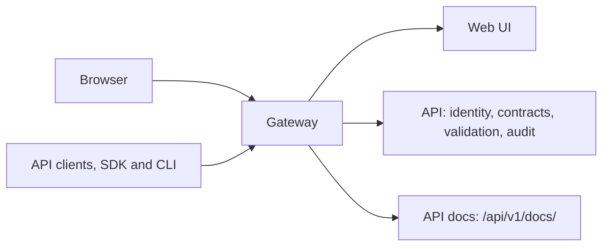

# Contractum

Contractum is a central service where data-engineering teams write, version and publish ODCS data
contracts in a folder tree: Root, then Organization, Project and Team.

- Policy Managers write reusable, versioned validation rules. A contract that breaks a mandatory
  rule for its place in the tree cannot be published.
- Engineers and pipelines fetch the exact version they need: the latest, an older one, or an
  upcoming preview. They use the web UI, the HTTPS API, or the Python SDK and CLI.
- Every change, read and refusal is audited.

## Where to start

- **[Users](user/getting-started.md)** sign in, find contracts, fetch versions and test their data
  against them. They can also [subscribe](user/subscriptions.md) to be told when a contract changes.
- **[Administrators](admin/deploy-kubernetes.md)** deploy Contractum, set up sign-in and keep it
  running.
- **[Developers](dev/local-stack.md)** run the stack locally, change the code and work with the CI.

## Security

How Contractum is protected and how every change is checked: [Security](security.md).

## Reference

- [CLI reference](user/reference/cli.md): every `contractum` command and option.
- [SDK API reference](user/reference/sdk-api.md): the public Python API of the `contractum` package.
- [HTTP API reference](user/reference/http-api.md): every API operation and the permission it checks.

## How you reach Contractum

Every request goes through one gateway. It serves the web UI to browsers and sends API calls to
the module that owns them.

