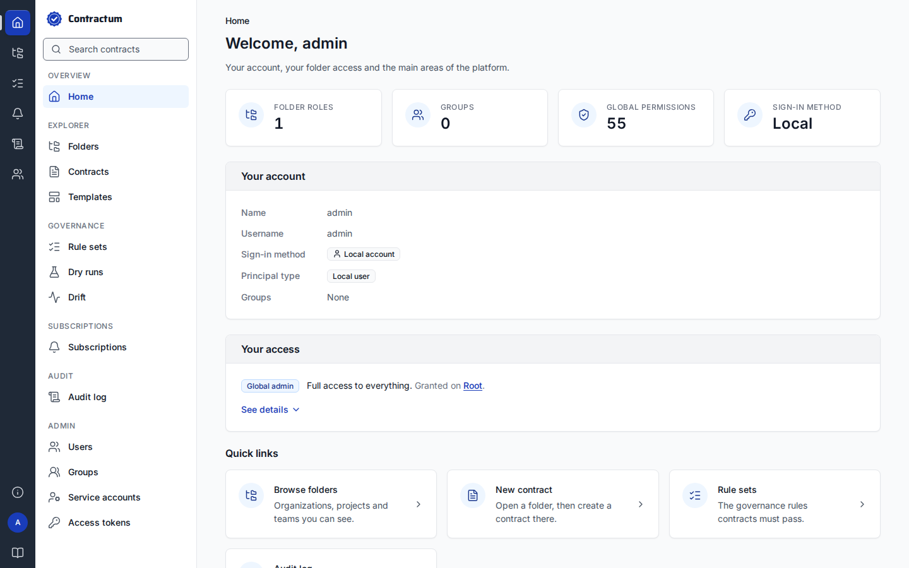
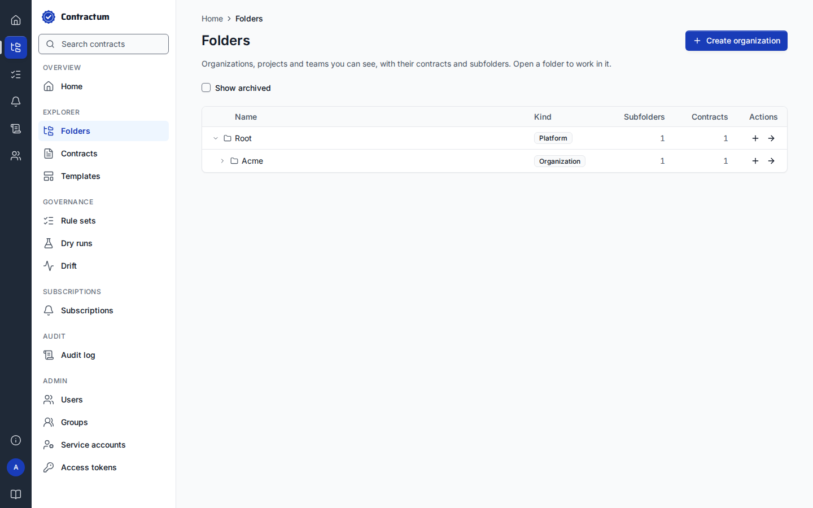
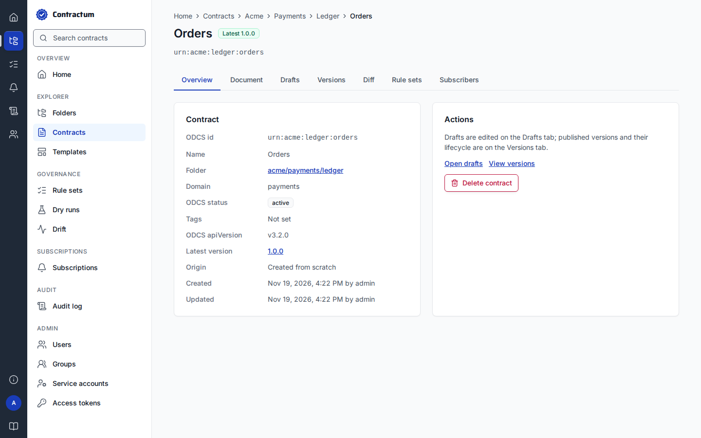
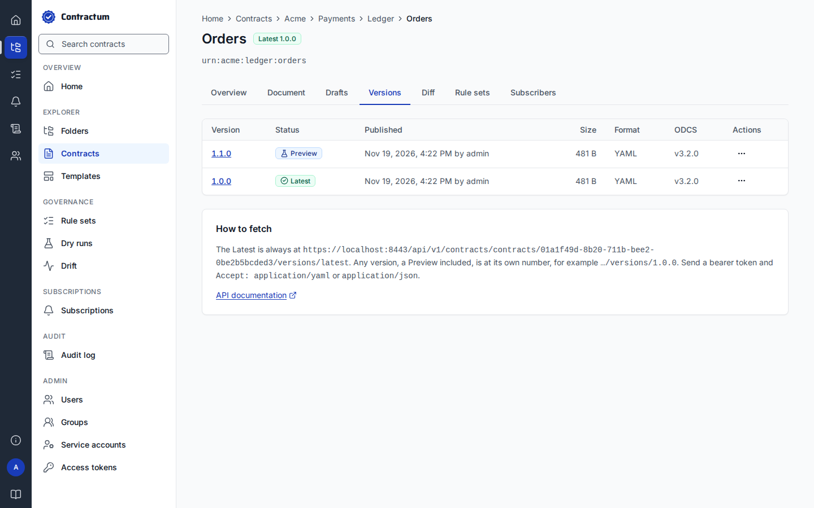
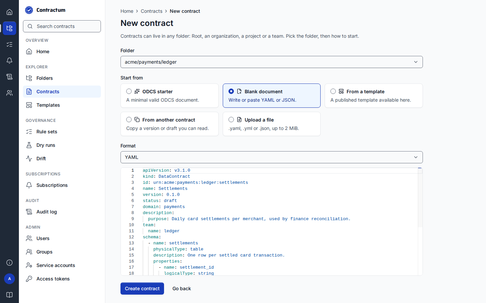
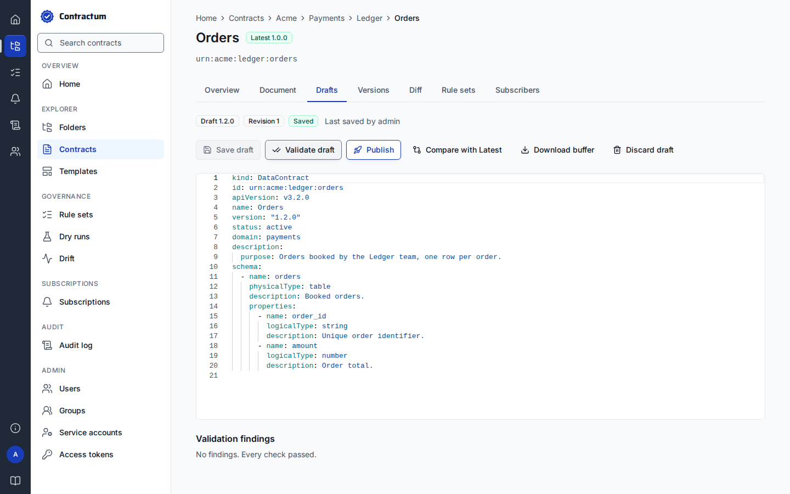
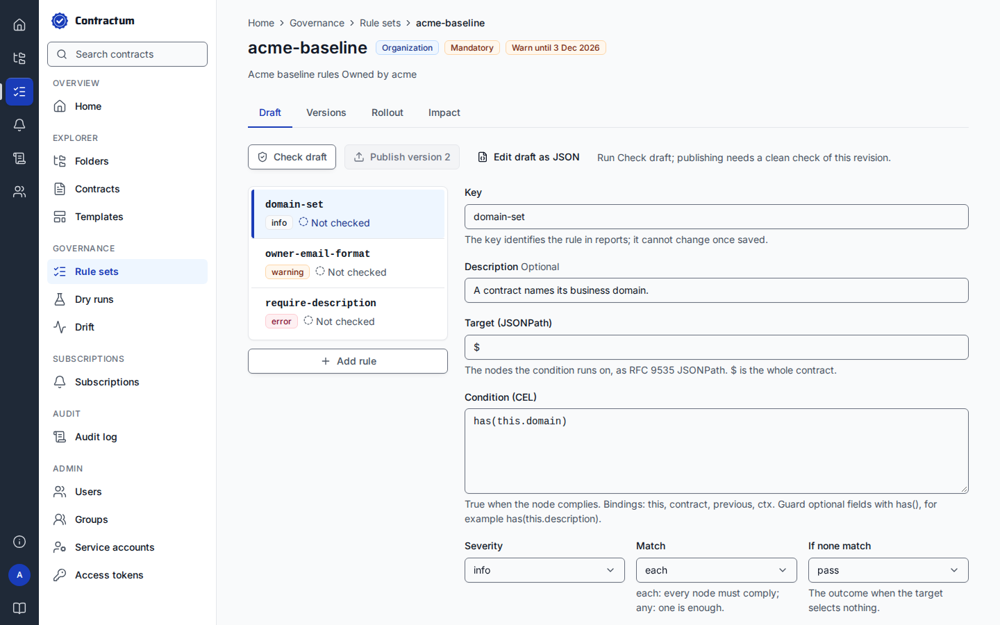
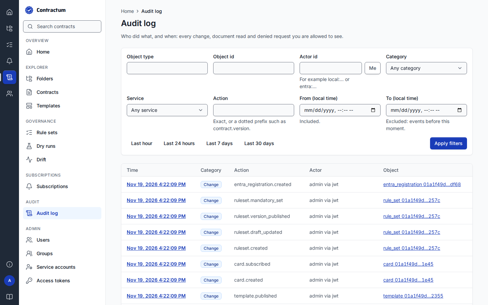

# UI guide

A short tour of the web UI, role by role. It starts with what everyone sees and adds the screens
that each role unlocks.

The UI shows only what your roles allow. A screen, tab or button you cannot use is hidden or turned
off. The server checks every request as well, so the UI never grants more than the API does. Roles
are given per folder and apply to that folder and everything below it. To see which roles you hold
and where, open **Home**. The [roles table](../admin/first-run.md#grant-access) lists what each role
allows.

The UI follows your system theme (light or dark) and works on a phone.

## Everyone: readers, consumers and data engineers

- **Home** shows your account, your roles in each folder, your groups and the sign-in method, plus
  links to the main areas.
- **Folders** shows the folder tree you can see: Root, then Organization, Project and Team. A folder
  page has tabs for its contracts, sub-folders, templates, rule sets, subscribers and access.
  - Tick **Show contracts in tree** (next to **Show archived**, off by default, and kept in the
    page address so a link keeps it) to list each expanded folder's own contracts under its
    sub-folders. Contracts are sorted by name. Each row shows the contract's lifecycle badge
    (Draft, Preview, Latest, Unpublished or Deprecated) and its latest version, or "Not published"
    before the first publish. Open a contract by clicking its row or pressing Enter on it.
  - A folder shows its first 100 contracts, then a **More contracts — open folder** row that opens
    the folder's **Contracts** tab. The row carries no count, because the server does not report
    how many contracts a folder holds.
  - The tree only shows contracts you can open from the **Contracts** list.
  - The Folders page loads at most 2,000 folders. When it stops, a note says so. Open a folder to
    see everything inside it, including contracts in folders the tree did not load.
- **Contracts** lists every contract you can see, across all folders, with filters for text, ODCS
  status and domain. The **Search contracts** box in the top bar works from any page.
- **Subscriptions** lists the [subscriber cards](subscriptions.md) you can see. A card records which
  contracts a team depends on, so it is told before a contract changes or is retired.
- The **account menu** (your initials) holds **Account settings** (profile and password),
  **Access tokens** for scripts and the CLI, **Versions** of the running services, and
  **Sign out**. **Versions** starts with the platform version of the web app ("Contractum
  1.4.0") and lists the web UI, Identity, Contracts, Validation, Audit and API docs with their
  version, commit and build time. A component on another version than the web app is marked
  **Different version**; name the versions when you report a problem.

### A contract page

- **Overview**: the ODCS id, folder, domain, ODCS status and the Latest version.
- **Document**: the current document.
- **Versions**: every published version with its state (Latest, Preview or older) and whether it is
  deprecated. Each row's menu copies the fetch URL or a curl example, downloads YAML or JSON, and
  compares the version with the Latest.
- **Diff**: the classified changes between two versions (breaking, warning or info).
- **Drafts** and **Subscribers** appear when you can read the full contract. A consumer, who reads
  published versions only, does not see them.
- **Rule sets**: the extra rule sets attached to this contract.

[Getting started](getting-started.md) shows how to fetch a version with the UI, curl or the CLI.

## Editors: write and publish contracts

Team editors, project editors and the admins of a team, project or organization can also create,
edit and publish contracts.

**New contract** (from Home or the Contracts page). Pick the folder, a name and the ODCS id. Then
pick how to start: **ODCS starter**, **Blank document**, **From a template**,
**From another contract** or **Upload a file**. Write the document in YAML or JSON. It is stored
byte for byte, exactly as written.

**Draft editor** (the contract's **Drafts** tab). The toolbar has:

- **Save**: stores the draft and shows the advisory validation findings.
- **Validate**: checks the draft against the ODCS JSON Schema and every rule set that applies to the
  folder.
- **Publish**: opens the publish dialog. Save first. A new version above the Latest is published as
  a Preview; promote it from the **Versions** tab to make it the Latest.
- **Compare with Latest**, a download button and **Discard draft**.

If a breaking change needs a new major version, the editor says so and names the smallest version
that passes.

Each finding shows the rule, its message and where in the document it applies. A contract that has
a blocking finding cannot be published. [Writing rules](writing-rules.md) explains findings and
when they block.

On the **Versions** tab, editors can also **Promote to Latest**, **Deprecate version** (with a sunset
date), **Unpublish version** and **Republish version**.

## Policy Managers: rule sets and templates

The Policy Manager role is given at a folder and covers everything below it. It reads contract
metadata but not contract content.
A contract you can see as metadata only opens with a notice and without the **Document**,
**Versions** and **Diff** tabs.

- **Rule sets** lists the rule sets you can read. A rule set page has four tabs:
  - **Draft**: the rule list and a form for the selected rule (key, description, target, condition,
    severity, match, behaviour when nothing matches, message, and pass and fail fixtures).
    **Check draft** runs the full check. **Publish** freezes the draft as the next version.
    **Edit draft as JSON** replaces the whole draft at once.
  - **Versions**: every published version.
  - **Rollout**: the switch that makes the set mandatory for its folder and everything below, and,
    for each version, when it starts to block publishes. **Enforce now** makes a warning version
    block at once.
  - **Impact**: a dry run of a version, or of the draft, against the published contracts in scope.
- **Dry runs** shows which published contracts a rule-set version would block if it applied now.
- **Drift** lists published contracts whose Latest no longer passes the mandatory rules in force,
  or will not once a warning version starts to block. Organization admins see it too.
- **Templates** lists contract templates. Policy Managers create, publish and deprecate them; editors
  start new contracts from them.

[Writing rules](writing-rules.md) explains rules, rule sets and rollout in detail.

## Administrators: access, accounts, settings and audit

Organization, project and team admins manage their own part of the tree. A Global admin manages
everything.

- **Access** (a folder's tab): the grants made at this folder, **Grant access** to a user, group or
  service account, and your own effective access. Organization and Team folders also have a switch
  that blocks inherited access. It never stops mandatory rule sets.
- **Users**: local users (create one with an initial password) and registered Entra users.
- **Groups**: local groups and registered Entra groups, with their members.
- **Service accounts**: accounts for pipelines, with up to two active keys each so you can rotate a
  key without downtime.
- **Access tokens** (admin view): every personal access token, with revoke.
- **Settings** (Global admin): one tab per settings section, such as **Entra**, **Notifications**,
  **Governance**, **Sign-in & security** and **Platform**, with export and import.
- **Audit log**: every write, read and refusal you are allowed to see, filtered by time, person,
  category and object. Open an event to see its details and changes. Global admins and readers, and
  the admins of an organization, project or team, see the audit log of their part of the tree.

The administrator guides cover setup: [first run](../admin/first-run.md),
[Entra setup](../admin/entra-setup.md) and [settings](../admin/settings.md).
